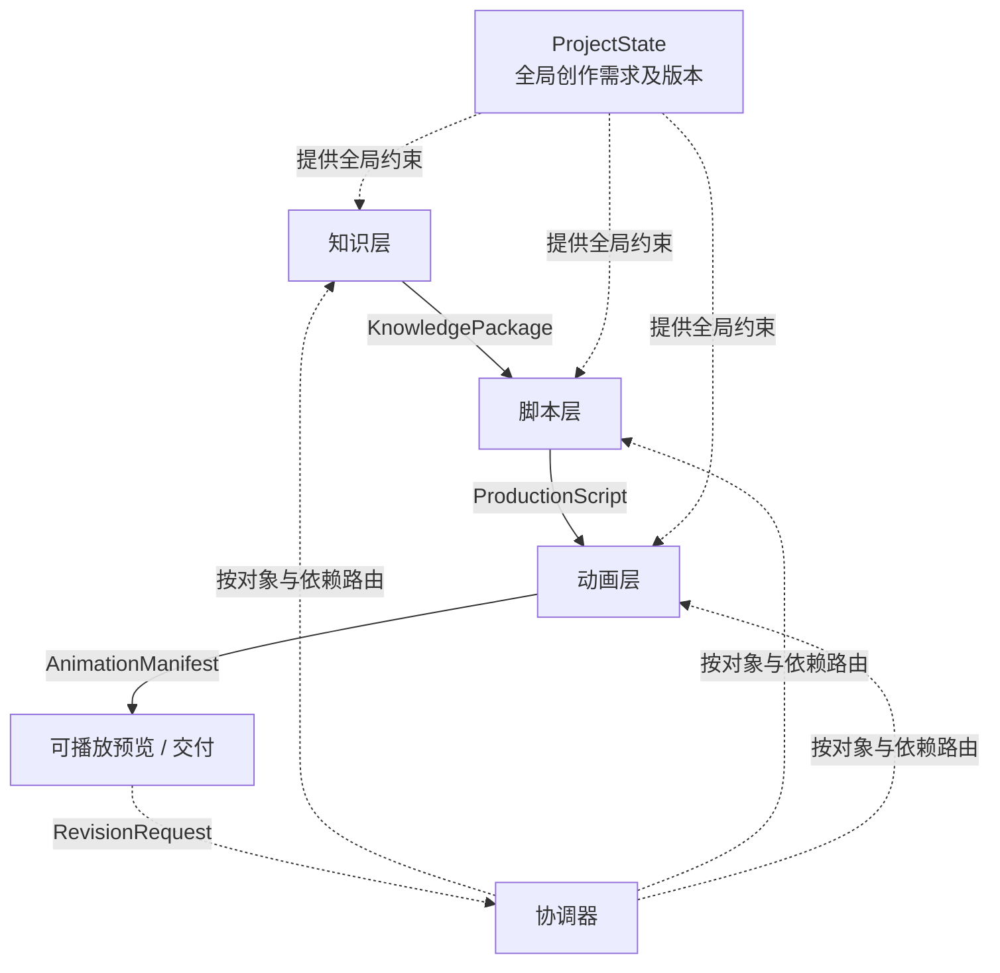
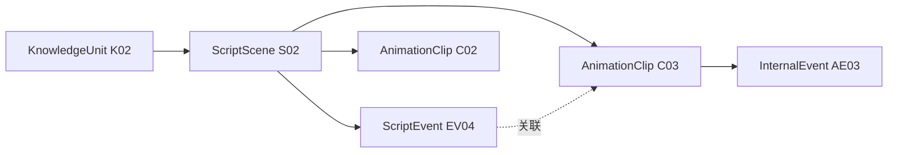

# 知识短视频生成系统：跨阶段接口契约与协作规范

> **文档定位**：双人黑客松的跨阶段交接标准。定义数据边界、必要字段、对象引用、版本和修订语义，以便知识层、脚本层、动画层并行开发。
>
> **规范状态**：候选协作基线，双方使用模拟数据完成最小联调后冻结。
>
> **配套文件**：`schemas/`（五份 JSON Schema）、`examples/`（五份连贯实例）、`validate_contracts.py`（跨文件验证与负向测试）。

## 一、目标和模块边界

产品面向缺少专业知识和动画制作经验的普通创作者，目标是在较低成本下生成时长约 2 分 30 秒至 3 分钟、具有观看吸引力且知识可靠的短视频。用户可以填写主题、细化方向、创作模式和可选偏好；系统自主研究、规划、制作。用户可提前选择创意方向，也可以接受系统推荐，先看实际结果再提出反馈。

生产主线采用：



| 层次 | 拥有的决策权 | 不负责的事 | 标准交付 |
|---|---|---|---|
| 知识层 | 探索、核验、整理知识；提出多个真正不同的创作候选；标注知识重要性和视觉潜力 | 确定逐秒脚本、具体分镜、画面布局、动画示例 | `KnowledgePackage` |
| 脚本层 | 从可靠知识素材中取舍内容；选择/执行已确认方向；制定场景时间线、叙事事件、文字与视听节奏 | 变更未经核验的事实；决定具体动画曲线与绘制代码 | `ProductionScript` |
| 动画层 | 实现场景、连续运动、视听表现；形成可追踪的实际片段与产物引用 | 擅自改写核心知识事实、用户明确方向或全局时长安排 | `AnimationManifest` |
| 协调器 | 保存全局状态、发布当前产物、接收反馈、分析影响、路由修订 | 自行代替专业模块修改各层持有内容 | `ProjectState`、`RevisionRequest` 的调度 |

### 1. 创作模式的处理规则

创作模式是全局偏好，由三层读取，不绑定某一个阶段。

| `creative_mode` | 知识层筛选偏好 | 脚本层策划偏好 | 动画层表现偏好 |
|---|---|---|---|
| `creative` | 反直觉现象、意外联系、内容想象空间 | 新颖叙事、惊喜和转折 | 表现力与视觉冲击 |
| `visual_explain` | 有对象、关系、过程和可见变化的知识 | 围绕机制的变化组织说明 | 让抽象机制直观可见 |
| `knowledge_dense` | 核心原理、结论与关键解释材料 | 精炼的信息密度与连贯性 | 画面明确、高效传达 |
| `story` | 故事、悬念、发现、认知冲突 | 起承转合和情绪推进 | 视听节奏服务故事 |
| `custom` | 按额外文字要求处理 | 同左 | 同左 |

- `creative_mode` 与 `art_style`（美术风格）和 `knowledge_depth`（知识深度）是独立字段，可以任意合理组合。
- 用户可选择 `auto`，但正式交付给各层的 `brief.effective.creative_mode` 应解析为具体模式。用户明确指定的模式不允许被静默覆盖。
- 任何模式都不能降低知识准确性要求；“创意优先”也不意味着强制使用某一种视觉表达。

## 二、接口总览和共同规范

| 接口对象 | 主要生产者 | 主要消费者 | 目的 |
|---|---|---|---|
| `ProjectState` | 协调器 | 所有层 | 统一创作需求、已确认决策、当前产物引用 |
| `KnowledgePackage` | 知识层 | 脚本层及协调器 | 候选方向与可靠知识素材 |
| `ProductionScript` | 脚本层 | 动画层及协调器 | 可执行的时间与叙事计划 |
| `AnimationManifest` | 动画层 | 协调器与预览/导出流程 | 实际动画片段及与脚本的关联 |
| `RevisionRequest` | 用户、某层或审核器 | 协调器和被指派层 | 定位问题并提出修订意图 |

共同规则：

1. 所有对象都有 `project_id`；正式阶段产物另有 `artifact_id`、`revision`。
2. `revision` 描述产物内容的修订。字段结构由当前 Schema 统一定义。
3. 同一个知识单元、场景、事件或片段在同一逻辑实体的连续修订中保留稳定 ID；删除后不复用旧 ID。新增对象生成新 ID。
4. 下游通过 `artifact_id + revision` 引用上游**具体版本**，不能只引用“最新”。
5. `ProjectState.artifacts` 指向**当前已发布产物**。待验收的新版本不得静默覆盖当前版本；历史版本存储方式不属于契约范围。
6. 一个模块只修改自己拥有的交付物。需要上游改变负责内容时，提出 `RevisionRequest`。
7. JSON Schema 只验证形状与字段规则。跨引用、时间一致性和版本关系由契约校验器检查；知识真实性、节奏与视听质量由各模块的独立验收检查。
8. 不要求所有模块都复制完整上游包：只要通过稳定引用能获取所需内容即可。跨模块仅依赖公开契约，不依赖对方内部 Agent 状态。

## 三、共享状态 `ProjectState`

`ProjectState` 是唯一的全局共享项目索引，包含两个逻辑部分：用户创作需求 `brief` 和当前项目进度 `decisions/artifacts`。**知识研究结果存入独立的 `KnowledgePackage`，不回写成 `brief` 的字段。**

### 1. 用户输入 `brief.user_input`

| 字段 | 类型 | 必填 | 语义 |
|---|---|---|---|
| `topic` | string | 是 | 知识主题，唯一强制输入 |
| `focus` | string | 否 | 具体知识方向或希望回答的问题 |
| `creative_mode` | enum | 否 | `auto/creative/visual_explain/knowledge_dense/story/custom` |
| `creative_mode_notes` | string | 条件必填 | 当 `creative_mode=custom` 时必须提供 |
| `creative_idea` | string | 否 | 用户自己的创意想法，与“美术风格”不同 |
| `must_include` | string[] | 否 | 希望出现的知识、例子或要点 |
| `must_avoid` | string[] | 否 | 不希望出现的内容或表达 |
| `art_style` | string | 否 | 美术审美偏好，独立于创作模式 |
| `knowledge_depth` | enum | 否 | `auto/intro/balanced/advanced` |
| `aspect_ratio` | string | 否 | 例如 `9:16`、`16:9` |

用户输入暂不强制要求目标受众、用途、精确时长、配音或参考素材。视频目标时长由产品统一配置（当前预计 2 分 30 秒至 3 分钟），写入有效配置并由脚本层落实到 `total_duration_ms`。如果后续确需新增用户输入，请更新 Schema，而不是把不同信息塞进模糊的“大备注”字段。

### 2. 系统有效配置 `brief.effective`

每个生产层都读取 `effective` 作为执行时的统一偏好：

- `creative_mode`：已解析的创作模式，不能保持 `auto`。
- `knowledge_depth`：已解析的深度，不能保持 `auto`。
- `aspect_ratio`：已解析的画面比例。
- `target_duration_ms`：产品配置的目标时长，单位为毫秒；当前预计范围为 150000–180000。
- `art_style`：可选的审美偏好。
- `creative_mode_notes`：自定义模式下必填。

`user_input` 用于保留用户真实意图，`effective` 用于执行。用户明确选择的模式、深度、比例、美术风格必须在 `effective` 中保持一致；未填写的部分由系统补默认值。

### 3. 选择与产物版本

`decisions.direction_id` 表示当前方向，`direction_status` 表示由谁确认：

- `system_default`：系统推荐，用户未确认，可继续自动生成。
- `user_confirmed`：用户明确选择，下游不得擅自改选。
- `script_selected`：脚本层在授权范围内重新选择，必须先更新全局决策再发布新脚本。

`artifacts` 提供当前 `knowledge_package`、`production_script`、`animation_manifest` 的 `ArtifactRef`。某阶段尚未完成时，该项可以缺省。

### 4. 更新原则

- 需求变更提升 `brief.revision`；依赖它的阶段产物可能过期，由协调器根据字段变化判断失效范围。
- 方向变更通常影响脚本及其下游动画；若需要额外知识，再请求知识层补充。
- 只改变具体动画实现时，可以保留原 `ProductionScript`，只发布新 `AnimationManifest.revision`。
- 已发布产物在新版本未验收前仍保留原引用。应用新版本后再更新 `ProjectState.artifacts`。

## 四、接口 A：`KnowledgePackage`（知识层 → 脚本层）

知识层交付经过研究和必要核验的**候选方向**与**共享知识素材池**。不替脚本层决定某个事实必须在第几秒出现，也不提前编排具体视觉创意。

### 1. 顶层结构

| 字段 | 类型 | 必填 | 作用 |
|---|---|---|---|
| `artifact_id` | string | 是 | 知识包标识 |
| `revision` | integer | 是 | 产物修订版 |
| `brief_revision` | integer | 是 | 基于哪一版用户需求 |
| `directions` | array | 是 | 至少一个候选方向，通常生成 2–3 个，不能为凑数而重复 |
| `recommended_direction_id` | string | 是 | 指向候选之一的默认推荐 |
| `knowledge_units` | array | 是 | 已核验、相关且可以供脚本采用的素材 |
| `evidence` | array | 是 | 资料来源、推导或其他核验依据 |
| `constraints` | object | 是 | 不可误导的边界、真正强制保留的知识 |

### 2. 候选方向 `directions[]`

| 字段 | 必填 | 作用 |
|---|---|---|
| `id`、`title` | 是 | 稳定标识与通俗标题 |
| `core_question` | 是 | 视频针对什么问题 |
| `hook` | 是 | 这个知识本身为什么值得看，**不是开场台词** |
| `learning_goal` | 是 | 期望观众获得的核心收获 |
| `knowledge_refs` | 是 | 指向共享知识素材池的 ID |
| `visual_potential` | 否 | `high/medium/low/unknown` 和简短判断理由 |
| `duration_fit` | 是 | 评估方向内容对目标时长的支撑程度及理由 |
| `recommendation_reason` | 否 | 为什么适合用户给定的主题和创作模式 |

**约束**：`visual_potential` 只分析知识是否具有可观察的状态、关系、数量或结构差异，不应提前规定“使用某种视觉隐喻、画面对象、动画步骤或镜头”。不设置独立的 `Creative Opportunities` 交付，脚本和动画层保留创作空间。

### 3. 知识素材 `knowledge_units[]`

| 字段 | 必填 | 作用 |
|---|---|---|
| `id` | 是 | 稳定知识 ID |
| `type` | 是 | `fact/concept/principle/phenomenon/example/analogy/derivation/application` |
| `content` | 是 | 准确、清楚的知识事实或机制 |
| `explanation` | 是 | 下游可以理解、转述或加工的补充解释 |
| `importance` | 是 | `core/supporting/optional`，**不是强制使用开关** |
| `verification_status` | 是 | `verified/needs_review`；未核实素材不能进入候选或脚本 |
| `depends_on` | 否 | 必要前置知识 ID，不允许循环依赖 |
| `conditions` | 否 | 重要前提、适用范围与假设 |
| `evidence_refs` | 是 | 至少一条指向 `evidence[]` 的依据引用 |
| `visual_potential` | 否 | 可选的视觉化潜力标注，不能替代事实内容 |

已核实知识必须至少引用一条 `evidence[]`；`needs_review` 素材可暂时没有证据引用，且不能被候选或脚本采用。`evidence[]` 记录 `id`、`kind`、`title`，以及可选的 `locator` 或 `details`。数学推导必须给出可复核的 `details`；外部资料必须提供可追溯的 `locator`。**有证据字段不自动代表事实核验合格**；知识层需要单独检查其可信性及前提。

`constraints.required_knowledge_refs` 仅指定当前视频确实不能省略的知识，允许为空；`constraints.must_not_misrepresent` 指定禁止的错误表述。核心知识 `importance=core` 并不自动进入强制列表。

### 4. 用户视图与机器交付

两者由**同一份规范知识包**派生，不生成两套彼此独立的事实：

- 用户看到候选的标题、问题、看点、学习收获和简要推荐原因；可采用默认方案、选择其他方向或补充想法。
- 脚本层获得完整候选引用、知识单元、证据与约束。可访问全部知识素材，但默认优先获取当前方向关联的部分，以降低上下文成本。

用户不用审阅原始证据、知识关系与公式；这些内部核验责任属于系统。

## 五、接口 B：`ProductionScript`（脚本层 → 动画层）

脚本层正式确定内容取舍，形成具有明确时间顺序的制作计划。脚本不是话剧台词。第一版不做配音：`timed_text` 只承载屏幕文字（字幕、标题或标注），纯视觉片段可以不写 `timed_text`；后续若需要旁白或配音，应另行扩展 Schema。

### 1. 顶层信息

| 字段 | 必填 | 作用 |
|---|---|---|
| `artifact_id`、`revision` | 是 | 脚本产物与修订版 |
| `brief_revision` | 是 | 使用的需求版本 |
| `knowledge_package_ref` | 是 | 精确引用知识包 ID + 修订版 |
| `direction_id` | 是 | 已实际采用的候选方向 |
| `total_duration_ms` | 是 | 总时长；单位为毫秒 |
| `core_message` | 是 | 整条视频最终希望观众记住的要点 |
| `scenes[]` | 是 | 按时间排序的场景 |

### 2. 场景 `scenes[]`

| 字段 | 必填 | 作用 |
|---|---|---|
| `scene_id` | 是 | 稳定场景标识 |
| `start_ms`、`duration_ms` | 是 | 在整条视频中的时间位置 |
| `objective` | 是 | 这段希望观众看到或理解什么 |
| `events[]` | 是 | 内部按时间先后组织的叙事/视听事件 |
| `knowledge_refs[]` | 是 | 本场景采用的知识单元，可为空（例如纯过渡场景） |
| `role` | 否 | 场景叙事角色，如 `hook/setup/explain/twist/payoff/other` |
| `visual_notes[]` | 否 | 场景之间需要延续的画面语义或视觉说明 |
| `timed_text[]` | 否 | 带相对时间的字幕、标题或标注 |
| `audio_intent` | 否 | 声音、节奏、强调点的自然语言约束 |
| `semantic_constraints[]` | 否 | 本场景不可错误表达的事实或关系 |

`events[]` 每个事件包含 `id`、`offset_ms`、`description`，可选 `duration_ms`、`knowledge_refs`；`offset_ms` 相对于所属场景开始。`timed_text[]` 每项含 `id`、`offset_ms`、`duration_ms`、`text`，可用 `kind` 标记 `subtitle/title/annotation`；它是屏幕文字，不代表配音或旁白文本，同一场景内 `subtitle` 不应重叠。场景总时长、事件偏移和文字偏移使用统一的毫秒单位。

第一版采用线性、无空白的**场景时间轴**：场景从 0 开始顺序覆盖总时长；事件之间可以有间隔或重叠。视觉过渡由动画实现处理；多轨重叠脚本可在后续版本中扩展，不提前强制复杂时间轴抽象。

### 3. 责任边界

脚本层可自行选择知识材料、改变解释顺序、增删可选内容，决定时间、文字和叙事事件；但不得未经核验创造新的实质性事实。改变了用户确认的方向或知识层核心约束时，需要反馈或获得授权。

动画层自主决定具体画面、对象形态、动画曲线、镜头效果和表现方式。若需要改变脚本事件或时间分配，应请求脚本层修订，而非修改它不持有的源数据。

## 六、接口 C：`AnimationManifest`（动画层 → 协调器）

为使产物能够被识别、复用、比较和局部修订，动画层需要交付一份**轻量索引**。该索引不是动画代码本身，也不规定具体编辑界面或渲染库。

### 1. 顶层信息

| 字段 | 必填 | 含义 |
|---|---|---|
| `artifact_id`、`revision` | 是 | 动画产物标识及版本 |
| `brief_revision` | 是 | 使用的需求版本 |
| `production_script_ref` | 是 | 精确引用脚本 ID + 修订版 |
| `total_duration_ms` | 是 | 实际产物对应的总时长 |
| `preview_ref` | 否 | 可被系统解析的预览资源标识 |
| `clips[]` | 是 | 连续动画片段索引，至少一项 |

### 2. 动画片段 `clips[]`

| 字段 | 必填 | 含义 |
|---|---|---|
| `clip_id` | 是 | 可独立定位和更新的片段 ID |
| `scene_id` | 是 | 所属脚本场景 ID |
| `start_ms`、`duration_ms` | 是 | 片段在整条视频中的时间范围 |
| `resource_ref` | 是 | 指向具体动画实现/资源的**不透明资源标识** |
| `script_event_refs[]` | 否 | 对应脚本场景中的事件 ID |
| `internal_events[]` | 否 | 可选的片段内部语义事件索引 |

`internal_events[]` 每项含 `id`、`offset_ms`、`description`，可选 `duration_ms` 和 `script_event_refs`。它描述实际动画的**语义变化阶段**，不要求逐帧列出数据、关键帧或 CSS/JS 参数。

### 3. 对应关系与粒度



- **一个脚本场景可以对应一个或多个动画片段**；不要强制场景与片段一一对应。
- 一段动画片段归属一个脚本场景，并位于其时间范围之内；所有片段按时间连续覆盖完整视频。
- 脚本事件与动画片段/内部事件可多对多引用，不要求逐秒严格对齐；但引用必须落在对应脚本场景内。示例中 EV04 的时间范围跨越 C02 与 C03，属于允许的重叠，不代表片段必须与事件按秒对齐。
- 场景事件属于脚本层；片段及内部事件属于动画层。内部事件 ID 由动画层管理。
- `resource_ref` 只是一条定位线索。资源如何加载、保存、执行和导出由动画层自行实现，不要求其他层解析 JS 源码。

这一最小结构足以支持跨阶段定位和局部替换，而无需把复杂的动画实现细节写进团队公共契约。

## 七、统一反馈 `RevisionRequest`

修订请求传递用户意图及受影响的上下文。用户不需要判断属于知识、脚本还是动画问题；系统可以先记录 `target_layer="unresolved"`，再由协调器判断。

| 字段 | 必填 | 含义 |
|---|---|---|
| `request_id`、`project_id` | 是 | 本次反馈标识及所属项目 |
| `base_project_revision` | 是 | 用户反馈针对的项目状态版本 |
| `source` | 是 | `user/knowledge/script/animation/reviewer` |
| `target_layer` | 是 | `knowledge/script/animation/unresolved` |
| `target_artifact` | 是 | 反馈所针对产物的类型、ID、revision |
| `anchors[]` | 是 | 锚定知识方向、知识单元、场景、事件、片段或时间范围；可为空 |
| `scope` | 是 | `local/multi_scene/global/unknown` |
| `problem` | 是 | 发现的问题；原始用户反馈可直接保留 |
| `desired_change` | 否 | 用户或模块明确提出的目标效果 |
| `preserve` | 否 | 要求尽量不改变的部分 |
| `original_user_feedback` | 否 | 自动转述时保留用户原话 |

`anchors[].kind` 可取：

`direction`、`knowledge_unit`、`scene`、`script_event`、`timed_text`、`clip`、`clip_event`、`time_range`、`whole_artifact`。

- 对实体锚点使用 `id`；对时间区间使用 `start_ms/end_ms`（绝对视频时间）。
- `target_artifact.kind=project_state` 时，`artifact_id` 填 `project_id`，`revision` 填 `ProjectState.revision`。
- `target_artifact` 必须精确指明反馈对应的产物版本；锚点可通过关联链定位相关上游对象。
- 如果反馈针对旧版本，协调器应先检查是否仍然适用，不能直接套用到新版本。
- 模块内部可以直接修改自己拥有的对象；越过职责边界时需发修订请求。
- 大范围修改在执行前应确定影响范围，局部修改优先复用未受影响的成果。具体交互确认策略不属于此文档。

### 1. 常见修订路线

| 反馈 | 目标层 | 上游/下游动作 |
|---|---|---|
| 某个事实错误、需要补充案例 | 知识层 | 新 `KnowledgePackage` → 检查相关脚本与动画是否需要更新 |
| 某个段落知识过密、事件顺序不合理 | 脚本层 | 新 `ProductionScript` → 更新受影响的动画片段 |
| 某段动画的表现、速度或画面需要调整 | 动画层 | 保持脚本不变 → 新 `AnimationManifest` |
| 变更视频的核心讲解方向 | 知识/脚本层 | 先检查用户决策，再修改知识范围与脚本，最后更新动画 |
| “这一段不够有趣” | `unresolved` | 结合选定锚点分析属于知识选择、叙事还是表现问题 |

修订链与阶段所有权是两件事：**可从最终结果触发任何层的修订，但各层只能发布自己的数据。**

## 八、跨文件一致性与验收标准

### 1. 自动结构检查

`validate_contracts.py` 对随附完整样本检查：

1. 五份 Schema 全部有效，示例遵循字段类型和枚举要求。
2. 五份示例的 `project_id` 一致；需求修订、阶段引用和全局当前产物引用匹配。
3. 用户明确填写的创作模式、深度、比例、美术风格不被有效配置覆盖。
4. 候选、知识单元、证据、脚本场景、脚本事件、动画片段、内部事件 ID 无重复；引用能够找到对象。
5. 知识单元依赖没有循环，强制引用的知识进入脚本使用集合。
6. 脚本场景按时间连续覆盖总时长；事件与定时文字的偏移不越界，同场景中 `subtitle` 互不重叠；脚本总时长与 `brief.effective.target_duration_ms` 偏差不超过 10%。
7. 动画片段按时间连续覆盖总时长，且每个片段处于对应的脚本场景范围内。
8. 反馈锚点引用存在，时间范围有效；九种负例检查无效引用、时间溢出、用户偏好覆盖及无效状态等约束。

**并非自动验收的内容**：来源真实性、知识推导正确性、观众理解程度、叙事吸引力、画面美学、动画播放成功、音画同步和最终视频编码一致性。这些需要各层实际实现后另外检查。

### 2. 双方独立开发验收

| 负责模块 | 可用模拟输入 | 第一版验收 |
|---|---|---|
| 知识层 | `ProjectState` | 输出可通过 Schema 的知识包；候选具有实质差异；事实可追溯；不给定具体镜头实现 |
| 脚本层 | `ProjectState` + `KnowledgePackage` | 选定方向并产出连续时间脚本；知识引用有效；内容可交付动画制作 |
| 动画层 | `ProjectState` + `ProductionScript` | 能执行并预览场景，输出与脚本关联的动画清单，结果可复现 |
| 协调器 | 五类对象的模拟样例 | 发布/保留各版产物引用；按锚点定位反馈；能路由跨层修订 |

### 3. 运行校验

```bash
python -m pip install 'jsonschema>=4.18'
python validate_contracts.py
```

预期输出：

```text
PASS: five schemas, five linked examples, cross-stage checks, nine negative cases
```


