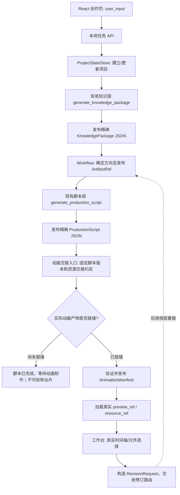
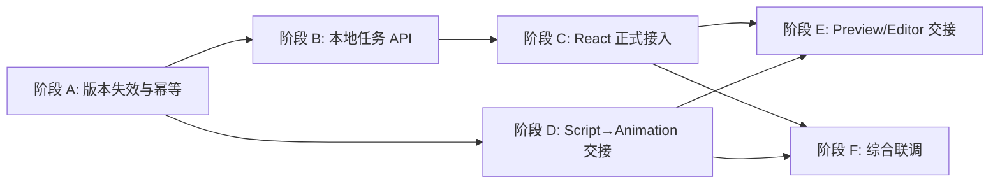

# knowledge-show｜主工作流前后交接补全执行方案

> **任务类型**：功能集成 / 跨层联调 / 小范围工程修订
> **审查仓库**：`LIZZYGREAT/knowledge-show`
> **审查基线**：`main@d7de5402ca3a165beb8501170bb47ea672c65512`（2026-11-14）
> **建议入库路径**：`docs/tasks/open/backend/主工作流前后交接补全执行方案.md`
> **任务状态**：实现与本地 Mock 验证已完成；真实模型脚本验收未执行，需用户明确同意后再运行；动画运行时、工作台、自动修订和导出仍属后续工作。任务保留在 open，待负责人验收后归档。
> **本轮定位**：优先打通各阶段的**输入、产物、任务状态、版本引用及交接页面**，不重做知识、脚本或动画层内部算法。

## 一、执行目标和边界

本轮需要建立一条由正式前端发起、后端可追踪、各阶段依据真实产物交接的执行主线：



**本轮必须交付**：真实 React 提交→任务 API→已有知识层→已有脚本层→正式脚本产物→可供动画负责人读取的输入交接，以及清楚的任务状态和失败/恢复流程。

**本轮必须定义并做好交接口径，但不强行假装完成**：动画产物发布、预览就绪、工作台进入、修订请求接收与路由。可以先通过固定的合法 Mock 做接口测试；只有真实动画资源存在且能够播放时，才在普通用户界面开放“视频预览/工作台”。

**明确不做**：知识层重新训练/重新设计 Research、Creative、Verifier；脚本叙事提示词或复杂评分的再次重构；动画生成 Agent、GSAP 具体镜头、Style Profile、美术模板、完整场景制作、音频/视频编码、复杂多轨编辑、完整自然语言修订 Agent、账号/云端多租户与分布式任务系统。这些由对应阶段后续独立推进。

核心产品原则：用户只看到自然的**正在探索知识 / 正在编排脚本 / 正在制作画面 / 可以预览**等语义状态；原始 API 状态码、traceback、模型统计、JSON 校验错误和内部字段属于研发诊断。不得用假进度、Mock 媒体或静态示例冒充真实生成成功。时间与费用优先：保留可用上游产物，失败从断点续接，不重复调用无关模型。

## 二、对最新 main 的核验结果

### 1. 已经实现的模块：直接复用

| 实现 | 实际仓库位置 | 已存在的能力 | 本轮处理 |
|---|---|---|---|
| 知识生成 | `backend/src/knowledge/service.py` | `generate_knowledge_package(project_id, brief, *, on_event, run_options)`；Research/Creative/Verifier、有限补研、费用上限、发布 JSON | **直接调用**，不复制核心流程 |
| 知识包发布 | `backend/src/knowledge/service.py`、`store.py` | `{artifact_id}-r{revision}.json` 原子发布、回读与 Schema 验证 | 通过精确引用消费，不访问 SQLite |
| 脚本生成 | `backend/src/script/service.py` | `generate_production_script(project_state, knowledge_package, *, llm_client, on_event, export_dir)`；一次有界修复、Schema+时间线核验 | **直接调用**，不要另建一套脚本 Agent |
| 脚本发布 | `backend/src/script/artifacts.py`、`validate.py` | 版本化 JSON、不可覆盖、精确知识引用及方向校验 | 保持现行公开 `ProductionScript` |
| 项目状态 | `backend/src/workflow/state.py` | `ProjectStateStore.create/load/load_revision/update/publish_artifact_ref`，版本化文件及乐观锁 | 扩展上游变更时的下游引用处理 |
| 知识→脚本编排 | `backend/src/workflow/service.py` | `run_until_script()`，已有知识包复用、默认方向、发布脚本与工作流进度 | 在此基础上集成，不重新发明工作流 |
| React 输入 | `frontend/src/common/creation.ts`、`App.tsx` | `toUserInput()` 保留主题/偏好，用户确认界面完整 | 接入真实请求；保留现有视觉布局 |
| 前端状态映射 | `frontend/src/common/progress.ts` | 已有 knowledge/script/animation 状态和用户语义文案 | 改为消费正式任务状态，不复制诊断字段 |
| 动画 P0 | `frontend/src/animation/runtime/`、`features/preview/main.tsx` | 固定 PN S01 15 秒播放器、Seek、元件 ID/bbox、独立研发预览 | 作为适配能力参考，**不是**完整生成链路 |
| 共享契约 | `contracts/schemas/`、`validate_contracts.py` | 五类对象、版本、可选 anchor、selectable_elements、render_element | 尽量保持 Schema 不变 |

仓库文档声称知识层 83 项、脚本 10 项、工作流集成 3 项、前端单测 10 项与 E2E 19 项通过；本次为远程代码审查，未在本环境复现这些测试。GitHub Actions 当前没有 main 的工作流运行记录。

### 2. 确实尚未接通的环节

| 断点 | 代码证据 | 对使用者的影响 |
|---|---|---|
| 前端没有正式生成调用 | `App.tsx::submit()` 仍给出“生成服务尚未接入” | 用户无法启动真实知识→脚本流程 |
| API 层空缺 | `backend/src/api/` 只有 `.gitkeep` | 无项目创建、任务启动、进度查询与产物读取入口 |
| API Key 测试未接线 | `ApiSettingsDrawer` 预留 `testConnection`，`App` 未提供实现 | 设置页无法确认连接成功，不能进入真实生产 |
| 任务事件没有可恢复的读取入口 | `run_until_script(... on_event)` 只有回调；缺任务查询/事件存储 | 刷新/返回页面后无法可靠查看本次进度 |
| 重试粒度与幂等尚需完善 | `run_until_script` 已复用知识包，但当前每次调用仍进入脚本生成；无当前脚本直接返回判定 | 重复点击可能产生无意义模型费用 |
| 上游版本变更可能遗留旧下游引用 | `publish_artifact_ref` 保留其它 `artifacts`；方向改变也不会自动删脚本/动画引用 | ProjectState 可能暂时指向不再匹配当前方向/知识的旧产物 |
| 脚本→动画接口未落地 | 脚本已发布，但没有动画任务输入适配与回写 Manifest 的协调器调用 | 动画负责人还不能直接从统一入口领取当前工作 |
| 动画预览仍是固定样本 | P0 入口固定 `PN v2 / S01`，没有从 Manifest 解析资源 | 不能把预览当作当前用户成片 |
| 工作台未读取真实产物 | 独立 HTML 编辑器的 `CHAPTERS/ANIM_TRACKS` 仍硬编码 | 时间轴、胶囊和用户当前项目不一致 |
| 修订未提交 | 独立原型的 `sendChat()` 仅本地追加内容 | 无 `RevisionRequest` 实际执行路径 |
| 视频导出 | 无正式资源编码和下载程序 | 本轮仅留交接边界，不实现编码 |

### 3. 本轮必须纠正的两项状态语义

**（1）上游变化后，下游引用失效。** 若知识包实际换成新 revision、选择了不同方向，则旧 `production_script` 和 `animation_manifest` 不能继续作为“当前有效产物”；若脚本实际换成新 revision，则旧 `animation_manifest` 也不能继续显示为当前结果。历史文件应保留供回看，但 `ProjectState.artifacts` 必须反映**当前有效引用**。只在引用实际发生变化时失效；重复发布同一版本不触发无效重做。

**（2）提交、刷新、重试不能引起重复计费。** 单项目同一时刻仅允许一条正式生成任务运行；已经发布且仍与当前上游匹配的脚本可直接返回，除非明确请求重新生成。脚本失败后沿用已发布的知识包，绝不默认从 Research 重新开始。失败后不标记已成功的其它阶段为失败。

## 三、统一交接规则：五类产物只有一份权威定义

### 1. `ProjectState` 是当前项目索引

协调器负责维护 `project_id`、`revision`、`brief.user_input/effective`、`decisions`、`artifacts`，其它模块只读取自己需要的内容。所有产物通过 `ArtifactRef = { artifact_id, revision }` 精确引用，不读取“最新一版”替代上游引用。

首次创建由 `ProjectStateStore.create(user_input)` 产生完整状态；前端传 `user_input`，不构造 `effective`、项目 revision、产物 ID。默认 16:9、165000ms，显式不支持的比例应在模型计费前被拒绝。

当前 `ProjectStateStore.update()` 只更新 `decisions/artifacts`，**本轮的主题编辑先按“新建项目”处理**；不要承诺已经支持在同一项目内修改 Brief 的完整历史管理。之后确有需要再按 Schema 修订需求版本的更新方式。

### 2. 方向选择与脚本输入

知识层提供 `KnowledgePackage.directions[]` 和 `recommended_direction_id`；协调器在脚本启动前确保 `ProjectState.decisions.direction_id` 已明确。用户未选定时使用 `system_default`；用户选择其它候选时写入 `user_confirmed` 并让旧脚本失效。

脚本层只接收**已发布的** ProjectState 与精确 KnowledgePackage 文件；不访问 SQLite，不擅自改方向和知识事实。脚本发布后 `ProductionScript.knowledge_package_ref` 必须精确等于当前知识包引用，`direction_id` 必须与项目决策一致。知识引用仍按脚本层现有 `validate.py` 验证。

### 3. 脚本→动画交接

当前可交付给动画负责人的最小输入是：

- 当前 `project_id`、`ProjectState.brief.effective`（含 16:9 与目标时长）；
- `ProjectState.decisions.direction_id`；
- 精确 `production_script_ref` 和对应完整 `ProductionScript`；
- 必要时根据 `ProductionScript.knowledge_package_ref` 读取相关知识条件；
- 研发内部可附一份简单的任务说明，但**不新增公共 Schema 的强制字段**。

动画负责人独立决定生成技术、模板、对象和运动实现。本轮只提供一个可读取当前脚本的交接入口与未来 `AnimationManifest` 发布接口。不要让工作流依赖某个 PN 样片的路径或只能单场景运行的 P0 Player。

### 4. 动画→预览/编辑器交接（先定义接口，后连真实资源）

只有动画负责人交回实际生成并校验的 `AnimationManifest`，且 `preview_ref/resource_ref` 能被当前播放器解析，才发布 `ProjectState.artifacts.animation_manifest` 并让前端进入工作台。

`selectable_elements[]` 提供逻辑元件 ID；真实运行时负责 Seek 和 bbox，编辑器负责叠层框选。**编辑器胶囊与选中状态绑定 element_id/clip_id/scene_id，不绑定轨道序号。** 本轮只对齐数据边界，暂不改写 800 行时间轴或设计轨道类型。

### 5. 修订→重新发布的交接

用户反馈需要转成现有 `RevisionRequest`：`target_artifact` 精确版本，`anchors` 使用 `render_element/timed_text/scene/clip/time_range` 等已有类型。协调器根据修改所属层重做必要下游：

- 事实或方向变更：知识或方向更新 → 脚本及动画引用失效；
- 叙事或时间变更：脚本新 revision → 动画引用失效；
- 纯动画修改：只发布新动画 revision，上游 KnowledgePackage 与 ProductionScript 不动。

首版可以先**接收并保留有效的请求、确定其目标版本**，不假装已经实现自动语义改写。正式产品中尚不能执行的操作应明确告知或暂不开放提交按钮。

## 四、本轮推荐的最小运行时结构

不建微服务、Celery、Redis、复杂事件总线或独立任务编排平台。沿用当前 Python 单机 + React/Vite：

```text
backend/src/
├── knowledge/              # 现有实现，保持
├── script/                 # 现有实现，保持
├── workflow/
│   ├── state.py            # 现有 ProjectStateStore；补版本失效边界
│   ├── service.py          # 现有 run_until_script；补幂等/阶段交接
│   └── jobs.py             # 新增轻量任务状态与查询（若 API 内更简单可并入）
├── api/
│   ├── app.py              # 新增 FastAPI 最小入口
│   └── models.py           # 请求响应类型：必要时新增，避免为一个字段拆文件
└── common/                # 不为本任务预置大量抽象
backend/tests/
├── knowledge/              # 现有
├── script/                 # 现有
├── integration/            # 增加任务/版本/接口 Mock 联调
└── api/                    # 新增必要的 HTTP 测试（可并入 integration）
frontend/src/
├── App.tsx                 # 正式提交与返回/刷新恢复
├── common/
│   ├── creation.ts         # 已有用户输入转换，保持
│   ├── progress.ts         # 已有 UI 语义状态，复用
│   └── api.ts              # 新增最小 HTTP 客户端
├── features/settings/      # 提供 testConnection 接线
├── features/progress/      # 保留演示；增加真实运行态
├── features/preview/       # 先给真实 Manifest 加载留入口，不冒充视频已就绪
└── features/revision/      # 后续依据真实 ArtifactRef 接入；本轮不重构
```

依赖建议新增 `fastapi`、`uvicorn`（按实际 Python 项目配置写入依赖文件），使用 `httpx` 或 FastAPI 测试客户端进行接口测试，优先使用已安装的 `pytest`。仅本机使用时后端监听 `127.0.0.1`、前端 Vite 代理 `/api`，不开放无鉴权的公开互联网项目读写服务。非单机部署再另立任务规划身份鉴权与远程资源权限。

## 五、拟新增的最小 HTTP 接口（当前仓库尚不存在）

> **接口名称是本轮建议的实施约定，不是对已实现端点的描述。** 一旦选定，在 `docs/work/contracts/API.md` 登记方法、路径、输入、输出和实施状态。不要为了任务传输再造一份 ProjectState/Script/Manifest Schema。

| 方法与路径（建议） | 输入 | 输出 | 作用与完成条件 |
|---|---|---|---|
| `GET /api/health` | 无 | `{status:"ok"}` | 只证明本地服务存活，不代表 DeepSeek Key 有效 |
| `POST /api/model/test` | `{api_key}` | `{connected:boolean}` | 经用户显式操作进行一次**低费用真实验证**，不能仅检测字符串非空就宣称成功 |
| `POST /api/projects` | `{user_input}` | `{project_id, project_revision, project}` | `ProjectStateStore.create` 并返回完整已验证项目 |
| `GET /api/projects/{project_id}` | 项目 ID | 当前 ProjectState | 刷新后恢复项目版本与已发布引用 |
| `POST /api/projects/{project_id}/jobs` | `{target:"script",api_key,regenerate?:boolean}` | `{job_id,status}` | 启动或复用一条知识→脚本任务；不等待模型结果才返回 |
| `GET /api/jobs/{job_id}` | 任务 ID | 当前状态、阶段、用户文案、ArtifactRef | 前端查询进度、错误与成果，不包含模型/密钥诊断 |
| `GET /api/projects/{project_id}/knowledge-package` | `artifact_id`、`revision` 查询参数 | 精确版本 KnowledgePackage | 已发布知识包读取；校验项目及引用一致 |
| `GET /api/projects/{project_id}/production-script` | `artifact_id`、`revision` 查询参数 | 精确版本 ProductionScript | 脚本交接和研发检查入口；禁止自动代换最新版 |
| `POST /api/projects/{project_id}/direction` | `{direction_id,expected_project_revision}` | 新 ProjectState | 切换方向，原子清理不再有效的脚本/动画当前引用 |
| `GET /api/projects/{project_id}/handoff/animation` | 项目 ID | 当前 ProjectState 简要配置、精确 ProductionScript 及上游引用 | 动画层拿到当前可执行脚本；当前没有脚本则返回明确未就绪 |

**下一阶段按需接入，但这次至少确认接口形状与责任**：

| 拟新增接口 | 对接方式 | 现在允许做到哪里 |
|---|---|---|
| `POST /api/projects/{id}/animation-manifest` | 动画生产者携带 Manifest 与资源就绪信息提交；后端校验并发布精确版本 | 可先实现 Mock 联调，**不可**把缺媒体的示例发布为正式视频 |
| `GET /api/projects/{id}/preview` | 仅在合法 Manifest 及真实资源可读时返回真实 `preview_ref` | 当前 P0 固定样例不满足用户成片条件；返回“尚未就绪” |
| `POST /api/projects/{id}/revision-requests` | 用户/编辑器提交规范 RevisionRequest，协调器校验目标版本 | 可先接收、记录、回执“待处理”；未做修订执行不得返回“修改成功” |
| 最终导出入口 | 由动画与导出负责人确认可复用的预览资源后补充 | 本轮不预设虚假视频下载路径 |

API 要保持小而清楚：项目是一组已发布**产物引用**，任务是一次**执行活动**。不要把 API 内部的任务状态写回公共 `ProjectState` 为新字段；也不要让五类公开 Schema 承担 HTTP 传输和日志职责。

### 推荐的任务查询结构（仅内部 HTTP 传输类型）

```json
{
  "job_id": "JOB_abcdef123456",
  "project_id": "P_0123456789abcdef",
  "status": "running",
  "current_stage": "script",
  "stages": {
    "knowledge": "completed",
    "script": "running",
    "animation": "pending"
  },
  "message": "正在安排讲述顺序与场景节奏",
  "project_revision": 3,
  "artifacts": {
    "knowledge_package": {"artifact_id": "KP_P_0123456789abcdef", "revision": 1}
  }
}
```

此 JSON 为**拟实现响应示例**，不是现有运行产物。可选 `status`：`queued / running / script_ready / failed / interrupted`；`script_ready` 仅表示脚本可供动画接入，**不等于视频已完成**。动画阶段在无生产者时保持 `pending`。字段精简即可；不要复制知识层每条内部事件到客户端。

默认使用 `GET /api/jobs/{job_id}` **轻量轮询**（约每 1–2 秒）而非一开始做 WebSocket/SSE 双方案。前端只展示最新语义状态；若需要短暂展示进度气泡，可为任务存 4–8 条已过滤的用户消息。将来确有流式需求再换 SSE，保持响应对象语义不变。

## 六、具体执行阶段

### 阶段 A：工作流与版本正确性（P0，先做，不产生模型费用）

**主要文件**：`backend/src/workflow/state.py`、`service.py`、`backend/tests/integration/test_workflow.py`。

1. 保留 `run_until_script()`，增加“已经有适用的 ProductionScript 且未明确重做 → 精确读取并返回”的条件；检查其 `brief_revision`、`knowledge_package_ref`、`direction_id`、Schema/时间引用。匹配时 0 次脚本模型调用。明确请求 `regenerate` 才调用脚本层。
2. 在正式知识包引用**变化**时，更新当前知识包并移除 `artifacts.production_script`、`artifacts.animation_manifest` 当前引用；只是重读同一知识包 revision 不移除。保留历史文件。
3. 在实际选择方向发生变化时，更新 `decisions`，同时清理两项旧下游引用；用户明确选择须校验方向在当前知识包中。
4. 在正式脚本引用变化时，发布新脚本并移除旧的 `artifacts.animation_manifest`。如果仍为同一脚本版本，则不清理。
5. 若新知识包不再包含旧方向：`system_default` 可重新选择新推荐方向；`user_confirmed` 应提示重新选择，不能静默替用户改方向。
6. 在同一项目上禁止两条正式生成任务同时执行，或以最小互斥/幂等方式处理；现有 `ProjectStateStore` 乐观版本检查仍保留。不要只依赖浏览器禁用按钮来防重复计费。
7. 失败保留已成功的上游版本；脚本失败后重试复用知识包，动画失败不重跑知识和脚本。不得把上一条成功的旧脚本冒充本次失败任务的新成功结果。

建议不引入新的状态框架。只有真正涉及上游变化时才修改 ProjectState，提交为一个独立 Commit。

**阶段 A 验收**：测试同一项目重复启动不重复产生脚本费用、已有脚本直接复用、方向变更下游失效、知识重新发布下游失效、脚本失败后只重跑脚本、项目 revision 冲突被拒绝，均使用 Fake 客户端。

### 阶段 B：建立本地任务 API 和凭证注入（P0）

**主要文件**：新增 `backend/src/api/app.py`、轻量任务记录代码、相关 API 测试；最小修改 workflow 的客户端注入。

1. 用 FastAPI 暴露第五节核心接口，默认绑定 localhost。JSON 请求参数由 Pydantic/当前契约验证，错误统一转换为安全响应；内部异常只写研发日志。
2. API 启动任务时创建持久化的最小任务记录，记录 `job_id/project_id/stage/status/artifact refs/语义消息/创建与结束时间`。不保存 API Key、模型原始输出或逐条 traceback。
3. 通过 `WorkflowOptions` 和 `RunOptions.clients` **逐请求注入**模型客户端；脚本层的 `script_client` 使用同次任务的凭证构造。禁止在并发请求中临时覆盖 `os.environ["DEEPSEEK_API_KEY"]`，也禁止把用户密钥写入 `.env` 或 ProjectState。
4. 实例化客户端时可使用 `dataclasses.replace(load_settings(), api_key=request_key)` 生成**仅本次任务**的配置；知识 LLM、Search/Fetch 和脚本客户端分别使用该配置。集中管理关闭生命周期，避免注入后忘记释放连接；若开发者在本地使用服务端 `.env`，须明确标注是开发环境策略。
5. `POST /api/model/test` 需要真实校验才报告 `connected=true`，并在设置页明确是一次实际网络调用。仅 `GET /api/health` 成功不能推断模型连接成功。避免页面打开即发起付费验证。
6. `POST /api/projects/{id}/jobs` 立即返回 job ID；后台执行进度只由真实 `on_event`、产物发布、失败状态决定。实现可采用单机进程内受控任务注册和 JSON 状态快照，不建设 Celery/Redis。进程重启时未完成任务标记 `interrupted`，不得伪装完成；首次版本不承诺自动恢复模型请求。
7. **接口错误分层**：客户端仅获得 `invalid_input / missing_key / invalid_key / rate_limited / temporarily_unavailable / conflict / failed` 等有限错误码和用户语言；诊断原因在服务器日志。HTTP 端不得原样返回 `diagnostic`、模型参数、系统 Prompt 或完整异常。
8. 确保 `api_key` 不进入请求日志、任务记录、前端错误提示、产物 JSON、测试快照。为本地 Vite 配置 `/api` 代理；服务端仅允许本机开发 Origin，生产部署另议。

**阶段 B 验收**：创建项目→返回有效 ProjectState；测试连接；用 Fake 知识/脚本客户端启动任务→轮询到 `script_ready`；刷新后查询同一任务；API 重启后已有产物可读取、未完成任务不标成功；重复启动不重复计费；错误响应不泄漏密钥。全部可在零 DeepSeek 费用下验证。

### 阶段 C：正式前端接入（P0）

**主要文件**：`frontend/src/App.tsx`、`common/api.ts`（新增）、`common/progress.ts`、`features/progress/GenerationStatus.tsx`、`features/settings/ApiSettingsDrawer.tsx` 和相应测试。

1. 保留目前的 Landing、创作输入、设置抽屉、生成进度的视觉设计，不重构布局。
2. `App.tsx::submit()` 改成调用真实 API：`toUserInput(draft)`→创建 ProjectState→发起 job。**不要**用前端自行构造 `effective` 或 `ArtifactRef`。
3. `ApiSettingsDrawer` 传入真正的 `testConnection`。连接成功与否只对应真实检测结果；`connected` 是本地会话中的状态，刷新后如密钥已清除需重新配置。
4. 正式生成状态读取 `GET /api/jobs/{job_id}`。可以复用现有 `stageOrder`、`applyEvent` 和语义文案，但生产页面绝不能继续展示“流程演示/下一条演示事件”。原手动演示入口独立保留供开发展示。
5. 不把 API 原始 `diagnostic/error` 渲染到普通用户页面。阶段完成只由后端已发布结果认定；知识准备完成才显示知识完成，脚本有合法 ArtifactRef 才显示脚本完成。
6. 已得到 `ProductionScript` 而尚无 AnimationManifest 时，明确显示“脚本准备完成，等待动画制作”，可提供“查看脚本概览/返回创作”这类真实可用操作；不显示“视频完成”“立即预览”或自动跳编辑器。
7. 浏览器刷新后可依据会话内的 `project_id/job_id` 尝试恢复任务显示；本地项目第一版如不做长期存储，可保持 URL 或 session 范围内的标识，**不要持久化 API Key**。若页面丢失会话，不能重新自动付费生成。
8. 失败时只提供“重试当前阶段”等可用操作，明确依靠后端已有产物复用；禁用按钮和请求层幂等同时生效。

**阶段 C 验收**：用户任意合法主题输入→真实显示知识/脚本进度→返回发布的脚本结果；断网/错误 Key/脚本失败分别显示可理解反馈；演示与真实流程不会混淆；不出现技术异常或假预览。

### 阶段 D：脚本交付给动画层的统一入口（P0，**不实现动画生成内部**）

**主要文件**：`backend/src/workflow/service.py`、API 新增交接查询、`backend/tests/integration/`、`docs/work/contracts/API.md`。

1. 完成 `GET .../handoff/animation`：先读取当前 ProjectState，检查已发布 `production_script`，按精确 ArtifactRef 从磁盘读取、重验脚本及上游版本，并返回动画负责人所需的当前脚本数据。
2. 与动画负责人约定：开始制作必须固定当前 `ProductionScript.artifact_id/revision`、`brief_revision` 和 `direction_id`；完成后通过规范 `AnimationManifest.production_script_ref` 原样回传，不以“最新脚本”猜测。
3. 接口允许业务状态 `awaiting_animation`；这意味着**脚本已交接、动画尚未发布**，不是 job 整体失败，也不是成片完成。
4. 准备一个固定 Mock Manifest 的接收/校验测试，但不将当前 15 秒 P0 预览伪造成 165 秒正式成片。将来接收正式 Manifest 时必须校验 `project_id/brief_revision/production_script_ref/total_duration_ms`、clips 的场景归属与全片覆盖，且 `preview_ref/resource_ref` 确实可解析。
5. 动画阶段生产方式仍归动画层。这里不要求 backend 在 Python 中调用 GSAP/编译动画代码，也不修改脚本或动画 Scene 定义。

**阶段 D 验收**：在没有动画运行时的情况下，动画负责人能用同一个项目 ID 读取固定版本的真实 ProductionScript；旧版本不会被误读；缺少脚本时明确“未就绪”；完成上述交接不产生 API 费用。

### 阶段 E：预览、工作台与修订的前后接口先对齐（P1，限交接骨架）

**主要文件**：工作流/API 的产物入口、已有前端 `features/preview/` 与 `features/revision/` 的少量适配、对应 Mock 测试。

1. 在动画负责人提供完整且可加载的 Manifest 后，协调器通过原有 `ProjectStateStore.publish_artifact_ref()` 发布当前动画引用；如果脚本在此期间变更，拒绝过期 Manifest。
2. 前端统一按照 `ProjectState.artifacts.animation_manifest` 加载准确版本，然后解析 `preview_ref`；资源加载和首帧检查成功才进入工作台。资源未就绪时保持待制作状态，禁止“假完成”。
3. **工作台交接对象**最少包括 `project_id`、当前 `production_script_ref`、当前 `animation_manifest_ref`、真实预览资源。时间轴从真实 Script/Manifest 构建，不从旧 HTML 的 `CHAPTERS` 推断业务事实。
4. 胶囊身份遵守现有契约 `scene_id/clip_id/element_id`，选中后向运行时请求当帧 bbox。高亮只在编辑器显示，不进入视频；这一步依赖动画负责人后续的 Manifest/多场景适配。
5. 用户修订输入先能形成一个合法 `RevisionRequest`，目标为当前已发布的精确版本；可以先保存和显示“已收到修改请求”，但若没有执行器应显示“暂不支持自动修改”，**不能**返回“修改完成”。
6. 真正的知识/脚本/动画局部再生成、Agent 路由、可视化差异和视频导出均另立后续任务。此处只确保它们将来通过一致的版本引用连接，不在前端私下创造一套不同的对象身份。

**阶段 E 验收**：使用合法固定示例可完成 Manifest 的引用校验、UI 预览可用/不可用状态判断及 RevisionRequest 结构校验；真实加载场景的完成状态取决于动画负责人提供的资源，未提供时不得伪造验收成功。

### 阶段 F：有限真实联调与文档收尾（P0/P1）

1. 先跑固定 Mock：ProjectState→KnowledgePackage→ProductionScript→动画交接请求。所有脚本/引用/状态检查必须在 **0 次 API 调用**下通过。
2. 再用已发布的真实 KnowledgePackage 复用知识，只进行一次受控真实脚本生成验证，记录模型调用数、token、耗时与是否通过契约。真实调用仅在用户明确同意后执行。
3. 最后才做从真实前端主题输入到脚本交付的一次联调，不强制每次测试都重跑 Research。
4. 更新 `docs/work/contracts/API.md` 的**实际**路由与状态；更新 `STATUS.md`、`README.md`、`docs/work/architecture.md`，将已合并的 PR #12 写成 main 实际能力，区分“脚本链路已完成”和“动画/工作台尚待对接”。
5. 核对已关闭的方案与进行中任务目录，避免把已完成的脚本/工作流模块当成缺失重新布置；新任务完成并经负责人确认后才归档。

## 七、测试矩阵及运行命令

### 已有检查命令（当前代码可运行，执行结果需要本轮实际记录）

```bash
# 仓库根目录；假设已有可用的 .venv
PYTHONPATH=backend/src .venv/bin/python -m pytest backend/tests/knowledge -q
PYTHONPATH=backend/src .venv/bin/python -m pytest backend/tests/script backend/tests/integration -q
.venv/bin/python contracts/validate_contracts.py

cd frontend
npm ci
npm run build
npm test
npm run test:e2e
```

Playwright 若缺 Chromium/系统库，按 `frontend/README.md` 安装；区分环境失败与代码失败。

### 新增后拟运行的 API 联调命令（**当前仓库尚无** `api.app`，实施后才执行）

```bash
# 仓库根目录：新增 FastAPI/uvicorn 与测试依赖后
PYTHONPATH=backend/src .venv/bin/python -m uvicorn api.app:app --host 127.0.0.1 --port 8000

# 另一个终端
curl --fail http://127.0.0.1:8000/api/health
# 预期：HTTP 200，明确的服务就绪信息，不表示 DeepSeek Key 已验证

# 前端开发环境
cd frontend
npm run dev
# 前端通过 Vite /api 代理访问本机后端，避免为本地开发开放任意跨域源
```

新测试建议包含：

| 用例 | 预计验证对象 | 必须满足的结果 |
|---|---|---|
| 创建项目 | ProjectStateStore + POST `/projects` | `user_input` 原样保留、effective 合法，revision=1 |
| 启动 Mock 任务 | job API + workflow | 知识和脚本真实执行 Fake 路径，完成后 PS 正式发布 |
| 已完成任务重复触发 | 项目任务幂等 | 不产生第二次模型调用；返回已发布 Script 引用 |
| 知识重跑 | 工作流与版本关系 | 新知识版本使旧脚本/动画当前引用失效 |
| 选择其它方向 | ProjectState 决策 | 非推荐方向能生成合法 Script，旧下游引用清理 |
| 脚本失败后重试 | 断点恢复 | 复用已有知识包，不重复研究 |
| 并发重复提交 | API/Job 互斥 | 同项目不能同时花两次钱生产同一阶段 |
| 无效/过期引用 | ArtifactRef | 返回可理解失败，不悄悄改用最新版 |
| 后端重启 | 任务状态 | 旧产物仍可读取；未完成任务标中断，不假成功 |
| API Key/日志 | HTTP 边界 | 密钥不落盘、不回显；用户不见 stack trace |
| 动画交接 | handoff/animation | 返回与当前 ProjectState 一致的 ProductionScript |
| 无 Manifest 的预览 | 任务及前端 | 只显示“等待动画”，禁止打开正式预览 |
| 编辑器反馈 Mock | RevisionRequest | 引用准确的 Manifest revision 与 element_id |

## 八、建议的实施依赖与双人协作



| 责任区 | 建议负责内容 | 与他人的最小交接 |
|---|---|---|
| 后端整合负责人 | 阶段 A、B，ProjectState/ArtifactRef/Job API | 向前端提供路由及一份可用 Mock 响应 |
| 脚本负责人 | 保持现有脚本执行器稳定；协助测试真实生成/引用 | 提供一份实际发布的 ProductionScript 与执行注意点 |
| 前端负责人 | 阶段 C；阶段 E 的前端状态和页面入口 | 通过统一 API 读取项目/任务/已发布产物 |
| 动画负责人 | 后续决定真实动画生产、资源打包及可加载 Manifest | 本轮只需确认 handoff 输入与 Manifest 回传方式 |
| 双方共同 | 阶段 D、F 的契约/流程检查 | 共享 Schema 变动先协商；本轮原则上无需变更公开字段 |

推荐两条并行小任务：后端把 API 与项目状态接好；前端基于固定 Mock 任务响应完成页面消费。后端阶段 B 具备后再联调阶段 C。动画负责人可以继续按现有计划独立推进，不必等本轮改完内部运行时。

Git 工作流：从最新 main 建独立短期分支，不在同一工作树多人修改同一文件。每个有独立验收意义的阶段及时 commit；共享接口、API 语义变更先向对方同步。提交前 `git diff --check`、核对修改文件与实际测试；PR 由负责人确认后合并，不未经授权强推 main 或清理他人分支。

## 九、结果对照验收

| 交付项 | 当前 `main@d7de5402` | 完成后的实际标准 | 证据 |
|---|---|---|---|
| ProjectState 初始化 | Python store 可创建，React 未连接 | 页面提交创建真实项目 | UI + API 集成测试 |
| 知识包交付 | 完成 | UI 任务产生并发布精确知识包版本 | 文件回读 + ProjectState 引用 |
| 脚本生成 | 完成独立服务，缺真实验收 | 工作流能调用或复用脚本、结果实际可读取 | 模拟/有限真实测试 |
| 重试与版本失效 | 有部分断点复用，缺完整下游失效处理 | 同项目不重复计费，上游变化不引用旧下游 | 集成测试 |
| API 与状态 | 不存在 | HTTP 接口可创建、查询任务及取得产物 | HTTP 测试 |
| 正式页面接入 | 仍为演示 | 可显示真实知识→脚本任务及成果 | 浏览器 E2E |
| Script→Animation | 只在概念/文档中 | 动画负责人可读取**当前精确**正式脚本输入 | handoff Mock 测试 |
| AnimationManifest 发布 | 目前无完整正式产物 | 等真实资源就绪后校验、发布并更新当前引用 | 交接测试；未就绪时不得冒充完成 |
| 预览与编辑器 | P0 单场景演示 | 实际资源就绪才允许真实工作台；数据来自正式产物 | P1 后续运行时验收 |
| 修订与导出 | 只有接口结构或原型 | 本轮保留准确版本/对象身份的未来接入口 | 修订 Mock；实际执行后续任务 |

**本轮完成定义**：从正式创作页可以通过真实任务接口得到合法、已发布的 KnowledgePackage 与 ProductionScript；任务失败、重试、浏览器刷新与上游版本变更不会导致错误的产物引用或不必要的额外模型调用；动画层能通过统一入口领取当前脚本；前端不会在真实动画尚未产生时显示已出片。之后动画负责人只需要兑现既定 `ProductionScript → AnimationManifest + 可加载资源` 交接，便可以继续接上工作台和导出，而不必推翻前面的 API、项目状态或版本逻辑。

## 十、Codex 执行与交付要求

1. 先阅读：`AGENTS.md`、`STATUS.md`、本方案、`contracts/接口契约与协作规范.md`、五类 Schema、`backend/src/workflow/{service,state}.py`、`backend/src/script/{service,validate}.py`、`frontend/src/{App.tsx,common/progress.ts}`。不要重新实现已经存在的代码。
2. 先从 **阶段 A** 开始，使用 Fake 客户端验证全部状态与版本逻辑；改动通过后 Commit。接着阶段 B、C、D，最后才做 E 与真实联调；各阶段只修改其责任范围。
3. 如遇到 API 名称、文件布局或任务状态字段的局部实现选择，可选更简洁的方式；若准备改变用户体验、公共 Schema、Mock/真实成功语义或双人模块归属，必须先对齐而不能擅自改约定。
4. 输出完成报告应含：实际修改文件、Commit、测试命令与真实结果、仍未完成的动画/修订/导出能力。**不得**把示例产物、硬编码预览、静态进度或测试 Fake 结果标成真实用户视频完成。
5. `STATUS.md` 只记录实质性状态变化和下一步依赖，过时的“当前分支”文字按合并后的 main 事实修正；已完成任务由负责人确认后移入 `docs/tasks/closed/`。
