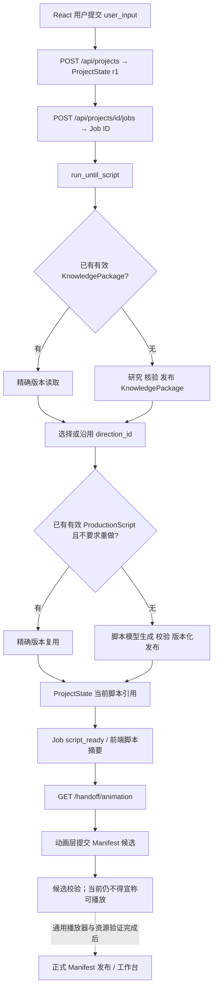

# knowledge-show｜最新 main 主链路审查与收尾修订方案

> **任务类型**：缺陷修复 / 跨层联调 / 状态与文档收尾
>
> **审查日期**：2026-11-14
>
> **审查仓库**：`LIZZYGREAT/knowledge-show`
>
> **审查分支与提交**：`main@16affe408aadc8bafadd74c669f7b0b9b014b2bd`（PR #13 已合并）
> **方案文件**：`docs/tasks/open/backend/主链路收尾修订方案.md`
> **执行状态**：A–F 已在 `fix/main-handoff-correctness` 实施；知识层 83 项、脚本/集成/API 24 项、契约、前端构建、前端单测 11 项、Playwright E2E 24 项和本机 health smoke 均通过。未发起真实模型请求；本分支尚待集成，任务待负责人验收后归档。

## 一、审查结论与边界

本轮 `main` 已经拥有从前端创作输入到正式脚本发布的实际执行链路；上次所缺的最小 HTTP API、任务 JobStore、脚本工作流和前端真实进度页面已经落地。本次无需重做知识研究、脚本生成、API 传输或 React 视觉界面。核心工作是补齐**少量会影响用户真实提交、版本一致性与跨层交接的缺陷**，然后以 Mock 验证整个入口到脚本交付的闭环。

当前已确认的实现事实：

- `frontend/src/App.tsx`、`frontend/src/common/api.ts`、`features/progress/TaskProgress.tsx`：正式页面能够创建项目、启动 Job、轮询任务、展示脚本摘要；独立的流程演示仍保留。
- `backend/src/api/{app,models,task_runner}.py` 与 `backend/src/workflow/jobs.py`：本机 FastAPI、任务状态快照、进程重启中断标记与逐任务 DeepSeek 凭证注入。
- `backend/src/workflow/{service,state}.py`：项目不可覆盖版本、方向/上游变更后的下游引用失效、知识与脚本幂等复用、精确版本读取。
- `backend/src/script/{service,validate,artifacts}.py`：模型生成、有限一次格式或契约修复、产物校验、不可覆盖 JSON 发布。
- `backend/src/workflow/{animation,revisions}.py`：接收动画 Manifest 候选和修订请求，**但尚不发布正式可播放动画，不执行修订**。
- `frontend/src/animation/`：已有固定 PN S01 的独立研发播放器；它不等于能够读取任意 ProductionScript/AnimationManifest 的正式运行时。

仓库 `STATUS.md` 记录 API/脚本/集成测试合计 21 项、公共契约校验和前端 E2E 20 项通过。本次未克隆仓库重跑，真实性以执行本方案后的实际命令输出为准。真实 DeepSeek 脚本生成尚无此次代码版本的付费验收记录。

**本任务重点**：P0 修复错误复用用户需求；P1 修正终态脚本读取与候选/修订的交接正确性；P2 同步文档。动画场景内部、GSAP 模板、美术质量、视频编码及复杂自动修订不在本任务内。

## 二、按实际运行顺序复核链路



**当前真实闭环终点是 `script_ready`。** `validated_pending_runtime` 是动画候选已被接受，不等于成片发布。修订请求 `received` 是收件回执，不等于修改已执行。

### 交接状态核对表

| 边界 | 已实现入口 | 当前状态 | 本次动作 |
|---|---|---|---|
| 用户输入 → ProjectState | `POST /api/projects`、`build_brief()` | 可用 | 修正旧项目与新需求的匹配 |
| ProjectState → 知识 | `generate_knowledge_package()` | 可用 | 不重构 |
| 知识 → 脚本 | `run_until_script()`、精确文件 `ArtifactRef` | 可用，已有幂等 | 做回归，不重复实现 |
| API Job → React 进度 | `GET /api/jobs/{job_id}` | 可用 | 改善终态脚本摘要恢复 |
| 脚本 → 动画负责人 | `GET /api/projects/{id}/handoff/animation` | 已有正式交接 | 保持引用校验 |
| 动画候选 → 正式预览 | `POST .../animation-manifest`、`GET .../preview` | 仅候选校验；预览未就绪 | 修正候选当前性语义；正式发布待动画层 |
| 编辑器反馈 → 修订 | `POST .../revision-requests` | 收件/存储，不执行 | 补必要的实体引用核验；路由与执行后续 |
| 成片下载 | 暂无 | 未实现 | 后续动画/导出任务 |

## 三、P0：必须先修复的问题

### A. 表单新需求可能错误复用旧 ProjectState

**问题性质：确定的代码路径缺陷。**

相关代码：`frontend/src/App.tsx`

当前 `CreationComposer.onChange` 只在 `next.topic !== draft.topic` 时调用 `clearTask()`；`submit()` 却在 `projectId` 非空时跳过 `createProject()`，直接对该项目启动 Job。实际复现路径为：

1. 用户提交主题及特定 `focus`、`creative_mode`、`knowledge_depth`、`must_include`；`POST /api/projects` 已创建项目。
2. 紧接着启动 Job 的 HTTP 请求因断线、后端未启动等原因失败；React 仍保存了该 `projectId`。
3. 用户在表单中只修改 `focus` 或 `must_include`，主题不变。
4. 再次提交时沿用之前的项目 ID，而服务器已有的 `ProjectState.brief` 仍是**修改前输入**。前端显示新偏好，实际模型按旧偏好生成。

刷新后恢复 `projectId` 但 `jobId` 为空时，也有同类风险：`readTaskSession()` 只恢复 `topic`，其它曾提交的创作偏好没有恢复。

**推荐最小修法**：

- 以完整 `toUserInput(draft)` 作为用户需求的真实快照，而非只比较主题。可使用稳定字段序列化比较，也可以直接与从 `GET /api/projects/{project_id}` 获取的原始 `brief.user_input` 比较。
- **快照相同**时允许继续使用原项目；这很重要：如果第一次 `POST jobs` 已在后端启动、只是前端没有收到响应，再次提交应复用同一项目和正在执行的 Job，避免重复模型费用。
- **快照不同**时创建新项目，再启动新任务。当前仓库还没有更新同一项目 `brief` 的正式接口，不要悄悄只修改前端字段，也不要擅自新增通用 Brief 修订系统。
- 恢复未启动 Job 的项目时，应读取原始 `brief.user_input` 并还原对应表单；如果无法获取，明确要求以新项目开始，避免把仅有主题的空白表单当成原始需求。用户偏好可以使用当前已有的 ProjectState API 恢复，API Key 绝不从项目状态恢复。
- `retryCurrentTask()` 仍针对原项目重试，以便重用已发布知识包；不要因 UI 重新渲染或偶发网络异常自动创建新项目。

**建议修改文件**：`frontend/src/App.tsx`、`frontend/src/common/api.ts`（按需增加 `getProject`）、极少量表单数据转换辅助函数、`frontend/tests/e2e/creation.spec.ts`。

**验收**：

- 主题不变但 `focus`、`must_include`、深度或创意模式改变，再次提交时新建项目，服务器收到新要求。
- 项目创建后启动 Job 网络失败，未编辑输入再次提交仍沿用原 `projectId`，后端最多一条有效任务。
- 刷新后未启动任务的项目能准确恢复已提交偏好，或明确使用新项目；不允许静默丢失偏好。
- API Key 不写入 sessionStorage、LocalStorage、ProjectState、Job 文件或日志。

## 四、P1：应该随本轮联调修复的小问题

### B. 终态脚本读取失败没有独立重试

**文件**：`frontend/src/features/progress/TaskProgress.tsx`

目前轮询在 `job.status === "script_ready"` 后停止，且获取脚本前即把 `loadedScriptKey` 设为当前引用。若 `GET /production-script` 临时失败，任务已结束，定时器不再启动；页面只显示读取失败，脚本摘要不能自动恢复。

**修改**：将“读取 Job 状态”和“读取已发布脚本摘要”分成两个状态；脚本读取失败后保留 `script_ready` 以及 ArtifactRef，提供一个可重试的“重新读取脚本”操作（或一次有界本地重试，不重启生成 Job）。加载成功才记录已读版本。`jobId` 变化时重置旧 Job/摘要/错误，避免旧任务短暂占据新任务界面。

**验收**：模拟首次脚本 GET 返回 503、第二次 200；不产生新的 Job、ProjectState 或模型请求，脚本摘要恢复正常。新的 `jobId` 不显示上一次任务的脚本内容。

### C. 动画候选的“当前性”需要与当前脚本绑定

**文件**：`backend/src/workflow/animation.py`、`backend/src/api/app.py`

`AnimationManifestCandidateStore.has_candidate(project_id)` 目前只看项目目录下是否存在 `*-r*.json`。用户切换方向、新脚本发布后，旧候选文件仍存在，`GET /preview` 可能继续显示“动画产物已通过交接校验”，虽然候选引用的旧脚本不再属于当前 ProjectState。

**修改**：保持历史候选不可覆盖，改为按**当前项目的精确** `production_script_ref`、`brief_revision` 识别“仍适用的候选”。可以给 `has_candidate()` 增加当前版本参数，也可以提供 `has_current_candidate(project)`；由于本地目录体量很小，遍历并读少量 JSON 即可，**不需要数据库/索引服务**。不匹配当前引用的候选不影响当前预览提示。若当前脚本已失效，直接返回“等待脚本”或“尚无当前动画产物”。

**验收**：提交合法候选→预览显示仍未就绪但候选有效；切换方向使脚本失效→旧候选仍留存，预览不再将其视为当前成果；发布新版脚本→旧候选不会自动套用。

### D. Manifest 候选验证应满足现行公共契约的关键不变量

**文件**：`backend/src/workflow/animation.py`、`backend/tests/api/test_app.py`。

目前 `_validate()` 已检查 Schema、脚本引用、时间覆盖和本地资源路径，值得保留。但它仍缺少部分已在 `contracts/validate_contracts.py` 明确的关系约束：

- `source_ref.kind="timed_text"` 时，`selectable_elements[].id` 必须复用对应 `timed_text.id`；当前只检查来源 ID 存在。
- 对 `anchor=true` 的脚本事件，应有实际动画内部事件的 `script_event_refs` 关联。当前候选校验未检查这个关系。**注意：有引用不等于已实测播放命中，不能因此宣布可预览。**
- 当前对 `clips` 做排序再验证覆盖，但不会拒绝输入数组自身的乱序；正式消费者可能直接按提交顺序播放。应按公共接口语义要求输入顺序连续。
- 必要的 `clip_id`、`internal_event.id` 唯一性及脚本事件来源一致性可以在已有局部校验中补齐；优先复用当前约定，不为此创建另一整套公共 Schema。

**修改**：只增加这些影响真实交接的检查和负例；保持 `validated_pending_runtime`，不创建虚假的 `ProjectState.artifacts.animation_manifest`。不要为了静态校验追加 LLM 审查或完整渲染测试。

**验收**：错误的文字元件 ID、缺失的锚点关联、乱序片段等被拒绝；有效候选继续通过；没有通用可播放资源时仍为待运行时状态。

### E. 修订请求应核对实体锚点，而不只验证外形

**文件**：`backend/src/workflow/revisions.py`，按需修改 `backend/src/api/app.py` 的依赖注入和测试。

现在 `RevisionRequestStore.accept()` 检查 Schema、项目 revision、目标产物当前版本，但没有进一步检查 `anchors[]` 的 `id` 指向真实对象。按现行契约，`render_element` 应只指向指定版本 `AnimationManifest.selectable_elements` 中确实存在的元件；场景/脚本事件/文字/clip 等锚点也应能在对应目标链上定位。

**修改范围保持很小**：

1. 在接收时按**目标产物精确版本**验证需要实体引用的锚点，至少先落实 `render_element`、`timed_text`、`scene`、`clip` 的可解析性，以及 `time_range` 是否在视频范围内。
2. `render_element` 必须针对 `animation_manifest`，且元件 ID 必须存在；没有已发布且可读取的 Manifest 时应拒绝该修订锚点，不得拿候选文件冒充已发布产物。
3. 不要把当前已接收的 `RevisionRequest` 声称为已经执行；回执仍是 `received`。
4. 如果动画正式发布入口尚不存在，可以先用 Mock 的精确目标文件和注入式解析器覆盖验证，真实联调留待运行时接入。**不必为了验证修改请求而提前实现自动修订 Agent**。

**验收**：合法、存在的元件锚点通过；不存在/跨版本的元件或越界时间被拒绝；`project_state` 上不需要实体定位的普通反馈仍可接收。

### F. 原因诊断与用户错误分层（低成本检查）

**文件**：`backend/src/api/task_runner.py`、`backend/src/api/errors.py`。

目前失败会被映射为友好的用户提示，这是正确的；但任务日志主要只记录 Job ID 和错误类别，研发排查实际原因较困难。建议让研发日志至少保留**异常类型、失败阶段和 Job ID**，并在确保密钥/原始模型输出不泄露的前提下记录经过脱敏的必要信息。对外 Job JSON 保持现有安全码和自然语言，不能直接返回原始 `str(exc)`、Prompt 或 traceback。不要建设复杂日志平台。

**验收**：模拟失败时用户 JSON 与前端不出现 API Key / traceback；本机日志能看出失败阶段和异常类型。

## 五、当前还未完成，但不应误判为本轮代码缺陷

| 后续能力 | 当前事实 | 建议处理方式 |
|---|---|---|
| 一次受控真实 DeepSeek 脚本验收 | 目前仓库未记载本轮实际脚本生成验收 | 在用户明确同意付费后，优先复用真实已发布知识包，仅跑一次脚本生成；记录成功率/耗时/模型调用，不做无意义多轮重复实验 |
| 选择非推荐创作方向的完整用户交互 | 后端已有 `POST /direction`，前端尚无正式方向选择页面；任务通常直接采用推荐方向继续生成脚本 | 维持默认自动流程；若要支持生成脚本前选方向，需要另行决定是否暂停在知识层，避免先付费生成推荐脚本再付费重做。当前不为此设计复杂审核流程 |
| 真正可加载的 Manifest 与多场景动画 | 当前只有 PN S01 独立开发预览；Manifest 仍停在候选状态 | 动画负责人按现有 `GET /handoff/animation` 和 Manifest 契约继续实现，不在本轮后端修复中创建通用播放器 |
| 预览与时间轴编辑器 | 当前 HTML 时间轴仍用演示数据 | 等动画运行时能稳定加载正式 Manifest 后，接入 `element_id`、Seek、bbox 和 `render_element`；不要提前固定轨道类别 |
| 真正的局部修订 | 当前只有 RevisionRequest 接收持久化 | 等精确锚点和真实预览联调后，先做一个最小可执行的局部修改用例；不需要一次覆盖所有反馈类别 |
| 视频导出 | 当前没有正式导出入口 | 动画/导出负责人另立任务；应以正式动画资源为输入，编辑器框选不进成片 |
| 多机/互联网公开部署 | 当前 API 明确是 localhost、单进程模型 | 当前不做认证、任务队列、分布式锁或数据库迁移；未来公开部署前必须重审身份权限与 Origin/Host/凭证边界 |
| GitHub Actions CI | GitHub main 暂无 Actions 运行记录 | 可选建立单个轻量工作流执行 Python 测试、契约和前端构建；不作为本轮主流程阻塞项 |

## 六、具体执行顺序与职责

建议两人各自在短期分支实施，按现有模块归属协调：

| 顺序 | 工作包 | 主要文件 | 建议责任人 | 完成标志 |
|---|---|---|---|---|
| 1 | **A：需求快照与项目复用** | `frontend/src/App.tsx`、`common/api.ts`、前端 E2E | 前端负责人 | 新偏好不会使用旧 Brief；重试原请求不重复新建项目 |
| 2 | **B：脚本摘要终态恢复** | `TaskProgress.tsx`、E2E | 前端负责人 | 脚本 GET 失败后可单独重读、无需重新生成 |
| 3 | **C/D：动画候选的当前性与关键引用校验** | `workflow/animation.py`、`api/app.py`、API tests | 后端集成人，与动画负责人确认 | 旧候选不影响现时提示；非法候选无法获得接受回执 |
| 4 | **E：修订锚点最低限度校验** | `workflow/revisions.py`、API tests | 后端集成人，编辑器负责人确认 | 不接收无法定位的实体反馈 |
| 5 | **F：日志与文档** | `api/task_runner.py`、`STATUS.md`、`README.md`、`docs/work/architecture.md` | 集成人 | 记录现行 main 状态，开发/用户反馈分层明确 |
| 6 | **综合联调** | `backend/tests/`、`frontend/tests/`、`contracts/` | 双方 | 完整无费用 Mock 链路及关键负例通过 |

文档只登记已实现且已验证的事实。`STATUS.md` 当前存在重复的“前端创作界面”段落，而且还把已合并的工作称为“当前工作分支 `feat/non-animation-mainline`”；`README.md` 和 `architecture.md` 也有同类表述。整理成 **`main` 已完成 / 当前待集成 / 后续工作** 三类，去掉重复条目。原有历史试验与已经发布的版本文件不迁移、不覆盖。

### 建议的 Git 流程

```bash
# WSL，项目根目录
# 先检查现有未提交修改，不要使用 reset --hard / clean -fd
git status --short
git fetch origin
git switch main
git pull --ff-only origin main
git switch -c fix/main-handoff-correctness

# 按各可验收工作包分阶段完成修改、测试、commit
# 最后检查
git diff --check
git status --short
```

共享的 `contracts/` 如确需修改，先由双方确认，先更新唯一 Schema/校验与 Mock，再同步消费者。建议**尽量不改公共 Schema**：本次问题主要来自已有实现没有完全兑现现行契约。

## 七、测试与验收矩阵

| 用例 | 当前缺口 | 修订后必须观察到的结果 | 是否允许真实模型调用 |
|---|---|---|---|
| 主题不变，修改 focus/深度/must_include 再提交 | 旧 ProjectState 可能被复用 | 模型实际读取更新后的 Brief；原项目不被静默覆盖 | 否，Fake 测试 |
| 创建项目后 Job 启动响应丢失，原样重试 | 前端恢复边界未覆盖 | 同一项目最多一个运行中 Job，不因网络恢复产生重复成本 | 否 |
| 刷新后恢复未启动 Job 的项目 | 只恢复 topic | 所有偏好正确恢复，或明确启动新项目 | 否 |
| Job script_ready；首次 GET Script 失败 | 无独立恢复 | 不重新调用模型，重读成功后展示摘要 | 否 |
| 旧动画候选 + 改变方向 | `has_candidate` 不看当前脚本 | 旧候选保留历史，但不被认为是当前适用候选 | 否 |
| Manifest 字幕元件 id 与 timed_text 不一致 | 候选校验不完整 | 422 / invalid_input | 否 |
| Manifest anchor=true 丢失内部关联 | 候选校验不完整 | 422 / invalid_input | 否 |
| Manifest clips 提交顺序错误 | 排序掩盖输入不一致 | 拒绝不符合正式时间轴顺序的候选 | 否 |
| 修订请求引用不存在的 element_id | 只核对目标版本 | 请求不被当作合法可定位反馈保存 | 否 |
| 修订请求针对旧 Manifest revision | 需保护精确版本 | 返回版本冲突，不能默默改为最新版 | 否 |
| 脚本失败后继续生成 | 已实现断点复用 | 知识包不再次研究；新脚本引用正确 | 否 |
| 没有可加载 Manifest 的前端 | 应保持待动画状态 | 不能出现“视频完成”、可预览或导出按钮 | 否 |
| 本机异常与密钥安全 | 当前对外已脱敏 | 用户结果不泄露；研发日志能定位失败阶段 | 否 |

### 建议执行命令

```bash
# 仓库根目录，使用当前仓库环境
PYTHONPATH=backend/src .venv/bin/python -m pytest backend/tests/knowledge -q
PYTHONPATH=backend/src .venv/bin/python -m pytest backend/tests/script backend/tests/integration backend/tests/api -q
.venv/bin/python contracts/validate_contracts.py

# 本地 API 最小 smoke（另起终端启动服务）
PYTHONPATH=backend/src .venv/bin/python -m uvicorn api.app:app --host 127.0.0.1 --port 8000
# 另一个终端执行
curl --fail http://127.0.0.1:8000/api/health
# 预期：{"status":"ok"}；不能据此宣称已连接模型

# 前端
cd frontend
npm run build
npm test
npm run test:e2e
```

执行者需报告**实际**通过数、失败日志与环境障碍；Playwright 缺浏览器系统库要区别于业务测试失败。默认使用 Mock/Fake，不要为了验证项目状态、引用或表单复用而请求 DeepSeek。

## 八、结果对照与完成定义

| 检查点 | 修改前的可确认问题 | 完成标准 |
|---|---|---|
| P0 用户需求 | `projectId` 只随 topic 变化清除 | 所有真实偏好变化都对应正确 ProjectState；未变更时可安全重试 |
| P1 终态读取 | Script GET 一次失败后不能独立恢复 | Script Ready 不丢失；重读不重新生成 |
| P1 动画候选 | 只按 project_id 存在文件判断 | 按精确脚本/Brief 判定当前候选 |
| P1 Manifest 合同 | 部分已约定跨引用约束未检查 | 关键语义不一致拒绝，不误报可播放 |
| P1 修订定位 | 对 anchor 只验 Schema 外形 | 已发布目标版本及真实锚点一致 |
| P2 文档 | main 与开发分支描述重复/过期 | 文档与 `main` 实际能力对应，清楚区分候选与正式产物 |
| 主链路不回归 | API、Job、知识、脚本、Mock 联调可用 | 输入→知识→脚本→ArtifactRef→动画 handoff 仍连续通过 |

交付时请提供：变更文件清单、Commit SHA、测试命令和实际结果、一个 Mock 项目从创建到 `script_ready` 的 `project_id/job_id/ArtifactRef` 对照，以及仍未完成的动画/编辑器/导出项。没有真实资源或真实模型验收的部分，只写“待联调”，不得写成已完成。

**本轮收尾后应达到的状态**：普通用户提交的完整偏好与项目状态一致；任务失败或刷新不会引起无意义的重复付费；KnowledgePackage 与 ProductionScript 的精确版本可以可靠地交给动画负责人；动画候选和修订请求有准确、可解释的接收语义。接下来再由动画负责人接入真正的多场景 Manifest、编辑器高亮、局部修订和成片导出。
