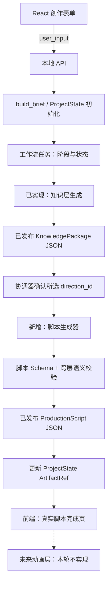
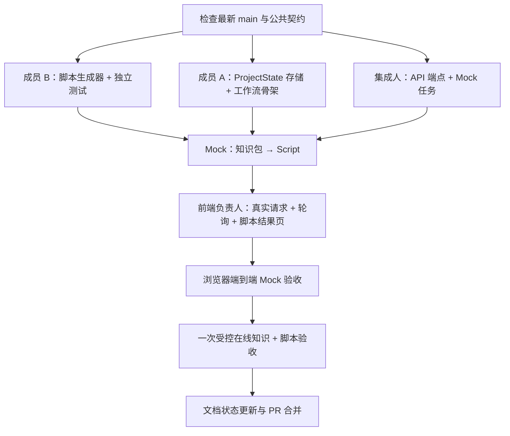

# knowledge-show｜非动画主链路补全与跨层联调执行方案

> **文档用途**：交给 Codex 执行的工程任务方案。当前文件路径为 `docs/tasks/open/backend/主链路详细执行方案.md`。<br>
> **任务类型**：新增功能 / 集成联调 / 接口实现 / 回归测试<br>
> **审查基线**：`LIZZYGREAT/knowledge-show`，`main@ed97bc7ddeb9490cc43bf4ce3dcd141c2830c0ed`，2026-11-14。执行时先核对最新 `origin/main`，以实际代码为准。<br>
> **任务状态**：**进行中**。脚本生成/发布和 ProjectState 到脚本的最小工作流已实现；HTTP API、前端真实任务接入和真实模型验收仍待完成。下述 HTTP 路径等约定仍是建议方案，不能视为已经提供的服务。<br>
> **本轮验收终点**：用户提交主题，系统真正执行知识层与脚本层，持久化 `ProjectState`、已发布 `KnowledgePackage`、已发布 `ProductionScript`，并在前端提供真实进度、结果摘要和可定位版本。**终点是“脚本已完成，待动画制作”，不是“视频已生成”。**

## 一、先确认当前事实与任务范围

### 1. 已经具备，不重复重构

| 已有能力 | 当前路径 / 接口 | 本轮使用方式 |
| --- | --- | --- |
| 创作输入与确认 UI | `frontend/src/features/creation/`、`frontend/src/common/creation.ts` | 复用 `toUserInput()`，保留现有视觉与字段 |
| 本次 API Key 的内存状态 | `frontend/src/features/settings/` | 保留临时持有、不持久化密钥的原则 |
| 知识层完整链路 | `backend/src/knowledge/service.py` | 直接调用 `generate_knowledge_package()` |
| Brief 生成与检查 | `backend/src/knowledge/brief.py` | 复用 `build_brief()`，默认 16:9、165000ms |
| 知识包正式版本发布 | `backend/src/knowledge/store.py`、`service.py` | `{artifact_id}-r{revision}.json`，采用真实保存后的版本 |
| 脚本写作 Prompt v0.3 | `backend/src/script/prompts/script_writer.md` | 作为脚本生成器的写作依据，不擅自改写 |
| 五类 Schema、跨层校验 | `contracts/schemas/`、`contracts/validate_contracts.py` | 保持为权威结构与语义参考 |
| 前端阶段语义映射 | `frontend/src/common/progress.ts` | 沿用用户可理解的进度文本，接入真实事件 |
| 编辑器及元件定位契约 | `contracts/`、`frontend/src/features/revision/` | 本轮**只保留未来交接能力**，不实现编辑器业务 |

审查基线 `main@ed97bc7` 上，`backend/src/script/` 仅有 Prompt，`backend/src/workflow/` 和 API 仍是骨架，前端 `submit()` 使用明确标注的流程演示。当前 `feat/non-animation-mainline` 已增加脚本生成/发布与 ProjectState 持久化、知识包到脚本的最小编排；HTTP API 和前端真实任务接入仍未完成。当前分支脚本 10 项、工作流集成 3 项测试通过，但这不等于本方案要求的完整前后端链路已完成。

### 2. 明确做与不做

**本轮必须完成**：脚本真实生成、脚本 Schema 与跨层引用验证、脚本文件发布、ProjectState 生命周期、最小工作流、前后端真实任务接口、API Key 的安全传递、实际进度与失败反馈、固定样例与一次受控的在线联调、文档更新。

**本轮不做**：动画生成模板、动画场景代码、播放/渲染引擎、`AnimationManifest` 生产、真实 bbox / 高亮、时间轴编辑器正式接线、视频编码/导出、音轨/配音、多用户账号、任务分布式队列、大型审核服务、重写知识层 Research/Creative/Verifier。

`AnimationManifest` 与 `RevisionRequest` 的既有 Schema 不动；尚未能实际生成的视频资源不能创建“已完成”的假引用。本轮可以使用现有动画契约作为**下一阶段的边界说明**，但不能用 Mock 动画冒充产物。

### 3. 首版的产品约束

- **面向普通人**：用户看到“正在了解主题 / 正在安排脚本 / 已准备好脚本”等语义，不显示 Research/Verifier 类名、JSON 解析错误、traceback、调用栈或内部数据库信息。研发侧才查看真正错误、原始事件、调用次数及 token 用量。
- **成本优先**：先用现有 Mock 做联调；真实 API 每个主题仅在必要阶段调用；不为了过度严格的复查反复请求模型或外网。脚本解析失败最多执行**一次有界的局部修复**，不能重跑整个知识层。
- **用户要求保真**：`user_input` 原样保留，`effective` 只按已确定规则补全；显式不支持的画幅在付费请求前拒绝，不能静默替换。
- **一份权威契约**：公开五类产物保持 `contracts/schemas/` 不变。下文新设的 HTTP 请求和任务状态是**传输层约定**，不应偷偷加入 `KnowledgePackage` 或 `ProductionScript`。
- **可随时单独验收**：不等动画层完成。脚本 JSON 合法且引用正确即可形成阶段性成果。

## 二、整体执行链路与交接点



**重点不变量**：

1. 只读取**精确版本**的知识包：`ProjectState.artifacts.knowledge_package == {artifact_id, revision}`。
2. 脚本真实引用同一版本：`ProductionScript.knowledge_package_ref` 与上述引用完全一致。
3. `ProductionScript.direction_id` 与当前 ProjectState 决策一致；无用户决策时采用知识包的 `recommended_direction_id`，由协调器登记为 `system_default`。
4. `ProductionScript.brief_revision == ProjectState.brief.revision`，脚本 `project_id`、时长、知识引用、场景时间都合法。
5. 只有脚本完成校验、原子写入并回读成功后，才能更新 `ProjectState.artifacts.production_script` 并向前端报告 `script.completed`。
6. 即使任务完成，`ProjectState.artifacts.animation_manifest` **仍然缺省**；前端不能把整个视频生成阶段显示为完成。

## 三、建议文件清单与分工

| 路径 | 操作 | 建议负责人 | 职责 |
| --- | --- | --- | --- |
| `backend/src/script/__init__.py` | 新增 | 队友 / 脚本负责人 | 导出脚本层公共入口 |
| `backend/src/script/service.py` | 新增 | 队友 / 脚本负责人 | 输入 KnowledgePackage + ProjectState，生成脚本 |
| `backend/src/script/llm.py` | 新增 | 队友 / 脚本负责人 | 模型请求、输出解析、一次有限修复 |
| `backend/src/script/validate.py` | 新增 | 队友 / 脚本负责人 | Script Schema 与必要跨层校验 |
| `backend/src/script/artifacts.py` | 新增 | 队友 / 脚本负责人 | 不覆盖已有 revision 的版本化 JSON 发布 |
| `backend/tests/script/` | 新增测试 | 队友 | 假客户端、合法/非法脚本、版本与知识引用测试 |
| `backend/src/workflow/service.py` | 新增 | 双方认领一位负责人 | 顺序协调，调用已发布产物，控制阶段结果 |
| `backend/src/workflow/state.py` | 新增 | 协调负责人 | ProjectState 文件读写、版本更新、轻量锁 |
| `backend/src/workflow/tasks.py` | 新增 | 协调负责人 | 当前任务状态、事件序列与中断处理 |
| `backend/src/api/app.py` | 新增 | 集成人 | FastAPI 最小入口、参数校验、错误语义 |
| `backend/src/api/schemas.py` | 按需新增 | 集成人 | **仅传输层**请求与响应，避免超多行 app.py |
| `backend/tests/integration/` | 新增测试 | 集成人 | 各阶段 Mock 串联、API、版本引用测试 |
| `backend/requirements-app.txt` | 新增 | 集成人 | 引用原知识层依赖 + API 运行所需依赖 |
| `frontend/src/common/api.ts` | 新增 | 前端负责人 | fetch、轮询、密钥和任务响应适配 |
| `frontend/src/App.tsx` | 修改 | 前端负责人 | 真正提交并切换到真实任务 |
| `frontend/src/features/progress/GenerationStatus.tsx` | 修改 | 前端负责人 | 接收真实状态；保留独立演示入口 |
| `frontend/src/common/progress.ts` | 小范围修改 | 前端负责人 | 新的脚本阶段成功/失败语义映射 |
| `frontend/src/features/settings/ApiSettingsDrawer.tsx` | 小范围修改 | 前端负责人 | 不伪造连接成功；根据真实 API 行为显示状态 |
| `frontend/vite.config.ts` | 如需修改 | 前端负责人 | 本地 API 代理或同源转发配置 |
| `docs/work/contracts/API.md`、`STATUS.md`、`README.md` | 更新 | 集成人 | 将真实实现登记与状态同步 |

这些为建议文件边界，可少量合并相邻职责，避免“每个函数一个文件”。不因为方案列出文件而强迫创建无实质内容的抽象。**脚本层文件由队友负责；共享 workflow/api 与前端修改先确认负责人，防止双人同时改同一文件。**

## 四、阶段 A：脚本生成器（优先独立完成）

### 1. 第一条可调用入口

建议实现：

```python
async def generate_production_script(
    project_state: dict,
    knowledge_package: dict,
    *,
    llm_client,
    on_event=None,
    export_dir=None,
) -> dict:
    ...
```

接口名称可以由脚本负责人调整，但**传入的知识包、ProjectState 和返回的合法 ProductionScript**必须明确，不能让脚本层依赖知识层 SQLite、Streamlit UI 或原始 ResearchStore 状态。

调用前：

- 校验两个对象基本 Schema、`project_id`、`brief_revision` 和知识包 ID/revision 之间的一致性；选定方向必须真实存在。
- 若 `ProjectState.decisions.direction_id` 已设置，采用该方向；否则采用 `recommended_direction_id`。若自动选取，协调器在脚本开始前写入 `decisions.direction_id` 与 `direction_status=system_default`。**不要在脚本层悄悄改选方向而不更新 ProjectState。**
- 所用素材只能来自选中方向的已核验知识单元及必要依赖。具体 `conditions`、`depends_on`、全局 `required_knowledge_refs` 均作为脚本输入约束；非推荐方向不受推荐方向独有知识的强制约束。
- 第一版优先保证与当前 v0.3 Prompt 的输入一致。**不要未经队友确认，为节省 token 随意裁掉关键上下文。**之后若测得输入显著冗余，再考虑仅保留已选方向、关联知识、限制条件等的上下文投影。

### 2. 使用当前 Prompt，而非复制新提示词

`backend/src/script/prompts/script_writer.md` 是脚本写作权威文件。执行器读取其中的“系统提示词”部分并注入当前 ProjectState 与 KnowledgePackage；不能直接把 Markdown 使用说明、示例占位符当作模型的最终输出。

现有 `backend/src/knowledge/llm_client.py` 的 `generate_json(role=...)` **只接受 `research`、`creative`、`verifier`**，不能直接用 `role="script"` 调用。首版由脚本层添加一层很薄的 `AsyncOpenAI` Responses API 调用即可，复用已安装的 `openai`/`pydantic`/`jsonschema` 包与相同的 DeepSeek 连接配置；不需要为此重构知识层客户端。若双方决定抽取公共底层客户端，应先确认避免跨责任模块产生大 Diff。

脚本生成器应支持**注入假 LLM**，以便离线跑全部脚本/编排单测。控制输出 token 上限与单阶段调用预算；脚本完整 JSON 比知识小段文本长，不要沿用明显不足的短输出上限。模型结构化输出失败时，最多使用已有模型回复进行一次 JSON 修复尝试；失败则记录脚本阶段失败，**保留已生成的知识包，绝不重新跑知识研究**。

### 3. 结构校验 + 跨层语义校验，缺一不可

`contracts/schemas/production-script.schema.json` 用于数据形状；现有 `contracts/validate_contracts.py::check_links()` 是**五份对象的完整关联校验**，不适合直接拿一个新脚本去调用其整个样例检查流程。

建议把真正复用的约束提炼为**小型纯函数**（或在脚本层实现最小必要子集，并用针对性测试保持一致）：

1. 顶层 `project_id`、`brief_revision`、`knowledge_package_ref`、`direction_id` 有效。
2. `direction_id` 存在且与实际选中方向一致；场景引用的知识全部是本方向可使用且已核验的单元；事件级引用是场景级引用的子集。
3. `required_knowledge_refs`（仅真正的全局硬约束）必须在场景的知识引用中得到覆盖；`importance=core` **不能误用为硬约束**。
4. 场景从 0 开始连续覆盖 `total_duration_ms`；与 Brief 目标时长偏差不超过现行契约的 10%。事件、`timed_text` 的偏移/时长合法，字幕不相互重叠。
5. `scene_id`、事件 ID、文字 ID 不重复；`anchor` 可选且必须为布尔，不能为了格式虚构锚点。
6. 脚本不能引入未经核验的知识结论。校验器做可验证的引用/时间约束，不必为每一句文本额外触发新的审核 Agent。

**注意**：通用 JSON Schema 通过不能替代引用检查；同时，不能让仅适用于五份 Mock 的校验入口成为新脚本生成的障碍。建议在 `backend/tests/script/` 用现有 Dice fixture 与一份脚本失败 fixture 精确覆盖边界。

### 4. 元数据由程序赋值，产物不可被覆盖

模型专注产出故事、场景、事件及文本。`artifact_id`、`revision`、`project_id`、`brief_revision`、`knowledge_package_ref`、`direction_id` 等**已有权威来源的字段必须由服务端最终确认/设置**，不得相信模型自报版本。

建议使用确定性脚本 Artifact ID（如以 `PS_` 加合法 `project_id` 派生，注意公共 64 字符长度限制），发布路径：

```text
.local/script-exports/{artifact_id}-r{revision}.json
```

使用与知识层相同的发布原则：同一版本不可覆盖不同内容；保存成功后读回并校验。若上一版本与当前完整脚本内容（含来源引用）相同，允许复用版本；内容或上游知识包版本改变时，发布新 revision。不要用模型返回的固定 `PS001/r1` 覆盖前一次成果。

**阶段 A 验收**：传入同一 `ProjectState` 和已发布 `KnowledgePackage` 的固定数据，使用 Fake LLM 可产出合法 `ProductionScript`、正确保存，第二次相同输入不覆盖版本；错误场景不会发布脚本。**这一步不需要协调器、前端或在线 API。**

## 五、阶段 B：最小工作流协调器和 ProjectState 持久化

### 1. ProjectState 的初始化、发布与更新

使用 `build_brief(user_input)` 创建真实 Brief，随后构建符合 `project-state.schema.json` 的对象：

```python
project = {
    "project_id": project_id,
    "revision": 1,
    "brief": build_brief(user_input),
    "decisions": {},
    "artifacts": {},
}
```

这里的 `project_id` 是协调器产生的合法 ID，禁止依靠前端的主题字符串作为 ID。首版可用 `P_` + UUID 缩写；并发创建时要防止重复。

为了控制依赖和开发时间，建议**使用 `.local/projects/<project_id>/` 下的版本化 JSON 文件**保存 ProjectState 和最小任务记录，使用临时文件 + 原子替换、同项目单任务锁，暂不新建 Redis/Celery 或另一套复杂数据库。知识层原有 SQLite 保持内部使用，不让协调器依赖其私有表结构。

每次**真正更新共享状态**时，将 `ProjectState.revision` 增加 1；`brief.revision` 只有需求变化时才增加。发布知识包或脚本时，应在精确版本文件已保存并通过回读后才更新 `artifacts.*`。不得把仍处于生成中的版本写入对外状态。只改变方向时修改 `decisions`，不强制重新运行知识层。

建议采用“先验证当前项目版本再更新”的最小乐观并发控制，避免用户改了需求后旧任务反向覆盖新状态。同一项目不能同时重复启动两条生产任务，API 返回可理解的冲突结果即可。

### 2. 编排服务应明确分段失败

建议 `workflow/service.py` 提供一个统一入口：

```python
async def run_until_script(project_id: str, *, options, on_event=None) -> dict:
    # 真实实现由此处的协调器拥有；以下是顺序示意。
    project = state_store.load(project_id)
    kp_ref = project["artifacts"].get("knowledge_package")
    if kp_ref is None or options.force_knowledge:
        package = await generate_knowledge_package(
            project_id, project["brief"],
            run_options=options.knowledge_options,
            on_event=on_knowledge_event,
        )
        kp_ref = exact_ref(package)
        project = state_store.publish_knowledge_ref(project, kp_ref)
    else:
        package = read_exact_knowledge_json(project_id, kp_ref)

    project = ensure_selected_direction(project, package)
    script = await generate_production_script(
        project, package,
        llm_client=options.script_client,
        on_event=on_script_event,
    )
    project = state_store.publish_script_ref(project, exact_ref(script))
    return {"project": project, "knowledge_package": kp_ref,
            "production_script": exact_ref(script)}
```

**上述函数与 options 字段均为建议接口，当前仓库中不存在。** 真实代码还需处理版本并发检查、发布失败和异常清理，顺序不应反过来。

最重要的是节约成本：

- `ProjectState.artifacts.knowledge_package` 指向仍可用的已发布版本时，默认直接复用，不再收费重跑知识研究。
- 模型只在没有有效知识包、需求确实改变或用户明确选择“重新探索”时重新研究。
- 脚本失败后重试：复用上次已发布知识包，仅重新生成脚本。
- 脚本重新生成时，如果用户只是改了所选方向，先更新 `decisions`，再从同一知识包生成脚本。
- 不引入固定的“每个阶段重复审查三轮”或无条件重试。

### 3. 任务运行状态与跨阶段事件

建议首版任务状态只需要：

```text
queued / running / completed / failed / interrupted
```

阶段只需要：

```text
knowledge / script / ready_for_animation
```

其中 `completed` 表示**本次非动画任务已产出合法 ProductionScript**。它不表示视频已做好。`ready_for_animation` 是可交付的业务终点，不触发不存在的动画生成。

任务记录维护 `run_id`、`project_id`、`phase`、`status`、事件序号与可公开的时间信息，以及真实诊断日志的位置。API 对用户返回**语义化的进度消息**；原始异常、Research/Verifier 内部信息、token 计量、模型原始输出和追踪记录只允许在研发诊断中查看。

可以采用**同一 FastAPI 进程内的有界异步任务 + 小容量任务状态记录**。不要为了首版引入消息队列。服务重启后：未完成任务标记 `interrupted`，已发布知识包和脚本仍保留；重试可复用合法产物，不伪造自动续跑。注意实际异步任务应保留 Task 引用并记录最终异常，避免协程被丢弃或错误被吞掉。

## 六、阶段 C：前后端最小 API（建议 FastAPI，同进程运行）

### 1. 使用范围与依赖

建议新增 `backend/requirements-app.txt`，引用已有 `requirements-knowledge.txt` 并加入 `fastapi`、`uvicorn`。保持**一个本机后端进程**，由它调用 Python 知识层与脚本层。不需要微服务或 Node 代理再启动多个模型服务。

首版本地环境只监听 `127.0.0.1`，CORS 只允许本机实际使用的 Vite 来源（例如 `http://127.0.0.1:5173`，如需 `localhost` 再明确添加），仅允许必要的请求头。若之后公开部署到多用户网络，必须另行处理鉴权与租户隔离；本次的本地开发假设不等同于互联网安全部署方案。

### 2. 首版 HTTP 接口（建议，**尚未实现**）

| 方法与路径 | 输入 | 输出 / 语义 |
| --- | --- | --- |
| `GET /api/v1/health` | 无 | 服务是否可访问；**不代表 DeepSeek 密钥有效** |
| `POST /api/v1/projects` | `{ "user_input": {...} }` | 创建 ProjectState，返回 `project_id`、当前 `revision` |
| `GET /api/v1/projects/{project_id}` | `project_id` | 当前完整合法 ProjectState（可由 UI 再作语义化展示） |
| `POST /api/v1/projects/{project_id}/runs` | `{ "mode": "real", "force_knowledge": false }`；本次密钥通过请求级头部 | `202 Accepted` + `run_id`；任务异步执行至 Script |
| `GET /api/v1/runs/{run_id}` | `run_id` | `phase/status`、语义事件、已发布 ArtifactRefs、非技术性失败原因 |
| `GET /api/v1/projects/{project_id}/script` | 已发布脚本的精确引用或当前 ProjectState | 返回正式 ProductionScript（给后续接入或研发检查用） |

这是**本次建议锁定的传输接口**，而不是现有公共产物 Schema 的新增字段。实现后在 `docs/work/contracts/API.md` 登记，不同时维护第二套 Schema 的 `KnowledgePackage` 字段。

创建项目示意：

```http
POST /api/v1/projects
Content-Type: application/json

{
  "user_input": {
    "topic": "为什么两枚骰子的点数和为 7 最常见？",
    "creative_mode": "visual_explain",
    "knowledge_depth": "intro"
  }
}
```

启动真实任务示意：

```http
POST /api/v1/projects/P_example/runs
Content-Type: application/json
X-DeepSeek-API-Key: <仅本次任务的用户密钥>

{"mode":"real","force_knowledge":false}
```

`<仅本次任务的用户密钥>` 是文档占位符，禁止复制真实密钥进 README、提交或测试快照。

轮询返回示意：

```json
{
  "run_id": "RUN_example",
  "project_id": "P_example",
  "phase": "script",
  "status": "running",
  "message": "正在安排讲述顺序与场景节奏",
  "events": [
    {"seq": 1, "stage": "knowledge", "kind": "completed", "message": "知识方向已准备好"},
    {"seq": 2, "stage": "script", "kind": "started", "message": "正在安排讲述顺序与场景节奏"}
  ],
  "artifacts": {"knowledge_package": {"artifact_id": "KP_example", "revision": 1}}
}
```

示例数据仅说明新传输层的设计格式，**不是当前实际存在的服务返回**。

### 3. API Key 的实际使用与成本控制

前端现有 `EphemeralKeyContext` 只在内存中保留密钥，知识层当前 `load_settings()` 默认从 `.env` 读取密钥。正式集成时需要**任务作用域**配置：

- 前端在用户明确发起真实生成时才发送密钥，尽量放请求头，不写进 URL、项目 JSON、run 事件、持久化日志、错误报文或调试输出。
- 服务端创建本次 `DeepSeekClient` 与 `DeepSeekSearchClient`，将它们注入知识层的 `RunOptions.clients`；脚本层复用本次任务的连接配置。**该知识层注入点当前真实存在**。
- 被外部注入的客户端不会由知识层自动关闭；由 API/协调器在 `finally` 中负责清理，避免连接泄漏。不能因为 `RunOptions.clients` 可注入就假设其生命周期已自动管理。
- 用户密钥不做本地持久化；异步任务需要在同一进程内暂时持有，直到任务完成后释放。服务重启则任务中断，用户需再次授权。
- 不在页面加载或每次输入时调用模型。API Key 连接测试不是生成前的必需付费步骤：可以先显示“已配置、未验证”，真实生成时首次验证；若保留“测试连接”，必须用户主动点击且使用最小成本的调用，不能伪称已验证。
- 真实失败只向用户呈现“密钥无效 / 网络暂不可用 / 生成未完成”等**经过分类的自然语言**，研发人员通过关联的 run_id 查看诊断；不得把模型响应/异常详情直接渲染在页面上。

### 4. API 异常和状态

只实现必要错误：`400/422` 输入或无效画幅，`404` 项目/产物不存在，`409` 同项目运行中或状态版本已变化，`401/403` 无效密钥（由真实上游错误按需要映射），`429/503` 上游限制/暂不可用，`500` 内部失败。不要把 DeepSeek HTTP 原始异常、token、隐私内容复制到响应正文。

用户点击“开始”后 API 应尽快返回 `202`，耗时模型调用发生在任务内。建议前端以**约 1 秒的轻量轮询**获取任务状态；首版无需 WebSocket、SSE、Redis。任务完成或失败后停止轮询，组件卸载时取消前端网络订阅。若后续确实存在大量并发再调整传输方案。

## 七、阶段 D：React 前端接真实任务，演示模式仍保留

### 1. 页面状态重新划分

当前 `App.tsx` 只区分 `landing / composing / demo`；建议在不改变现有视觉结构的前提下加入真实任务页面，例如 `generating` 和 `script_ready`。不要重做已经通过视觉验收的 Landing、枝叶装饰和输入排版。

实际交互顺序：

1. 用户输入主题，点击确认，前端调用已有 `toUserInput(draft)`。
2. 若没有本次生成的密钥，显示“先配置本次 DeepSeek 连接”，不跳到假的成功页。开发者仍可单独进入明确标注的演示模式。
3. `POST /projects` 创建项目；`POST /runs` 用任务密钥启动生成，保存 `project_id`、`run_id` 到当前前端状态。**API Key 不进入 sessionStorage/localStorage**。
4. 进入真实生成页，轮询 `/runs/{run_id}`，根据事件显示知识探索与脚本编排进度。
5. 用户看到的进度只采用后端**已语义化**的阶段事件，例如“正在补充关键知识”“正在构思讲述方式”“脚本已准备好”。不展示 JSON、Agent 内部步骤、调用额度或 traceback。
6. 知识层 `delivery.completed` 才算知识阶段完成；脚本 Schema、保存、回读并发布后才算脚本完成。
7. 任务完成后进入**“脚本方案已完成”**页面，可展示核心内容、场景概览和选定创作方向，提供“返回修改输入”等操作。动画阶段标为“尚未接入”，不出现可播放视频、不开放正式编辑器/导出按钮。
8. 若某阶段失败，停止进度动效，保留用户输入及当前已完成产物；给出可操作的“重试当前步骤”，脚本失败默认复用已有知识包。

真实任务页面与手动模拟 `GenerationStatus` 必须有明确标签，不能让用户把演示误当作真实运行结果。`frontend/src/common/progress.ts` 的语义映射可复用，但不能继续用固定 `sequence` 作为生产事件源。

### 2. 方向选择：首版不增加阻塞式页面

当前 ProjectState 已有 `decisions.direction_id` 和推荐方向。首版可**默认使用推荐方向继续制作脚本**，无需强迫普通用户每次在多个知识候选之间先做选择。若已有候选展示控件或明确用户指令，可采用合法方向 ID 更新决策；不为此开发复杂选题工作台。真正选择其他方向时，只从**同一已发布知识包**生成脚本，不重复研究。

### 3. 结果展示边界

普通用户看到“选定方向、核心问题、脚本场景和预计时间”。开发者可以通过后端本地诊断查看真实 `ProductionScript` JSON、KnowledgePackage、原始 run 事件与模型调用统计。脚本未完成时不得提供“成品视频预览”；仅把当前输出称为“脚本/内容计划”。

## 八、阶段 E：验证、测试和有限真实联调

### 1. 先离线，再做一次真实成本可控的检查

| 验收层级 | 测试方式 | 具体期望 |
| --- | --- | --- |
| A1 脚本 Schema | 现有骰子 ProjectState + KnowledgePackage，Fake LLM 返回脚本 | 顶层字段、场景时间、引用和锚点通过 |
| A2 脚本错误 | 假数据：未核验 K、跨方向 K、非法 ID、越界时间、重叠字幕、错误 revision | 在发布前失败，且说明实际问题 |
| A3 版本保护 | 同内容生成两次、改知识包 revision、故意冲突写入已发布文件 | 不覆盖既有版本；来源变化可追踪 |
| B1 状态流程 | Mock 知识包 + Mock 脚本，真正走协调器 | 项目由 revision 1 更新到可指向知识包/脚本的正确版本 |
| B2 脚本失败重试 | 知识成功，脚本模型第一次返回非法 JSON | 不重新运行知识层；一次修复后成功，或仅脚本失败 |
| B3 并发与中断 | 同项目重复提交、模拟服务重启 | 不出现双任务写同一个项目；中断不伪造成功 |
| C1 API | TestClient 或相应工具调用创建、启动、轮询、获取脚本 | 状态真实转移；输入错误/缺文件/冲突清晰 |
| C2 密钥 | 检查请求、响应、ProjectState、持久化 run 和日志 | 不出现真实 Key；无密钥不给用户假连接成功 |
| D1 前端联调 | Chromium 提交 Mock 主题并轮询 | 从真实接口得到知识、脚本状态；不出现“动画已完成” |
| D2 前端失败 | 注入上游失败、脚本格式失败、网络断线 | 停止动效，用户看到自然提示，输入不丢失 |
| E1 真实 API | 选择一个小范围已熟悉的主题，显式授权 API 费用 | 真正的 KnowledgePackage + ProductionScript 都能保存并回读 |

特别注意：`contracts/examples/` 五个文件是**同一个骰子项目**的连贯固定样例；不要用任意主题的 Mock KnowledgePackage 搭配骰子 Script，再把这种不匹配的数据称为真实端到端成功。离线测试可以统一使用这些关联样例，必要时由 Fake LLM 根据当前输入补齐**正确的项目、版本、方向引用**。

### 2. 建议命令（**新增命令在实现后方可运行**）

在 WSL 仓库根目录：

```bash
# 先确认现有能力不回归
PYTHONPATH=backend/src .venv/bin/python -m pytest backend/tests/knowledge -q
.venv/bin/python contracts/validate_contracts.py

# 新增后执行：脚本、协调器、API 集成检查
PYTHONPATH=backend/src .venv/bin/python -m pytest backend/tests/script -q
PYTHONPATH=backend/src .venv/bin/python -m pytest backend/tests/integration -q

# 新的依赖文件创建后安装、启动本地服务
.venv/bin/python -m pip install -r backend/requirements-app.txt
PYTHONPATH=backend/src .venv/bin/python -m uvicorn api.app:app --host 127.0.0.1 --port 8000

# 前端构建与 UI 测试
cd frontend
npm ci
npm run build
npm test
npm run test:e2e
```

预期：知识层原有测试、公共契约校验、脚本新增测试、端到端 Mock API 测试和前端构建/交互均通过。本方案不包含动画工作台接线；当前仓库另有固定脚本样例的 P0 独立预览及对应 E2E，用例通过不代表生产脚本流程已连接动画或工作台。

真实 API 检查建议仅做一次受控主题，输出**实际耗时、调用次数、tokens（若接口返回）、文件名和脚本验证结果**。不要为追求“更多测试覆盖率”重复花费模型费用。出现格式错误先根据真实失败原因修一个点、再只重试失败阶段。

### 3. CI 最小化（可在 P0 完成后顺手加入）

增加一个简单 GitHub Actions workflow：检查 Python 知识/脚本/集成测试、契约脚本、前端 `npm run build` 和 `npm test`。CI 只使用 Fake LLM/Mock，不注入 DeepSeek Key，不做真实研究，不要求浏览器 E2E 在每次小改动都跑。原有 CI 目前无主线运行记录，添加时以实际最小稳定检查为准。

## 九、执行顺序、双人依赖与 Commit



建议划分为**四个可独立 PR**，避免两个 Agent 同时改 `App.tsx` 或 `backend/src/script/`：

1. `feat/script-generator`：脚本客户端、Script 校验、正式 JSON 发布、`backend/tests/script/`。
2. `feat/workflow-api`：ProjectState 持久化、协调器、最小 FastAPI、集成 Mock 测试。
3. `feat/frontend-real-generation`：前端调用 API、进度与脚本结果页。依赖第 2 项接口，提前用固定模拟 HTTP 响应开发。
4. `test/cross-layer-script-handoff`（或最后一个集成 PR）：联调、少量修复、状态与接口文档、可选轻量 CI。

具体名称可由双方简化。共享层的 API 约定先在 `docs/work/contracts/API.md` 写明并让队友确认后实现；不需为此改动五类产物 Schema。脚本 Prompt 如要修改，应由脚本负责人执行或确认。

基础 Git 操作：

```bash
git status --short
git fetch origin
git switch main
git pull --ff-only origin main
git switch -c feat/script-generator    # 仅脚本负责人示例，其他人使用自己的任务分支

# 每完成可独立验证的一个阶段，选定文件、检查后提交
git add <本阶段明确修改的文件>
git diff --cached --stat
git diff --cached
git commit -m "feat(script): generate and publish production scripts"

# PR 前同步当前 main
git fetch origin
git merge origin/main
git diff --check
```

**不能自动执行** `reset --hard`、`clean -fd`、强推、删除队友分支或越过负责人合并 main。各 PR 的描述需列出实际实现、运行过的命令及结果、接口变更和仍待动画层的事项。

## 十、结果对照审查与交付标准

| 对照项 | 本次开始前 | 完成后必须看见的结果 | 证据 |
| --- | --- | --- | --- |
| 前端发起生成 | `submit()` 只提示服务未接入 | 用户点击后产生真实 `project_id` 与 `run_id` | 浏览器网络记录 + UI |
| ProjectState | 只有 Schema/Mock | 能真实创建、持久化、版本更新并精确指向产物 | 集成测试 + 实际文件 |
| 知识层 | 可独立运行 | 被协调器复用，不改变内部语义 | 原测试 + 协调器 Mock |
| 脚本层 | Prompt + 历史 JSON | 真正调用模型，生成经过校验的 ProductionScript | 脚本测试 + 受控真实试验 |
| 脚本版本 | 无运行时发布 | 精确来源、不可覆盖、保存后回读 | 版本与冲突测试 |
| 进度 | 手动演示事件 | 来自实际任务，异常能停止，用户看不到技术日志 | 前端 E2E + API |
| API Key | 内存 UI，无真实连接 | 只供本次请求、不持久化、不误报连接成功 | 配置/日志检查 |
| 阶段产物展示 | 无实际结果 | 可以查看真实脚本核心概要，明确动画未接入 | 浏览器验收 |
| 跨层契约 | 静态样例能校验 | 新生成脚本对当前知识包和项目决策引用一致 | 综合校验测试 |
| 动画层 | 未实现 | **保持原状，不假装已经完成** | `animation_manifest` 不被伪造发布 |

### Codex 交付报告必须逐项回答

- 本次实际修改了哪些文件，各属于哪个阶段/负责人？
- 脚本模型调用是否真实运行过？调用次数、耗时、token 计量与脚本文件路径是什么？
- 原知识层测试、公共契约、脚本测试、集成测试、前端构建和 E2E 各自**实际**通过多少项？
- 用户点击开始后是否会真实生成，并在页面中区分“脚本已完成”和“视频已完成”？
- 脚本失败重试是否复用既有知识包，避免无意义重复付费？
- API Key 是否仅保留在本次会话/任务，不进入持久化数据与普通用户报错？
- 哪些事项仍因动画层未实现而待对接？是否有新公共 Schema 变更需要队友确认？
- 给出 Commit/PR、剩余阻塞和最后的人工验收记录，不用“代码已写”代替运行证据。

## 十一、接到动画层时需要交付什么（仅接口占位）

本轮最终应能提供：

```text
ProjectState（合法、持久化）
  ├─ brief.effective.aspect_ratio = "16:9"
  ├─ decisions.direction_id = 有效方向
  ├─ artifacts.knowledge_package = 精确已发布版本
  └─ artifacts.production_script = 精确已发布版本

KnowledgePackage → {artifact_id}-r{revision}.json
ProductionScript → {artifact_id}-r{revision}.json
```

这就是未来动画层需要读取的规范输入。**本轮不创建 AnimationManifest、不设计动画 DSL、不实现绘制、播放、编辑器预览和导出**。未来接入只需要动画层根据 `ProductionScript` 及现有五类契约产出 Manifest，工作流再增加该阶段，不需要让知识层和脚本层重新设计。

**最终决策**：当前最值得投入的不是再扩展 Research/Verifier 或增加第二套接口，而是让用户的一次真实提交在现有仓库里生成**一个可复现、可版本定位、可交给动画层制作的正式脚本**。这条链跑通后，动画层可以并行接入；此前的所有“完整视频已生成”表述都不成立。
