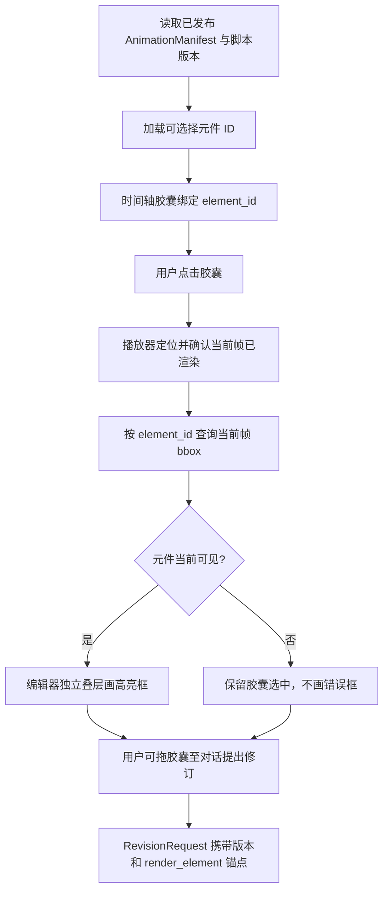

# knowledge-show｜main 合并审查与编辑器元件定位契约修订方案

> **任务类型**：最新主分支审查 / 共享契约小范围扩展 / 编辑器对接准备
> **审查仓库**：`LIZZYGREAT/knowledge-show`
> **审查基线**：`main@d695dd26bd0929719216c3ec406e1a5d3111a57e`（2026-11-14）
> **建议仓库位置**：`docs/tasks/open/frontend/编辑器元件身份与预览定位契约修订方案.md`
> **状态**：待执行；当前仅审查与设计，未修改仓库、运行联调或合并 PR。

## 一、合并完成情况及真正需要处理的问题

最新 `main` 已合并：

- **PR #6**：`ProductionScript.scenes[].events[].anchor` 可选布尔字段，v0.3 脚本写作提示词及相应契约校验。前次提出的 `anchor` Schema 冲突已经解决。
- **PR #7**：React / TypeScript / Vite 的创作入口、偏好输入、API Key 设置抽屉、流程演示。当前仍未接正式生成 API，演示不会伪造视频完成。
- **PR #8**：独立时间轴编辑器原型，包括双模式时间轴、缩放/拖动、组件胶囊、右侧对话和嵌入式预览。目前是 `frontend/src/features/revision/editor-layout.html` 与 `serve.py`，尚非 React App 的正式路由或可发布编辑器。

已确认的缺口及取舍：

| 等级 | 观察到的事实 | 决策 |
|---|---|---|
| **P0** | `editor-layout.html` 用 `track:idx` 生成胶囊 `data-id`，会随排序/重建改变，不是脚本或动画层真实元件 ID；且冒号不符合公共 Schema 的 ID 正则 | 建立稳定 `element_id` 身份与引用，不再拿 `track:idx` 当跨层主键 |
| **P0** | 选中时间轴只改变胶囊样式，尚无元件屏幕位置查询与预览框选 | 新增渲染器当前帧包围盒能力；编辑器独立绘制高亮 |
| **P0** | 当前 `AnimationManifest` 仅有 `clips`、`internal_events` 等，`RevisionRequest.anchors[].kind` 也没有“渲染元件” | 用最小可选字段与一种锚点语义打通身份与修订反馈 |
| **P1** | 编辑器演示使用硬编码 `CHAPTERS`/`ANIM_TRACKS`，嵌入的 `/mv` 来自独立 `world.execute(me)` 项目；未读取真实 `AnimationManifest` | 保留为原型，不宣称正式联通；今后按已发布产物替换演示数据 |
| **P1** | `serve.py` 的本地预览服务器绑定 `0.0.0.0` | 默认改为 `127.0.0.1`；需要局域网访问时由开发者显式配置 |
| **P1** | `README.md`、`STATUS.md`、`frontend/README.md` 仍描述 PR #7 为未合并的前端分支，未充分反映 PR #8 | 只更新事实状态，区分“原型已合并”和“功能已可供用户使用” |
| **P1** | PR #2（强制锚点语义）、PR #3（脚本提示词）仍处于 Open，但 #6 已集成可选锚点和所需提示词 | 与队友核对，旧 PR 不原样合入；可关闭或重新明确剩余改动 |

**不改**：Research / Creative / Verifier、知识层搜索和成本逻辑、首版 16:9、已有 `anchor` 语义、历史 9:16 trials、动画审美与视觉风格。当前没有必要添加新的 Agent、数据库、渲染框架或独立网络服务。

## 二、需求语义：选中一项，定位当前画面中的一个逻辑元件

在编辑器中点击时间轴上的一个胶囊，系统应：

1. 取得它引用的**稳定元件 ID**和相应动画产物版本。
2. 将播放位置调整到该元件可展示的时刻，或保留用户当前播放位置。
3. 等预览完成该帧渲染后，用该 ID 查询此时在**视频内容坐标系**中的可见包围盒。
4. 在编辑器预览外层叠加一个不可交互的选中轮廓；若此时不可见，则保持时间轴选中状态，并给自然的“不在当前画面中”反馈，不画假框。
5. 当时间轴拖动、播放推进、视口缩放、窗口变化时更新或清除框；切换元素时取消旧框。
6. 高亮属于**编辑器 UI**，不得绘制进产出的实际视频帧，不进入视频导出流程。

**这里的元件是编辑器可选中的逻辑对象**，例如一整段字幕、一个标注、一个结结构或一组作为整体操作的粒子。无需给每颗粒子、每个关键帧、每个 DOM 子节点都生成公共 ID。

必须区分以下四种身份：

- `scene_id`：脚本场景；
- `script_event.id`：脚本中一次语义变化 / 时间事件，`anchor` 只是事件时间属性；
- `clip_id`：动画片段；
- **`element_id`**：画面中可选择、可定位的逻辑元件。

它们可能有关联，但不要求一一对应，**不得拿事件或 clip ID 随意替代元件 ID**。一个元件可以跨多个事件或片段存在；时间轴可以有多个展示区间指向同一元件。

## 三、稳定 ID 的产生及生命周期

### 1. 字幕 / 脚本现有文字

由 `ProductionScript.scenes[].timed_text[].id` 作为权威 ID，动画层和时间轴直接复用。例如脚本中 `T01` 的字幕，渲染登记和编辑器胶囊中的 `element_id` 也都是 `T01`。

无论前端把它显示在“字幕轨”“文字轨”还是其他轨道，身份保持一致。轨道名只影响界面排布，不能参与计算元件主键。

### 2. 动画层新增元件

由动画层在**创建逻辑对象时**分配 ID，建议采用 `EL_` 前缀以规避与现有脚本 ID 冲突，例如 `EL_S01_BARRIER`。同一逻辑对象跨场景/片段持续出现时尽量保留原 ID；对象移动、缩放、重排或时间轴胶囊重建不能改变 ID。真正新增对象分配新 ID，删除后不在同一已发布产物内复用。

同一 `AnimationManifest` 版本内 ID 全局唯一，符合公共标识格式 `^[A-Za-z][A-Za-z0-9_-]{0,63}$`。**不使用** `subject:3`、`caption:1`、数组序号、DOM 顺序、CSS 类名或随机每帧 ID 作为跨层主键。

不同产物版本的 ID 不能脱离版本单独解释；编辑器选择和反馈应始终携带准确的 `AnimationManifest` `{artifact_id, revision}`。未改变的逻辑元件在新版本里应优先复用相同 ID，以便定位增量修订，但不能假设旧 ID 一定存在。

## 四、推荐的最小公共机器契约变更

> 这部分属于 `contracts/` 共享接口，需先与脚本/动画/编辑器负责人确认语义，再由同一任务同步 Schema、示例、校验与消费者。字段名称以下列约定为建议；一旦双方确认，就以 Schema 为唯一权威，不维护另一套运行时 JSON 定义。

### A. `AnimationManifest` 增加可选的可选择元件索引

**文件**：`contracts/schemas/animation-manifest.schema.json`

新增**可选**顶层数组 `selectable_elements`，只记录真正需要被时间轴/编辑器定位的逻辑对象：

```json
"selectable_elements": [
  {"id": "T01", "source_ref": {"kind": "timed_text", "id": "T01"}},
  {"id": "EL_S01_BARRIER"}
]
```

约定：

- `id` 必填，沿用现有公共 ID 正则，数组内唯一。
- `source_ref` 可选；仅描述来源身份，建议首版只支持 `kind: "timed_text"` 与 `kind: "script_event"`，`id` 指向**已经存在**的对应 ProductionScript 对象。来源不等于轨道类型。
- 以 `timed_text` 为来源的渲染文字，`selectable_elements[].id` **必须等于**被引用的 `timed_text.id`，避免产生第二套字幕 ID。
- 动画层新增对象可以没有 `source_ref`，直接使用自己的稳定 `EL_...` ID。
- `selectable_elements` **不加入** `AnimationManifest` 的必填字段；不具备精细编辑能力的历史 Manifest 和 Mock 仍然合法。没有列入的对象不保证能被精确选中。
- 不添加 `track_type`、`category`、`particle/caption/annotation` 等固定轨道枚举。
- **不把每帧 `bbox` 写入 Manifest**。布局位置和包围盒会随时间变化，归渲染器运行时查询。

`source_ref` 的取值仅为建立必要的**上游语义引用**。若脚本事件对应多个画面对象，允许多个 `element_id` 关联同一个 `script_event`，不得强行一对一。

### B. 预览渲染器暴露元件定位能力，不新增后端业务 API

该能力是**播放器/动画运行时与编辑器之间的本地接口**，不属于静态 `AnimationManifest` JSON 字段。可用如下 TypeScript 形状作为参考：

```ts
interface FrameBounds {
  x: number;       // 以视频画面宽度为 1 的相对位置
  y: number;       // 以视频画面高度为 1 的相对位置
  width: number;   // 非负，x/y 允许在画面外
  height: number;
}

interface PreviewInspection {
  seekAndWaitForFrame(timeMs: number): Promise<{ renderedTimeMs: number }>;
  getElementBounds(elementId: string): FrameBounds | null;
}
```

**接口语义比方法名重要**：

- `getElementBounds()` 返回**当前已渲染帧**上的逻辑对象包围盒，坐标是 16:9 视频内容坐标归一化后的值；`x/y` 可能超出 `[0,1]`，编辑器叠层按内容边界裁切。
- 对旋转/倾斜元件，返回轴对齐的外包矩形即可；组合元件可返回子对象可见部分的合并范围。不要求多边形、逐像素轮廓或每个粒子的单独框。
- 未出现、已消失、不可见、宽高为零或当前帧没有可定位对象时，返回 `null`；编辑器不凭历史框位置假装选中成功。
- `seekAndWaitForFrame()` 的完成表示目标帧真正可查询，不能在 iframe 尚未更新时读取上一次画面的坐标。
- 播放中跟随帧更新时间，只对当前选中的少量元素求包围盒；不预计算整个视频所有时间点，不要求额外模型调用。
- DOM/SVG 元件可计算可见变换后的元素边界；Canvas/WebGL 元件由运行时保存其逻辑对象的变换与几何信息，统一折算为视频内容坐标。不要强迫动画代码全部改成 DOM。
- 编辑器根据真正的视频内容显示区域完成归一化坐标 → 预览像素坐标的映射，处理缩放和黑边；轮廓作为独立的 `pointer-events: none` 覆盖层绘制。
- 正式渲染/导出模式不创建或不启用该覆盖层，因此输出视频永远不带编辑框。

当前 HTML 原型直接访问 iframe 的 `__preview`；正式接入时可用同源适配器，跨源/独立进程时可用带来源检查的 `postMessage`。**契约只规定上述能力，不锁定通信方式或 HTTP 路径。**

### C. `RevisionRequest` 新增可选元件锚点类型

**文件**：`contracts/schemas/revision-request.schema.json`

在 `anchors[].kind` 增加 `render_element`，按其他实体锚点一样要求 `id`：

```json
{"kind": "render_element", "id": "EL_S01_BARRIER"}
```

执行语义：

- 选中胶囊后生成修订请求时，`target_artifact` 应指向**当前被预览的精确 AnimationManifest 版本**，`anchors[].id` 采用元件 ID，不采用时间轴的轨道序号。
- 可以同时携带原有 `time_range` 锚点；用户要求“把这里变慢”或“改这块文字”由协调器结合 `source_ref`、现有脚本关系和用户反馈决定路由给脚本层或动画层，不让用户选择内部 Agent。
- 校验器检查 `render_element` 引用确实存在于目标 `AnimationManifest.selectable_elements`；若目标引用的是旧版本，不应直接假定新版本存在同一元件。
- 不删除或重定义已有 `timed_text` / `clip` / `clip_event` 锚点；新增类型只弥补当前缺少“可见对象身份”的场景。

**这是一项按需增强**：若本次只需要在编辑器里框选、不通过胶囊发起定向修订，A + B 就能构成首版。鉴于当前原型支持胶囊拖入对话，建议同一次契约任务顺手落实 C，避免反馈时再丢身份。

## 五、编辑器和渲染器最小联调流程



`editor-layout.html` 的迁移点：

1. `CHAPTERS`、`ANIM_TRACKS`、`buildAnimData()` 作为原型展示数据保留，但正式数据路径应来自 `ProjectState`、`ProductionScript`、`AnimationManifest` 和运行时可选择元件注册。**不要把演示数组当成产品业务契约。**
2. `addClip()` 当前的 `dataset.id = track + ':' + idx` 应从正式业务路径移除；胶囊绑定 `dataset.elementId`，另留 UI 自己的 `track`、`idx`、`label` 排版信息。两者职责不同。
3. `selectClip()` 除时间轴选中样式外触发预览寻址和高亮；移动播放头或重建胶囊后保持同一个 `element_id` 的选中，若超出可见范围隐藏框。
4. `insertChip()` 与 `sendChat()` 产生机器可解析的元件引用（`element_id` + `target_artifact` + 可选绝对时间区间）。原型 DOM `data-*` 可保留作界面实现，但不能只把 HTML 胶囊或显示轨道名传给后端。
5. 编辑器高亮层始终在 iframe/视频内容外独立挂载；普通观看和导出时不启用。勿用直接改视频帧像素/录屏再覆盖的方法实现。
6. 现有 `serve.py` 是本地预览工具，建议默认 `127.0.0.1`，避免把独立渲染目录暴露在局域网。未来正式前端不应依赖这个临时文件服务器。

**分工**：公共 Schema/校验由双方确认后由一人集中修改；动画层拥有 ID 登记与 bbox 计算；编辑器层拥有选择状态、时间轴关联及高亮绘制；工作流层将元件引用封装进 `RevisionRequest` 并处理局部修订。知识层无须参与元件位置计算。

## 六、验收要求与低成本测试

### 1. 契约测试（无需启动渲染器或调用 API）

建议修改 `contracts/validate_contracts.py`，更新 `contracts/examples/animation-manifest.example.json` 与 `contracts/examples/revision-request.example.json`，验证：

- 旧 `AnimationManifest` **不含** `selectable_elements`，仍能通过。
- 新 Manifest 包含 `T01` 和 `EL_S01_BARRIER` 等稳定 ID，均可通过。
- 重复元件 ID、非法 ID、`source_ref` 指向不存在的脚本文字/事件均被拒绝。
- `render_element` 反馈引用存在的元件时通过，引用不存在的元件时拒绝。
- `render_element` 属于 `animation_manifest` 版本，不得拿旧版本产物混充当前。
- 现有 `anchor`、已发布 KnowledgePackage 引用、五类 Schema Mock、十三类负向用例、非推荐方向切换均不回归。

建议只增加必要的几条正负例，不创建复杂通用验证框架。

### 2. 编辑器与渲染器最小试验（无模型费用）

只需一个简单的 16:9 动态片段和两类逻辑元件：

1. `T01` 字幕：点击对应胶囊后文字被定位并框选；无论轨道调整或时间轴缩放，`element_id` 仍为 `T01`。
2. `EL_S01_BARRIER` 动画元件：元件在画面中移动时，框跟随当前可见位置变化；消失时查询返回 `null` 并隐藏框。
3. 播放头 Seek 后等待真实帧，再取对应 bbox；不允许出现上一帧的残留框。
4. 选中后拖入对话可生成一条准确的 `RevisionRequest` 引用；轨道名字变化不能影响引用。
5. 普通播放与导出的内容不出现框、选择背景或调试 ID。
6. 不要求给几千个粒子逐一建对象；一个逻辑粒子组可以作为一个可选择元件。

没有正式动画运行时时只标记 **“契约与原型联调通过，真实渲染待实现”**，不得用假 bbox 冒充真实定位。

### 3. 现有回归命令

```bash
# 仓库根目录
PYTHONPATH=backend/src .venv/bin/python -m pytest backend/tests/knowledge -q
.venv/bin/python contracts/validate_contracts.py

cd frontend
npm ci
npm run build
npm test
npm run test:e2e
```

预期：所有既有检查通过；如 Playwright 环境未安装浏览器，先按 `frontend/README.md` 配置，不将环境缺失冒充代码失败。`npm ci` 不产生在线模型调用，但可能下载 npm 包。完成后记录**实际执行结果**而非照搬旧状态文档。

## 七、执行顺序与 Git 交付

1. 从最新 `origin/main` 新建短期任务分支；确认工作树干净，避免覆盖队友未提交内容。
2. **先同步契约**：在双方确认 `selectable_elements`、`render_element` 和 runtime bbox 语义后，集中修订 Schema、示例、`contracts/validate_contracts.py`、`contracts/接口契约与协作规范.md`。
3. **做无 API 的契约验证**；先确保旧示例向后兼容，再测试新元件 ID 和定位引用。
4. 由队友按职责分别接入动画逻辑对象定位与编辑器叠层。编辑器原型可保持独立运行，不强制本轮把它重写成 React 组件；但生产入口不得再使用 `track:idx` 作为正式身份。
5. 进行一段最小 16:9 的字幕 + 动态元件演示，核对 Seek、移动、消失、缩放、无框导出以及胶囊修订的完整关系。若渲染器尚未实现，就先交付契约，明确未完成项。
6. 修正文档状态：`README.md`、`STATUS.md`、`frontend/README.md` 中 PR #7、#8 的合并事实；区分“已合并”“原型可预览”“正式产品已集成”。根据负责人决定处理旧 PR #2、#3，不自动覆盖 #6 已确立的可选锚点语义。
7. 做 `git diff --check`、前后端对应测试、PR Diff 审查；跨层契约由双方确认后再合并 `main`。勿直接强推、重写历史或无授权删除分支。

建议 PR 标题：`feat(contracts): identify selectable render elements and expose editor inspection`。可将“共享契约修订”和“动画/编辑器实现”分成两个 PR，以降低互相阻塞与冲突。

## 八、最终交付边界

这次要真正锁定的是三件事：**谁是这个元件（稳定 ID）**、**它在当前帧在哪里（运行时 bbox）**、**用户选中的究竟是哪个版本的哪个元件（反馈锚点）**。

不在本次锁定轨道类别、渲染库、逐帧位置数据、复杂多选、旋转形框、多层碰撞检测、后端搜索/模型调用或新的工作流架构。用户只看到画面上的高亮与自然的编辑反馈；ID、版本、bbox 和错误诊断都属于内部实现与研发信息，不应直接展示在普通用户页面。
