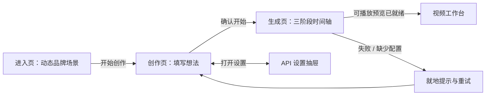

# knowledge-show｜创作入口与生成流程视觉设计

> 设计定位：面向普通创作者的产品体验与视觉实现规范，覆盖进入页面、创作需求填写、提交确认、三阶段生成过程、DeepSeek API 设置与工作台过渡。本文是设计方案，不代表功能已经完成。
>
> 源码参考：`LIZZYGREAT/PaperSkillWork` 的 `work/l2p` 分支（所查版本 `1c8e5492`），以及 `LIZZYGREAT/knowledge-show` 的 `main` 分支（所查版本 `5e351e0c`）。本方案在保持 `ProjectState` 等现有数据契约不变的前提下设计，具体接口以仓库 `contracts/` 为准。

## 一、体验定位与整体结构

产品的用户可能完全不懂知识研究、动画制作和 Agent 机制。页面应让他们获得三个直观感受：**这里能做出好看的动画**、**我只需要描述想法**、**作品正在一步步成形**。最终的视频面向普通观众，通常约 2 分 30 秒至 3 分钟。

界面应有克制的高级感，但绝不做成论文阅读站、表格后台或由卡片组成的 PPT。视觉上使用清楚的核心对象与连续变化，交互上以简洁、自然、可预期为先。不需要登录、注册、账户头像、套餐或作品广场。

页面路径可以按状态组织，实际路由由前端决定：



**关于“进入页面”**：设置真正有吸引力的 Landing Hero，但不要额外做一个强制停留数秒的开屏加载页。首次展示即能看见文字、按钮和动态画面；动画只负责自然引入。用户点击「开始创作」后，Hero 的核心视觉对象与创作页完成一次连续转场。返回进入页、刷新、减少动画偏好都不应阻碍使用。

## 二、从 PaperSkill / L2P 提取的视觉语言

### 1. 可直接参考的源码

| 参考文件（`PaperSkillWork/work/l2p` 下） | 提取内容 | knowledge-show 的处理 |
| --- | --- | --- |
| `papers/l2p/web/enhanced/src/shared/foundation/styles/kit.css` | 全局颜色、字体、圆角与可读性基础 | 抽取变量定义，建立独立 `--ks-*` Token，避免引入整套论文样式 |
| `papers/l2p/web/enhanced/src/shared/foundation/styles/editorial.css` | 宽屏阅读容器、顶栏、标题层级、高亮、语义文字色 | 保留留白与标题气质，重做为创作型布局 |
| `papers/l2p/web/enhanced/src/shared/foundation/editorial/EditorialFlourish.tsx` 与同目录 CSS | 轻量曲线、枝叶、暖色点缀 | 保留“有机、细腻”的语法，生成页改为与进度相关的动态线条和节点；不复制整幅静态分隔图 |
| `papers/l2p/web/enhanced/src/styles/paper.css` | 细边界、柔和分组、图表与交互状态 | 只参考局部组件的密度和强调方式，不搬运教学图表及逐章节布局 |
| `papers/l2p/web/enhanced/src/App.tsx` | 精简品牌顶栏、Editorial 标题与层级 | 把论文多章节导航替换为品牌、作品入口（后续可选）、API 设置 |

**特别说明**：L2P 的 `rk-font-math` 用来处理公式及英文衬线标题，不宜机械地拿来作为中文大标题的唯一字体。中文展示标题应配备适当的本机中文宋体/衬线字体回退；不打包或分发字体文件。

### 2. 建议的视觉 Token

以下颜色来自所查 L2P `kit.css`，第一版优先复用；新增应用组件用 `ks` 命名空间，避免跨项目全局选择器相互污染。

| Token | 建议值 | 用途 |
| --- | --- | --- |
| `--ks-canvas` | `#f7f7f2` | 页面暖白背景 |
| `--ks-surface` | `#ffffff` | 输入面板和浮层 |
| `--ks-surface-soft` | `#eff2eb` | 柔和内容承载、进度层次 |
| `--ks-figure` | `#f0f4ed` | 轻量视觉舞台 |
| `--ks-ink` | `#182a22` | 主要正文 |
| `--ks-muted` | `#586a5d` | 描述、次要信息 |
| `--ks-line` | `#dce3d9` | 细线分隔与输入边界 |
| `--ks-line-strong` | `#a7b6a6` | 重要边界与完成轨迹 |
| `--ks-accent` | `#2e6b4e` | 交互选中与进度主色 |
| `--ks-accent-strong` | `#1b4a34` | 大标题、主要按钮 |
| `--ks-accent-soft` | `#e2ebdc` | 轻强调背景 |
| `--ks-warm` | `#cfad72` | 稀疏的暖金视觉节点 |
| `--ks-warn` / `--ks-bad` | `#8a5a25` / `#98402a` | 风险提示和错误状态 |

建议字号：Landing 主标题 `clamp(46px, 5.2vw, 76px)`，创作页主标题 `clamp(36px, 3.6vw, 56px)`，区块标题 22–28px，正文 15–17px，次要说明 13–14px。桌面主要内容区域 `max-width: 1240px`，侧边距宽屏 48px 左右；手机端约 20px。按钮、输入框以 10–16px 圆角为主，避免所有东西都做成巨大圆角胶囊。

字体建议：正文与控件沿用 L2P 系统字体栈（`Aptos`、`Segoe UI`、`PingFang SC`、`Microsoft YaHei` 等）；中文大标题可优先使用本机可用的宋体系列，搭配英文字母衬线。标题的字体回退需要实际在 Windows/Chrome 和移动设备中检查，不允许因缺字出现异常大小、跳行或中英文基线错位。

**版面审美**：用留白、排版、细线和柔和底色实现层级；阴影只用于抽屉、弹层等真正浮起的组件。沿用 L2P 的浅绿文字高亮，但仅高亮一处重要短语。不要大片绿色背景、渐变玻璃卡片、持续漂浮的装饰物或密集图标。

## 三、进入页 Landing：流动的知识纹理

### 1. 创意核心

进入页以一整块**连续、轻盈且有体量的青绿流带**作为唯一主视觉。它从右侧一束细流生长，舒展、卷曲、分流再汇合，最后停留在不对称而完整的流动形态。主流带内部有少量顺势延伸的细线，边缘点缀克制的微粒、气泡和少数暖金节点。

构图首先要有清晰、饱满的主体轮廓；细看才能发现流线、透明色面与粒子的层次。颜色沿用暖白与墨绿，以蓝绿、青绿提高右侧主体的辨识度，暖金仅用于少量节点。标题和 CTA 始终清晰，主体不侵入文字及交互区。

它表达“好奇心让知识开始流动”，不对应某个具体自然规律，也不模拟真实水体。流带与内部纹理必须共享连续状态；粒子沿主体附近的流向移动，不能变成随机点云、科技光效或互不相关的绕圈路径。

### 2. 桌面首屏布局

```text
┌────────────────────────────────────────────────────────────────────────┐
│ knowledge.show                                             设置 ⚙     │
│                                                                        │
│       FROM AN IDEA TO A MOVING STORY                                    │
│                                                                        │
│       让知识，动起来。                    [饱满的青绿有机流带]           │
│       把好奇变成一支值得看完的动画。      [流线、少量微粒与暖金节点]     │
│                                                                        │
│       [ 开始创作  → ]                    [少量暖金 / 浅绿点缀]          │
│       只要一个想法，剩下的交给我们。                                    │
│                                                                        │
│     ─────────────────── 轻量曲线 / 精细分隔 ───────────────────       │
└────────────────────────────────────────────────────────────────────────┘
```

文字始终保持清晰和可操作，不因首屏动画处于播放中而隐藏 CTA。右侧动态舞台不必有明显边框或视频播放器形状，背景可以与页面融为一体。**不要放一个假的“成品演示视频”截图**来营造产品已具备的能力。

### 3. 开场动画分镜（建议节奏，允许调整）

| 时间参考 | 主视觉变化 | 文字与界面 |
| --- | --- | --- |
| 0–0.8 s | 一束青绿细流从右侧中下方显现并开始变宽；附近微粒向它聚拢 | 顶栏和 CTA 始终可用 |
| 0.8–2.2 s | 主体沿舒展的 S 形生长，第一处卷曲和内部细纹逐渐成形 | 标题保持稳定，不与主视觉争抢运动 |
| 2.2–4.2 s | 流带发生一次清楚的分流、回卷与汇合；气泡穿过流线，少量金色节点沿流向掠过 | 交互入口不被遮挡 |
| 4.2–5.5 s | 主体舒展成完整、不对称的构图，细粒沿内部方向缓慢漂移 | 画面进入克制的等待态 |
| 5.5 s 后 | 局部小幅波动、缓慢呼吸，避免重播整段开场 | CTA 持续可操作 |

用户点击「开始创作」后，共享的细线凝结点沿主流方向收束，并落在创作页主题标签旁；流场顺势淡出，标题与表单错峰进入。复用 `idea-seed` View Transition，约 450–700ms 完成主要切换；快速点击与不支持 View Transitions 时直接进入，不等待开场结束。

支持 `prefers-reduced-motion`：出现静态完整构图，点击后快速淡入内容；动画中任何时刻都允许用户点击，不能设置不可跳过的等待。

## 四、正式创作页：一个大输入中心 + 轻量可选配置

### 1. 布局原则

主视觉中心是**用户想讲的主题**。不要复制旧 Streamlit 左侧一长列字段、右侧一篇研究报告的结构。也不要把输入拆成连续的八个等宽表单行。

推荐采用一个宽敞的输入舞台，下面通过横向分组自然地承接两个主要选择：想突出什么、希望怎样讲。次要选项收进展开区。输入仍在语义上独立，便于映射 `ProjectState.brief.user_input`。

```text
┌─────────────────────────────────────────────────────────────────────┐
│ knowledge.show                                        API状态   设置  │
│                                                                     │
│             从一个问题开始。                                         │
│             你想让大家了解什么？                                     │
│                                                                     │
│  ┌─────────────────── 主输入舞台 ─────────────────────────────────┐  │
│  │ 例如：为什么只要 23 个人，就很可能出现相同的生日？             │  │
│  │                                                                 │  │
│  │ 试试：生日悖论    注意力机制    时间为什么不能倒流               │  │
│  └─────────────────────────────────────────────────────────────────┘  │
│                                                                     │
│  有没有特别想讲的？                       希望怎么讲？              │
│  ┌───────────────────────────┐        交给 AI   创意脑洞           │
│  │ 例如：我想重点讲...       │        直观看懂  干货精讲           │
│  │                           │        故事悬念  自定义             │
│  └───────────────────────────┘                                   │
│                                                                     │
│  ▸ 更多创作偏好（选填）                    [ 开始创作 → ]             │
└─────────────────────────────────────────────────────────────────────┘
```

主题输入使用真正的 `textarea`（可自动增高），不是一行限制很死的 `input`。默认显示一个自然的占位示例，**占位文本不能当成用户实际输入**；示例标签可点击并填入完整主题。用户输入后，辅助文案自动降低视觉存在感。

### 2. 主表单的内容设计

| 位置 | 用户看到的文字 | 交互规则 |
| --- | --- | --- |
| 首屏标题 | **从一个问题开始。** | 强调用户的想法，不出现“Agent 工作流” |
| 主输入 | **你想让大家了解什么？** | 唯一必填；示例可直接填入并编辑 |
| 细化方向 | **有没有特别想讲的？** | 独立选填；较大的多行输入，默认给一条具体示例 |
| 创作方式 | **希望怎么讲？** | 小型分组选择：交给 AI / 创意脑洞 / 直观看懂 / 干货精讲 / 故事悬念 / 自定义 |
| 展开区 | **更多创作偏好** | 包含知识深度、个人创意、美术偏好、希望包含/避开的内容 |
| 提交动作 | **开始创作** | 校验主题后弹出轻量确认；不做冗长向导 |

**模式交互**：选择项用横向或两行的小型 Choice Chip，选中项采用浅绿底、深绿边或文本，不依赖强烈阴影。自定义模式被选中时才出现独立说明输入，且保留已有文本。默认值显示“交给 AI”，内部根据当前契约转换为 `auto`，不应写死让用户必须理解“直观演示”。

**更多创作偏好**展开后使用两列的精简布局：知识深度（轻松了解 / 讲清原理 / 深入一点），美术风格偏好（文本），个人创意（文本），希望包含 / 希望避开（两个独立文本区）。一项复杂内容不要混到一个“随便填点什么”框中；但也不要每个选项独占一整屏。用户没有填写时，不显示任何警告。

**比例与时长**：当前知识层只允许 `16:9`，`target_duration_ms` 默认 `165000`。第一版可以在表单底部用淡字说明“横版 · 约 3 分钟”，但不要展示尚不支持的比例切换或让用户选择不可兑现的时长。

### 3. 提交确认

点击「开始创作」后在当前页面出现轻量确认面板：

> **准备把这个问题变成动画**
>
> 主题：生日悖论
>
> 讲述方式：由 AI 推荐 · 知识深度：讲清原理 · 横版约 3 分钟
>
> [返回修改]　[确认，开始制作]

只总结用户已提供的内容和系统真实生效的默认值，不展示编造的知识方向。确认不要求用户阅读研究报告或自己审查知识。没有配置有效 API 时，保留已填写内容并打开右上角设置抽屉；配置成功后返回确认步骤。

## 五、右上角设置：DeepSeek API 连接

### 1. 视觉形式与文案

顶栏右侧为一个简洁的 `设置` 图标按钮（有文字 tooltip、焦点可见）。未配置时可在按钮旁附一个低调空心状态点；已配置并连接成功显示小绿点。不要使用“我的账户”“登录”或与账户有关的语言。

点击后从右侧滑出约 380–420px 的抽屉，手机端改为底部面板或全宽页内面板：

```text
┌───────────────────────────────────────────┐
│ 设置                                   ×   │
│                                           │
│ 模型连接                                  │
│ 使用自己的 DeepSeek API Key 开始创作。    │
│                                           │
│ 服务商   DeepSeek                        │
│ API Key  [ sk-••••••••••••••• ] [显示]   │
│                                           │
│ [ ] 我了解：密钥仅用于本次连接和创作请求， │
│     应用不会持久保存我的密钥。             │
│                                           │
│ [ 测试连接 ]            [ 本次使用 ]       │
│                                           │
│ 连接状态：未配置 / 测试中 / 已连接 / 失败  │
└───────────────────────────────────────────┘
```

默认仅提供 DeepSeek；不展示大规模供应商矩阵、模型参数、Token、代理或其他开发选项。测试连接只进行最小必要请求，遇到错误给普通用户可理解的提示，例如“密钥无法使用，请检查后重试”。调用费用只在设置中的辅助说明体现，不要占据首页或主表单，也无需生成前反复勾选费用确认。

### 2. 密钥的实现边界（工程强约束）

**密钥只允许保存在当前运行会话的内存中**。刷新或重新打开应用后需要重新填写。不写入 `localStorage`、`sessionStorage`、IndexedDB、Cookie、URL、项目文件、SQLite、错误日志、埋点、浏览器持久化缓存或生成产物。输入框默认遮掩；显示/隐藏只改变输入可见性，绝不把密钥填入普通文本日志。

“应用不保存密钥”与“密钥从不经过应用服务器”是两个不同承诺。不能把它们混用：

- **优先适配当前本地运行方案**：页面与本机 Python 服务协同，密钥仅在浏览器内存与本地进程内存中短暂使用；本机服务负责向 DeepSeek 发出请求，不上传到团队运营的远程服务。后端需确保错误日志、请求体记录、诊断输出和持久化状态均不包含密钥。
- 若未来改为托管网页，必须先测试 DeepSeek 是否允许所需的浏览器跨域调用。官方 API 要求 Bearer 鉴权；浏览器跨域请求是否能成功取决于服务端的 CORS 设置，**不能事先假定浏览器直接调用可用**。
- 如果托管模式必须经团队服务器转发，服务器就会临时接触密钥。此时不能再向用户承诺“密钥不会经过我们的服务器”；需明确透明告知，并做到无持久化、无日志、传输保护、请求结束立即释放等控制。若坚持绝不经团队服务器，就必须采用经验证可用的浏览器直连或本地服务方案。

API Key 是敏感凭证。禁止在开发 Mock、测试截图或运行日志中出现真实密钥；任何异常信息都必须脱敏。**用户看到的是简洁的勾选文案，开发者遵守的是上述更严格的技术约束。**

## 六、生成页：三阶段时间轴与有机事件气泡

### 1. 页面结构

从用户确认提交到进入工作台，界面应从“填写想法”转为“正在生成作品”。保留固定品牌顶栏和右上角设置；中心使用一条明显但克制的横向时间轴，三枚节点代表三个实际阶段。

```text
┌─────────────────────────────────────────────────────────────────────┐
│ knowledge.show                                         ⚙ 设置       │
│                                                                     │
│           你的想法，正在成为一支动画。                               │
│           主题：为什么会出现生日悖论？                               │
│                                                                     │
│     ✓ 知识探索 ━━━━━━━━━━━ ◎ 脚本编排 ─ ─ ─ ─ ○ 动画制作           │
│       已完成                 正在进行                尚未开始        │
│                                                                     │
│     [浅绿色的有机线条横穿画面]                                        │
│        ○ 发现一个有趣的切入点         ◌ 正在安排场景                 │
│                ◯ 主要知识已整理                                    │
│                            ● 让内容自然衔接……                       │
│                                                                     │
│            正在把知识组织成一条完整的讲述主线                          │
└─────────────────────────────────────────────────────────────────────┘
```

顶部主句可以随状态温和更新，但不要长时间频繁闪烁。下方视觉舞台的主体是一条**与进度相关的连续轨迹**，而不是无目的的粒子海洋。用户始终能区分：哪些阶段已完成、当前在做什么、接下来是什么。

### 2. 事件气泡的两种职责

**装饰性小点**：作为视觉纹理，允许在限定区域内作轻微随机漂移、低幅呼吸、局部聚散。它们不携带任务含义，不能影响时间轴主结构，不可遮挡文案和按钮。

**任务事件气泡**：必须由真实后台事件触发。新事件沿当前阶段的轨迹缓慢浮出，包含一句人能读懂的短文案，停留一段时间后退出。建议同时保留 2–4 条，避免堆满事件日志。

| 内部阶段/事件 | 面向用户的表述示例 | 触发要求 |
| --- | --- | --- |
| `brief` 已验证 | 已理解你的创作想法 | 真实收到需求确认事件 |
| `research` 进行中 | 正在了解这个主题 | 知识研究真实启动 |
| `search` / `fetch` 进行中 | 正在补充关键资料 | 实际进行了外部检索或抓取，不是每轮都显示 |
| `creative` 进行中 | 正在寻找有趣的讲述角度 | 创意阶段真实启动 |
| `verifier` 进行中 | 正在确认重要知识 | 关键核验真实启动 |
| 知识包发布成功 | 知识方向已经准备好 | 知识产物被验证并发布 |
| 脚本阶段事件 | 正在安排讲述顺序 / 场景节奏 | 脚本模块真实发出事件后才显示 |
| 动画阶段事件 | 正在生成场景 / 组合动态画面 | 动画模块真实发出事件后才显示 |
| 动画预览可用 | 作品可以预览了 | 预览资源实际能够加载 |

知识层当前已有 `on_event`，可从中映射用户文案；脚本和动画层尚未建立稳定的共享事件流，因此开发时可用**明确标注的开发态 Mock**展示布局，不能在正式环境伪装其已完成。`knowledge.complete` 不等于全片完成，必须区分各阶段与最终产物状态。

### 3. 运动规格

时间轴状态变化建议 300–500ms；事件气泡出现 260–450ms，漂移 5–9 秒，退出 250–400ms。漂移曲线可以用低幅正弦或有界样条实现，让气泡自然“生长、飘移、消散”，不要每帧重新随机坐标，也不要多条同速匀速上下移动。

不同状态的色彩采用语义层级：已完成为墨绿实心与细实线；进行中为有呼吸感的绿色环；未开始为浅色空心；出错为局部暖色提示，不把整屏染红。主视觉始终保留一处明确的中心，不要让所有事件同时跃动。

**不显示伪造的完成百分比、倒计时或预计耗时。** 第一版以阶段状态、当前动作和真实事件作为进度依据。失败或网络超时要停止当前动画的“进行中”暗示，并给出“重试此步骤 / 返回修改”的实际操作。用户返回后应保留已填写的创作要求与已完成的可信产物。

## 七、完成态与工作台过渡

动画模块发布 `AnimationManifest` 且实际可播放预览成功加载后，时间轴最后一段才进入完成态。此时动态轨迹收拢到一个明确的视觉焦点，逐渐转为工作台的播放区域轮廓；主句从“正在制作”变为：

> **你的知识动画，准备好了。**
>
> 现在可以看看成片，修改喜欢或不满意的片段。

显示 `进入工作台` 按钮，并可在短暂视觉过渡后自动进入工作台；自动过渡不应阻止用户手动进入。路由传递项目 ID 和已发布的精确产物引用，不通过浏览器地址传输 API Key。工作台的内部时间轴/编辑交互由对应负责人继续设计，本文件只规定进入体验与状态条件。

如果动画层尚不可用，就不能展示“动画完成”；可以停留在可验证的知识或脚本阶段，并明确表示当前开发联调状态。

## 八、页面组件与仓库实施边界

本次只定义前端 UI/UX。建议沿用现有工作区并适当增加独立子模块：

| 位置 | 推荐组件 / 职责 | 备注 |
| --- | --- | --- |
| `frontend/src/features/landing/`（新增） | `LandingHero`、`KineticKnowledgeScene`、进入动画 | 首屏品牌体验，独立于知识算法 |
| `frontend/src/features/creation/` | `CreationComposer`、`TopicInput`、`ModePicker`、`MorePreferences`、`CreationConfirm` | 映射 `ProjectState.brief.user_input` |
| `frontend/src/features/progress/`（新增） | `CreationTimeline`、`EventBubbles`、`StageStatus`、`GenerationStatus` | 和真实状态事件绑定，不与最终视频预览混淆 |
| `frontend/src/features/settings/`（新增） | `ApiSettingsDrawer`、`EphemeralKeyContext` | 仅会话内存；不进入持久化状态 |
| `frontend/src/features/preview/` | 视频完成后的实际预览入口 | 保留给真实动画预览，不承载全部生成进度 |
| `frontend/src/components/` | 精简的输入、按钮、标签、抽屉、状态提示组件 | 只抽取确实复用的基础部件 |
| `frontend/src/common/` | 主题 Token、动效常量、面向用户的事件映射 | 业务文案集中维护 |

`backend/src/knowledge/devtools/review_app.py` 是 Streamlit 内部知识检验页，继续保留用于研究层调试，不作为用户界面复用。新前端不能通过操作 Streamlit 页面来间接触发生成；需要后续由 `backend/src/api/` 与 `backend/src/workflow/` 提供真实的任务接口与统一事件状态。当前无端点，不在此文档中虚构 HTTP 路径。

### 交互状态

必须明确 `unconfigured → composing → confirming → generating(knowledge/script/animation) → preview_ready → workbench` 以及 `retryable_error`。任一阶段只有后端真实确认完成才变为 `completed`。API 设置可以从 Landing、创作页和生成页进入，但生成中的密钥修改必须避免影响正在执行的任务：旧任务在已建立的请求上下文中完成或取消，新密钥只应用于后续请求。

## 九、实现优先级与视觉验收

### 第一阶段：视觉骨架与交互

完成 Landing、主输入区、模式选择、更多偏好、提交确认和设置抽屉。此时可使用静态示例数据演示界面，但开发态必须可辨认。主题示例不作为真实输入提交；用户自定义内容在确认/返回间完整保留。

### 第二阶段：动态过程

实现三阶段主时间轴、真实事件映射、气泡动效、进行中/失败/完成状态。先使用可复现的模拟事件序列验证动效，之后接入实际事件时不得凭前端定时器伪造后端完成。

### 第三阶段：工作台交接

接入真实已发布的动画预览资源；完成态与工作台路由联动。无有效 `AnimationManifest` 或预览不可加载时不得自动跳转。

### 视觉与体验验收重点

| 检查范围 | 通过标准 |
| --- | --- |
| 桌面布局（建议检查 1280px / 1440px / 1920px） | 标题有重心、主体区域呼吸感足、输入不拥挤、无悬浮层重叠；超宽屏不过分拉伸 |
| 手机/小窗（建议 375px、768px） | 单列自然重排，时间轴可改垂直但保持阶段顺序，设置面板可关闭，按钮可触达 |
| 首屏动效 | 主要视觉对象可追踪、动作连贯；允许随时操作、跳过和减少动画；不出现纯随机粒子噪声 |
| 输入交互 | 必填仅主题；示例可点击；所有选填项独立保存；展开/收起不丢值；自定义模式可输入 |
| 进度真实性 | 每条任务气泡有真实事件来源；没有假进度百分比；错误态不会继续表现为成功运行 |
| 连接与密钥 | 未设置时引导打开抽屉；密钥不入持久化、URL、日志、截图或上报；刷新后无法复原密钥 |
| 工作台过渡 | 实际预览可加载后才能标记成功；可手动进入，失败可返回或重试 |
| 可访问性 | 键盘导航、可见焦点、清晰标签、合理对比度；`prefers-reduced-motion` 下保持完整功能 |
| 性能 | 移动端无持续高负载粒子计算；页面交互和文本输入不因动画掉帧，切页时停止不可见动效 |

## 十、最终设计判断

这套界面的视觉价值，应来自**一个有辨识度的动态开头、一个足够舒展的创作输入中心，以及生成过程具有生命力但不干扰阅读的连续时间轴**。用户可以不懂 Agent、检索和渲染实现，但能清楚地知道：提出了什么想法、系统正在做什么、何时能够看到真实作品。

视觉上借鉴 L2P 的暖白纸面、墨绿文字、浅绿高亮、细线和有机装饰；交互上则完全围绕创作者重构。不要简单移植 PaperSkill 的文章结构，更不能把一堆固定卡片依次淡入当作“精美动画”。

**实现边界**：本文件确认视觉与交互原则，不扩大公开数据 Schema，不要求增加登录系统，不把尚未实现的脚本、动画和编辑工作台描述为已经可用的能力。
