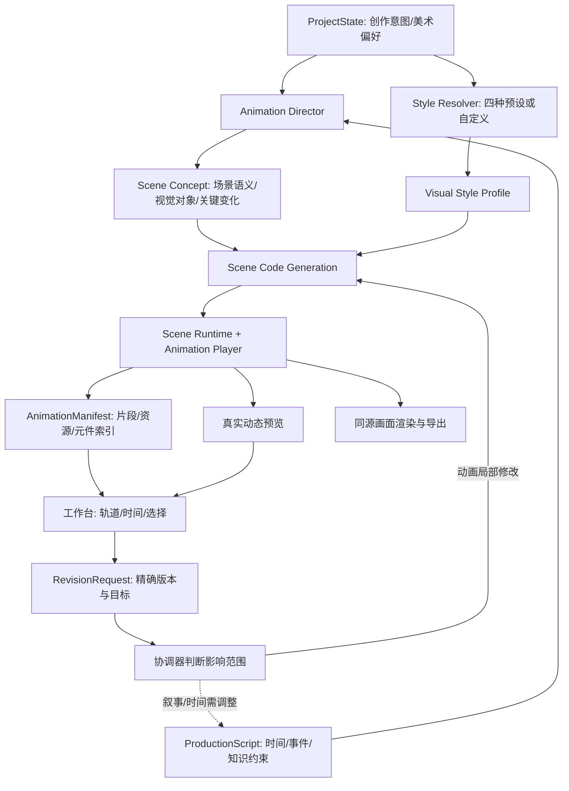

# Knowledge.show(me) 动画层与工作台接入执行方案

> **任务类型**：新增功能 / 动画基础设施 / 集成联调 / 视觉设计体系<br>
> **制定日期**：2026-11-14<br>
> **审查仓库**：`LIZZYGREAT/knowledge-show`<br>
> **审查基线**：`main@ed97bc7ddeb9490cc43bf4ce3dcd141c2830c0ed`（PR #11 已合并）<br>
> **建议工作分支**：`feat/animation-runtime-workbench`（开发者可按现有分工拆成小分支）<br>
> **执行原则**：以本文件为任务方案；开始编码前重新核对 `git status`、实际分支和 `contracts/`。公共契约、共享 API 和队友持有的脚本模块如需改动，先确认后实施。

## 一、任务目标与当前基线

本任务围绕第三层建立一条可逐步打通的真实链路：**`ProductionScript` → 动画创意与美术方案 → 可执行场景 → 真实可定位的预览 → 工作台反馈 → 局部修订 → 成片导出**。首先使用仓库已有的固定脚本样例验证，不等待上游脚本 Agent 的正式生成服务。

最终目标是：动画具备吸引人的画面、明确的知识对象与连续的运动，能够被工作台按时间定位、选中、框选并定向修改；视频预览和导出尽可能复用同一份场景实现。

### 1. 已经存在的能力

- 知识层已可产出正式 `KnowledgePackage`；`ProductionScript` 有 JSON Schema、写作提示词及多份试验样例，但正式脚本生成执行器尚未打通。
- `AnimationManifest`、`RevisionRequest` 等五类跨层数据契约已有 Schema、示例与校验工具；最新已支持可选 `selectable_elements`、`render_element` 修订锚点，以及 `ProductionScript` 的可选事件 `anchor`。
- React/Vite 创作前端已存在；`frontend/src/animation/runtime/`、`scenes/` 目前仍是占位目录。
- `frontend/src/features/revision/editor-layout.html` 是独立工作台原型：有场景轨、组件轨、播放头、胶囊拖入对话等 UI，但数据为硬编码，预览依赖仓库外的演示项目，没有正式元件定位。
- `docs/work/frontend/animation/首次出片尝试.md` 记录过 PN 结 0–43 秒的临时 Canvas 样片，证明出片链路可行，同时指出自由生成容易退化成霓虹粒子、缺少对象身份与知识解释。
- 当前默认正式视频配置约为 **16:9、165000ms**。本任务遵循现有约束，不擅自改时长或比例。

### 2. 本次最重要的设计决策

**网页 UI 美术与成片视频美术完全解耦。** 网站可以继续采用自己的色彩、字体、流线、装饰与布局；动画内部不读取 `frontend/src/common/theme.css` 的 `--ks-*` Token，不将网站的品牌风格当作生成视频的默认美术规则，也不把编辑器配色输出到视频。

第三层采用以下结构：

1. **Animation Director**：依据脚本的知识机制、事件与约束，自主提出视觉对象、状态变化、镜头组织及过渡方案。
2. **Visual Style Profile**：约束整条视频的色彩、材质、空间、字体、光影和动态气质；不规定具体知识对象、场景构图或镜头顺序。
3. **Motion/Implementation Skills**：Codex 编码时按需参考已经安装的 Motion Design 与 GSAP Skills；Skill 是创作和编码指导，不是浏览器运行时依赖。
4. **Scene Runtime / Animation Player**：统一场景挂载、确定性时间定位、播放、元件检查、预览和导出所需的渲染入口。
5. **Editor Adapter**：负责把工作台的选择、播放头和反馈转换为运行时调用与正式 `RevisionRequest`。

不预设“数学模板”“历史模板”“粒子讲解模板”一类完整场景。**先构思知识该如何被看见，再决定复用现有能力还是生成新代码。**

## 二、整体数据流与模块边界



约定：

- `ProjectState`、`ProductionScript`、`AnimationManifest`、`RevisionRequest` 的**公开字段以 `contracts/schemas/` 为唯一权威**，本任务不新增平行的公共 JSON Schema。
- `StyleProfile`、`SceneConcept`、`SceneDefinition`、运行时对象索引和工作台视图数据属于**动画层内部对象**；只有确有跨层持久化需求时才协商扩展公共契约。
- `AnimationManifest.resource_ref`、`preview_ref` 是不透明资源引用；工作台通过统一解析器获取真实资源，不需要解析生成的 TS/JS 源码。
- 协调器持有已发布产物的精确 `artifact_id + revision`；未通过检查的新版本不替换当前已发布版本。

## 三、四套美术风格档案：可以复用，但不限制创作

首版准备四份 `Visual Style Profile`：

| 风格 ID（内部建议） | 名称 | 主要美术语言 | 允许变化的内容 |
| --- | --- | --- | --- |
| `paper-editorial` | 纸艺编辑风 | 层叠纸材、柔和阴影、精细纹理、编辑式字体层级 | 对象、纸面结构、空间深度、剪裁、转场、镜头构图 |
| `precision-science` | 精密科学风 | 清晰空间结构、精确几何、克制光影、透明/实体材质 | 2D/2.5D/3D 感、表现尺度、材料形态、光照与运动 |
| `modern-graphic` | 现代图形风 | 鲜明图形关系、形变、节奏感、对比与现代排版 | 色彩与构图节奏、抽象程度、对象图形化方式 |
| `narrative-collage` | 叙事拼贴风 | 图像剪贴、层叠素材、纸张/印刷纹理、混合媒介 | 影像素材、局部材质、历史感、镜头叙事和空间切换 |

### 1. Style Profile 设计原则

- 描述**艺术语言**，不规定“每个场景必须有三张卡片”“每条视频从标题淡入开始”之类完整视觉结构。
- 颜色是**语义与审美规则**，不要求场景中的所有对象只能取固定调色板。出现重要物理含义时，颜色与形状必须保证可辨识和前后一致。
- 支持 `auto/custom`：用户没有指定时，由 Agent 根据具体脚本选用预设或生成新风格档案；明确指定风格时优先遵循用户意图。
- 全局档案在一条视频中保持稳定，但允许场景局部强化光影、色彩对比、视觉密度和镜头强度；变体必须有合理的叙事或视觉目的。
- **四套档案不是四套动画代码系统**；底层播放器与绘制能力统一，风格差异通过设计方案、参数、材质和对象实现体现。

### 2. 建议内部字段（非公共契约）

```ts
type StyleProfile = {
  id: string;
  name: string;
  intent: string;                  // 本风格希望形成的观看气质
  palette: { base: string[]; accents: string[]; semantic?: Record<string, string> };
  typography: { display: string; body: string; hierarchy: string[] };
  materials: string[];
  spatialLanguage: string;
  lighting: string;
  motionCharacter: string;
  decorativeGuidance: string[];
  consistencyRules: string[];
  avoid: string[];                 // 应避免的审美陷阱，而非禁止新对象
};
```

这份结构是指导美术生成的轻量语义配置，不应发展成覆盖全部参数的巨型模板语言。具体实现可以采用 TypeScript 导出的常量，不需要新增数据库、远程风格服务或公用 API。

**隔离要求**：把视频舞台作为独立渲染域（可采用隔离的 iframe/独立容器 + 专用 CSS reset，选更简单且经测试有效的方案）；所有视频字体、配色、背景、字幕、材质从 Style Profile 和场景本身取得。工作台按钮/胶囊/UI 的颜色永远不影响视频舞台；编辑框仅绘制在舞台外层叠加层。

## 四、动画运行时与工作台接口

### 1. 使用一个播放系统

同一场景实现被三处消费：

- **独立调试预览**：便于 Codex 在生成单场景时逐帧检查；
- **工作台预览**：可播放、暂停、拖动、选中、显示当前元件包围盒；
- **导出流程**：由统一时间参数驱动画面，不额外实现一套不同的视觉逻辑。

### 2. 内部接口建议

以下是**动画层内部接口草案**，可因具体技术适当简化；不要据此改动公共 Schema。

```ts
type FrameBounds = {
  x: number; y: number; width: number; height: number;
}; // 以完整视频逻辑画布为 1 的归一化轴对齐矩形

type SelectableElement = {
  id: string;
  label: string;
  sourceRef?: { kind: 'timed_text' | 'script_event'; id: string };
  visibleFromMs?: number;
  visibleUntilMs?: number;
};

type SceneHandle = {
  seek(localTimeMs: number): void;
  getSelectableElements(): SelectableElement[];
  getElementBounds(elementId: string): FrameBounds | null;
  destroy(): void;
};

type SceneDefinition = {
  sceneId: string;
  durationMs: number;
  mount(host: HTMLElement): SceneHandle;
};

type AnimationPlayer = {
  load(manifestRef: { artifact_id: string; revision: number }): Promise<void>;
  play(): void;
  pause(): void;
  seekAndWaitForFrame(timeMs: number): Promise<{ renderedTimeMs: number }>;
  getCurrentTimeMs(): number;
  getElementBounds(elementId: string): FrameBounds | null;
  getSelectableElements(): SelectableElement[];
  destroy(): void;
};
```

`seekAndWaitForFrame` 必须在**目标帧实际渲染完成后**才 resolve，防止工作台读取上一帧 bbox。连续拖动时以请求序号处理过期 seek，旧请求不得覆盖最新状态。

### 3. 时间模型与 GSAP 的边界

- 公开数据使用毫秒；GSAP Timeline 通常使用秒。全部换算集中在 Runtime，一处维护，不能在各场景中随意混用。
- `ProductionScript.scenes[].start_ms` 为**全片绝对时间**，`events[].offset_ms` 为**场景局部时间**。Scene Runtime 根据 `globalTime - scene.start_ms` 计算 `localTimeMs`，并映射到对应的 clip 资源。
- 同一脚本场景可对应多个动画 clip；clip 不可越过脚本场景边界，时间覆盖要遵守现行校验要求。
- `events[].anchor=true` 的绝对计划时刻必须在动画实际事件中可定位；不能擅自推迟、提前而不经脚本层确认。
- GSAP 推荐使用可暂停、可 `seek` 的 Timeline 来管理 DOM/SVG 动画；不依赖 `onComplete` 触发永久创建对象等不可回溯副作用。场景的任何时间状态应可重建。
- Canvas 的绘制与粒子运动采用固定种子、由时间计算位置或可重建快照，不能只有“从上一帧不断累加位置”的不可逆更新逻辑。
- 对同一时间点 `t`，按 `0 → t`、`20s → t`、`40s → t` 三种寻址方式的结果必须相同。页面缩放、暂停、Seek、重复播放不得改变对象身份。

### 4. 元件身份、包围盒与预览高亮

严格沿用已合并的编辑器契约：

- `scene_id`、`script_event.id`、`clip_id`、`element_id` 分别代表不同对象，不能混用。
- `timed_text` 的可选择渲染对象沿用脚本文字 ID（如 `T02`）；动画自建逻辑对象采用稳定 `EL_...` ID，例如 `EL_S02_JUNCTION`。
- ID 在一个 AnimationManifest 版本内唯一；同一逻辑对象跨镜头保持一致身份。一个 ID 可以映射多个时间区间，不按数组序号或轨道名称生成。
- 元件注册范围以**有编辑价值的逻辑对象**为准，不需要给每个粒子分配 ID；粒子群、材料块、字幕、关键标注可以作为可选逻辑对象。
- `getElementBounds(id)` 返回**当前实际已渲染帧**的归一化视频内容坐标；不存在、不可见、移出场景或几何不可定位时返回 `null`。旋转对象可用轴对齐外包矩形。
- SVG/DOM 可计算变换后的对象边界；Canvas 对象必须在运行时自行维护几何状态并投影回视频坐标。
- 工作台根据实际视频内容区域（含 letterbox 缩放）绘制 `pointer-events:none` 的选择框；视频本身和导出帧绝不携带编辑器框选标记。

### 5. 工作台时间轴数据来源

现有 HTML 中 `CHAPTERS` 和 `ANIM_TRACKS` 是硬编码演示数据，正式版本必须改为：

1. **场景轨**从 `ProductionScript.scenes[]` 生成，使用明确的 `scene_id/start_ms/duration_ms`；
2. **clip 轨**从 `AnimationManifest.clips[]` 生成，使用 `clip_id`、`scene_id` 与真实时间；
3. **元件轨/胶囊**从可选择元件索引及运行时内部可见区间生成，显示名称可以按 UI 自行分组，但引用必须是稳定 `element_id`；
4. 选中胶囊、拖入聊天输入、生成反馈时必须保留 `target_artifact` 的**精确 AnimationManifest 版本**和适用的 `render_element` / `clip` / `time_range` 锚点。

现有公共 Manifest 未规定每个元件的时间区间。首版**不必因此修改 Schema**：由 Runtime/Adapter 提供元件在其片段内的实际可选区间，或者用对应 clip 区间作为粗粒度展示范围。只要 ID、实际可见性及修订锚点可靠，就足以完成首版联调。

## 五、生成 Agent 与 Skills 的接入方式

### 1. 不把 Agent 调用和动画播放器混在一起

**Codex/Claude 的 Skills 只参与代码与设计生成阶段。** 浏览器运行时执行生成后的 TypeScript/JavaScript 和已安装的动画库，不会在播放中读取 SKILL.md。用户报告已在 WSL 安装 Motion Design 与 GSAP Skills；执行任务时先核对安装状态，不重复无意义安装。

```bash
node -v
npx skills ls -g
cd frontend
npm install gsap
npm run build
```

只有实际选择 `@gsap/react` 的集成方式才额外安装对应包。运行时不必为了安装了 Skill 而额外引入全套工具。

### 2. 先固定脚本试作，再自动生成

**第一轮：手动驱动 Codex 生成一段真实动画**，采用 `docs/work/backend/script/trials/case2-pn-v2/production-script.json` 的 S01–S02（0–43s）。Agent 读取用户约束和现有脚本，给出一份简短的场景创意与视觉对象清单，然后完成可执行场景。此时无需构建正式多 Agent 调度器。

**第二轮：固化生成规约**，把反复验证有效的内容整理为项目专用 `Animation Director` 指导文件：

- 场景创意：首先确定画面主体、知识对象的首次指认、事件前后状态与观看焦点；
- 美术设计：先确定视觉表达，再依据 Style Profile 赋予材质、字体、颜色与光影；
- 运动设计：根据真正的知识因果、叙事节奏组织连续动作，不以淡入文字和任意粒子替代知识动画；
- 工程实现：严格遵守已存在的脚本事件、语义约束、运行时接口、元件 ID 和独立资源路径；
- 检查修订：编译 + 实际画面审查 + 时间 Seek + bbox + 编辑器局部修改验证。

**第三轮：自动化调用**。由工作流协调器触发动画生成任务，传入精确版本的 `ProjectState + ProductionScript` 和动画层内部 Style Profile。新代码生成、编译、检查、资源发布必须在服务端受控工作区完成；生产端不能直接执行未经审查的任意用户/模型生成脚本，更不能让生成代码接触 API Key、服务器环境变量等秘密。

### 3. 推荐的 Agent 内部顺序

```text
读取脚本与用户创作约束
    ↓
理解场景：对象、前置状态、核心变化、知识约束
    ↓
提出镜头创意与关键画面（不先查模板列表）
    ↓
生成或选择 Visual Style Profile
    ↓
检查风格与创意是否兼容；必要时局部修正方案
    ↓
确定使用现有 primitives，或新增自定义视觉对象
    ↓
编写可 Seek 的 SceneDefinition，登记元件身份
    ↓
运行测试、截取关键帧、审查实际运动
    ↓
不合格则局部修订；通过后生成 Manifest 并发布预览
```

**Skill 的取舍**：Motion Design 用于构图、运动品质和审美判断；GSAP Skills 用于 API、Timeline、路径运动和 React 集成。不要把外部 Skill 中的示例镜头直接升级成强制场景模板。

## 六、建议代码与资源组织

优先围绕当前目录扩展，避免更改知识层和脚本层的目录：

```text
frontend/src/
├── animation/
│   ├── styles/
│   │   ├── profiles/            # 4 种内部 Style Profile
│   │   └── resolveStyle.ts      # 用户偏好 → 风格档案/自定义
│   ├── runtime/
│   │   ├── SceneTypes.ts        # 内部类型
│   │   ├── AnimationPlayer.ts   # 全片时间、场景装配、Seek
│   │   ├── ElementRegistry.ts   # 逻辑对象 ID 与 bbox
│   │   └── resourceResolver.ts  # 不透明 resource_ref 解析
│   ├── primitives/              # 真实复用出现后再加，勿预置大量空抽象
│   ├── scenes/
│   │   └── pn-junction/         # 首轮 S01、S02 样片
│   └── export/                  # 导出能力确定后再加
├── features/
│   ├── preview/                 # 真正的播放器容器与视频舞台隔离
│   └── revision/                # 现有原型及其正式适配层
└── ...                          # 现有首页/创作页面原则上不动

frontend/tests/
├── animation/                   # 新增 Seek/身份/时间覆盖单元测试
└── e2e/                         # 真预览/选择/框选/对话回归测试

docs/work/frontend/animation/
└── ...                          # 运行约束、风格说明、试片验收记录
```

这只是推荐文件定位。实际代码应根据仓库 `docs/work/engineering.md` 保持紧凑；只有真实复用时才抽象公共 primitive，不为目录树填满文件。

项目专用美术规约可放 `docs/work/frontend/animation/`，并在 `AGENTS.md` 中**简短登记**“动画任务应按需阅读该规约及用户已安装的 Motion Design/GSAP Skills”。不复制第三方 Skill 的全部正文，不将外部实现假设强加给项目。

## 七、分阶段实施与每阶段验收

### P0：最小运行时与真正可运行的一幕

**输入**：固定 PN 结试验脚本的 S01，既有 `ProductionScript` Schema，用户风格配置选其中一种（建议以 `precision-science` 做第一次科学可读性测试）。

**实施**：

1. 从最新 main 建工作分支；检查现有未提交修改、锁文件与公共契约。
2. 安装 `gsap`，先实现 `SceneDefinition`、`SceneHandle` 和最小 `AnimationPlayer`；支持一个场景的 mount、seek、播放、暂停、销毁。
3. 给视频舞台建立独立 CSS 作用域，明确 16:9 逻辑画布和渲染缩放策略；验证产品 CSS 不影响视频场景。
4. 读取固定脚本中的 scene、events、timed_text、semantic_constraints，制作 **S01 真实可播放动画**；主要视觉对象必须可追踪，按时出现，关键对象进行稳定 ID 登记。
5. 添加一个独立本地预览入口（仅研发用），能在固定时刻 seek 并截图，不需要上游在线 API。

**验收**：`t=0/6/10/15s` 的画面与脚本事件一致；从不同位置 Seek 到同一时刻画面一致；对象有明确身份；无 UI CSS 串色；真正播放可看；重建/销毁后无残留 Timeline。完成后单独 Commit。

**不要做**：这一步不要实现整个视频生成 Agent、真实服务 API、复杂工作台迁移、完整视频导出。

### P1：S01–S02 连贯场景与工作台播放联调

**输入**：PN v2 脚本 S01–S02（0–43s）、P0 Scene Runtime。

**实施**：

1. 完成 S02；保留 PN 结构在 S01–S02 之间的主体身份与视觉连续性，严格检查脚本描述及语义限制。
2. 建立两场景的全局时间到局部时间的映射，生成可被解析的动画资源引用和有效 `AnimationManifest`（本阶段不必直接发布正式 API）。
3. 将工作台播放器从仓库外的 `/mv` 演示项目切换到真实预览入口。可以先通过同源 iframe + 明确的播放器适配器联调，保留现有布局；禁止长期依赖向外部页面注入 CSS、点击其隐藏按钮等临时黑盒方法。
4. 以 `ProductionScript.scenes[]` 生成场景轨，以 `AnimationManifest.clips[]` 生成片段轨，以元件注册数据生成可选择胶囊。UI 的轨道类别与颜色仅供展示，不进入身份语义。
5. 点击时间轴胶囊后，先 Seek 并确认帧完成，再查询 bbox，于视频预览外层绘制高亮；不可见则隐藏框，不显示错误的历史位置。
6. 验证拖动、播放、暂停、时间轴缩放、页面布局变化时框的位置与所选元件一致。

**验收**：可在工作台完整播放 0–43s；拖到 16s/25s/37s 能得到正确帧；字幕 `Txx` 与动画元件 `EL_...` 均能正确选中；不存在对象时返回 `null`；屏幕缩放后高亮仍对准视频内容；高亮不属于实际视频画面。完成后单独 Commit。

**编辑器迁移取舍**：先让真实 Player 控制现有独立 HTML 原型，验证交互数据路径；除非成本很低，否则暂不把约 800 行 HTML 全部重写为 React。正式产品整合放在 P3，避免两个播放器长期并存。

### P2：四种 Style Profile 与美术质量试作

**输入**：P1 的同一段固定脚本、已有可执行场景、四种美术风格档案。

**实施**：

1. 实现四套 Profile 的描述及解析；严禁读取网页 Theme Token 作为视频风格默认值。
2. 首先用**同一段 S01（或 S01 的固定关键 8–12s）**进行四风格静态关键帧比较，观察构图、字体、空间、材质、对象可读性。
3. 选择视觉效果最好的一套完成完整动态试片；其他风格保留可用于新项目的档案，不要求立即渲染四条完整视频。
4. 提炼经实际验证的 Motion Design 规则至项目专用指导文件；为生成场景添加静态画面与动态过程的验收项。
5. 确认风格仅控制艺术语言，不决定知识对象、场景结构或动画顺序；允许 Agent 使用全新组件。

**验收**：四份档案均可独立选择或被自动选择；同样脚本在不同 Style Profile 下能够生成明显不同的美术方案；视频场景未继承网页颜色；所选试片不存在明显 PPT 式过渡、无意义霓虹点阵、元素身份不明、文字压过主体或图层遮挡。完成后单独 Commit。

### P3：工作台自然语言修订闭环

**输入**：P1 的真实工作台预览、有效 AnimationManifest 与 RevisionRequest Schema。

**实施**：

1. 将工作台胶囊中的稳定 ID 与精确 Manifest 版本封装为 `RevisionRequest`；选中可同时携带 `render_element`、`clip`、`time_range` 锚点。
2. 先做**无模型调用的修订模拟**：例如将 S02 的粒子运动速度设置为另一配置，产出一个新动画版本，确保工作台可定位差异并回退。
3. 再连接动画 Agent 的局部改写：用户反馈仅传目标片段、原设计意图、必要 Style Profile、相关脚本知识约束和需保留对象；不每次重建整个视频。
4. 模型提出的修改如涉及脚本事件时间、知识结论或用户明确约束，则创建上游修订请求交给协调器，不在动画层静默覆盖。
5. 新资源通过编译、寻址、框选和视觉回归后再发布新版本；发布前旧版持续可播放。

**验收**：工作台选择某个对象并输入“这里的粒子运动减慢一点”，生成有效且版本正确的反馈；实际只修改受影响动画资源；旧片段不变；新版本可以预览与回退；用户不需要理解内部元件 ID。完成后单独 Commit。

**协调器未就绪时**：可以先完成 `RevisionRequest` 的构造、校验与本地修订 Demo，不要伪造共享工作流 API 已经运行。

### P4：正式生成入口、工作台产品化与视频导出

**输入**：真实 `ProjectState + ProductionScript`、P0–P3 运行时及修订能力。

**实施**：

1. 将手动 Codex 试作中已经验证的生成步骤，整理为受控的场景生成任务：设计 → 写代码 → 编译 → 关键帧检查 → 发布资源及 Manifest。
2. 正式前端接入真实任务状态与已发布的 `preview_ref`，仅在预览资源可以加载时开放工作台；保留原有演示标识和真实结果隔离。
3. 在 React 产品中接入或迁移工作台 UI；与独立原型复用同一 Adapter 和 Player，不复制播放逻辑。
4. 选择最简单可验证的导出方式：优先测试浏览器逐帧按时间定位渲染并结合 FFmpeg 编码，评估完整 165s 产物的时间成本；如果性能不足，可以先采用实际测过的实时录制备选方案，并清楚标示其时长和质量限制。
5. 配音、音乐和音效根据真实素材/能力逐步接入，必须确保时间同步；尚无对应资源时不虚构音频已生成。
6. 对导出视频与 Player 在若干采样时刻的画面进行一致性对照；导出不能包含编辑框、工具栏、调试 HUD。

**验收**：至少一个完整端到端样本可以从已发布的脚本生成可播放预览，进入工作台，定向修订后得到实际视频文件；`ffprobe` 可读取长度、分辨率、编码；片段时间、关键锚点、视觉主体和音画关系符合预期。不应把“可播放预览”冒充“已经能导出 MP4”。

**比赛时间不足时的截断原则**：优先交付 **P0 + P1 的真实可演示片段与工作台选择**，随后做 P3 的局部修订；P4 的完整自动化与成片导出在具备真实测试条件后推进。不要为了增加功能清单而牺牲样片视觉质量。

## 八、工作台的完整数据与修订流

```text
1. 读取 ProjectState 当前的 AnimationManifest ArtifactRef
2. 校验 Manifest、ProductionScript 引用及片段时间覆盖
3. resourceResolver 解析本版本真实预览资源，AnimationPlayer 加载
4. 工作台由 script.scenes / manifest.clips / runtime element registry 构建轨道
5. 播放头移动 → player.seekAndWaitForFrame(globalMs)
6. 点击胶囊 → 取得 elementId + manifest artifactId/revision
7. player.getElementBounds(elementId) → overlay 框选（null 则隐藏）
8. 胶囊拖入聊天 → UI 保存机器引用，不仅保存显示文本
9. 用户提出修改 → 转为 RevisionRequest（source=user, target_layer 可 unresolved）
10. 协调器判断 animation/script/knowledge 责任及受影响范围
11. 生成候选新版本 → 局部检查 → 用户预览 → 正式发布/回退
```

在 `editor-layout.html` 中应重点替换：

- 原硬编码 `CHAPTERS/ANIM_TRACKS` 的正式数据来源；
- 对 `iframe.__preview`、外部隐藏控件和固定 `/mv` 的直接耦合；
- 仅存 `{track, idx}` 的选中状态；
- 仅展示文本胶囊、无法构造正式修订锚点的聊天逻辑。

保留其已形成价值的**时间轴布局、拖动、缩放、胶囊进入聊天区和选中视觉反馈**。不要为了更换播放器重做整个 UI。

## 九、测试与视觉验收

| 检查点 | 执行方式 | 预期结果 |
| --- | --- | --- |
| 现有前端回归 | `cd frontend && npm run build && npm test` | 已有页面与交互不回归 |
| 浏览器回归 | `cd frontend && npm run test:e2e` | 已有用例通过；新增真实工作台用例通过 |
| 公共契约 | `python contracts/validate_contracts.py` | 五类 Schema、Mock 与跨引用检查通过 |
| 精准 Seek | 新增 Runtime 单测及浏览器画面检查 | 同一时间定位结果不受 seek 历史影响 |
| 场景边界 | 15s（S01→S02）、43s（试片结束）前后逐帧检查 | 无黑帧、双层残留、时长错位 |
| 元件身份 | 多次播放、缩放和轨道重建 | 文字、主体对象 ID 稳定，选择正确 |
| 元件位置 | 变形、移动、消失、缩放下读取 bbox | 可见框正确，不可见返回 null |
| 编辑器隔离 | 同时检查编辑器预览与纯视频预览 | 选中高亮仅在编辑器显示 |
| 风格隔离 | 对比视频舞台与网站主题色；尝试更换 Style Profile | 两套 CSS/字体/变量互不污染 |
| 视觉质量 | 查看关键姿态截图与实际录屏 | 主体明确、知识可读、运动连续，非 PPT 式轮播 |
| 局部修订 | 修改 S02 某动画参数，比较资源与 Manifest 版本 | 新版本只重做受影响资源，旧版保留 |
| 视频导出（P4） | 真实播放/编码 + `ffprobe` + 采样帧对照 | 视频可播放、音画合理、无编辑器覆盖物 |

建议关键画面采样：PN 样片 `0s / 6s / 10s / 15s / 21s / 29s / 37s / 43s`；实际连续动作还必须通过录屏人工审阅，单帧截图无法证明运动自然。

**美术验收优先级**：先看画面静态构图，再看运动质量，最后看文字、光效和装饰。静态画面主体不明确或视觉层次混乱时，不要尝试通过增加粒子和转场掩盖问题。

建议浏览器检查至少覆盖 **1280px、1920px** 桌面视口，另检查 375px 工作台的合理降级或明确最小可用宽度；视频本身逻辑分辨率保持 16:9，不能随浏览器宽度改变镜头语义。

## 十、团队边界、增量提交与不做事项

### 1. 文件所有权

| 范围 | 建议负责人 / 处理方式 |
| --- | --- |
| `frontend/src/animation/**` | 动画实现者主导，可独立开发运行时、风格和场景 |
| `frontend/src/features/revision/**` | 工作台负责人主导；动画负责人提供 Player/Adapter 接口，由双方确认接入点 |
| `frontend/src/features/preview/**` | 由前端/动画一方认领，避免两人同时重写 |
| `backend/src/script/**` | 脚本负责人保留所有权；动画层用固定 Mock 消费，不直接改源脚本 |
| `backend/src/workflow/**`、`backend/src/api/**` | 共享集成区域，先由双方明确任务所有权 |
| `contracts/**` | 现有 Schema 尽量保持不变；必要变更先协商并同步正负例 |
| `docs/work/frontend/animation/**` | 动画实现说明、实际效果记录与 Skill 使用约定 |

### 2. 推荐的提交检查点

- `feat(animation): add deterministic scene runtime and first PN scene`
- `feat(animation): connect PN preview to editor timeline and element inspection`
- `feat(animation): add independent visual style profiles and design review`
- `feat(revision): create targeted animation revision workflow`
- `feat(animation): publish preview and export video artifacts`

每个阶段：实现 → 测试 → 实际画面查看 → `git diff --check` → 审查相关 Diff → Commit。跨模块、共享契约、合并及 Push 遵照仓库 `AGENTS.md`，不擅自替队友修改或合并分支。

### 3. 本任务明确不做

- 不将网站的 `theme.css`、有机流带、枝叶装饰、网页颜色或字体当作成片模板。
- 不创建按学科分类的固定整片模板，不限制 Agent 只能使用预制组件。
- 不把 Motion Design / GSAP Skills 当成浏览器里能动态调用的服务。
- 不在第一阶段引入复杂的多 Agent 自治调度、完整 3D 引擎、素材市场或音频生成平台。
- 不因工作台接入需求去修改知识层的研究逻辑、脚本事实或现有 `anchor` 语义。
- 不在尚未真实生成或加载文件时宣称“工作台已可用”“视频已导出”。

## 十一、Codex 首轮执行指令（先完成 P0）

可直接将以下内容作为 Codex 的首轮任务范围：

> 请基于本文件的 P0 阶段实施，不执行 P1–P4。先查看 `AGENTS.md`、`README.md`、`STATUS.md`、`docs/work/engineering.md`、`contracts/` 及 PN v2 的 ProductionScript 样例。检查 WSL 已安装的 Motion Design/GSAP Skills，根据需要读取，并在 `frontend` 中安装真实需要的 GSAP 依赖。**网页 UI 风格与视频美术完全隔离**，不要引用 `--ks-*` 或复刻 Landing 风格。建立最小可 Seek 的 Scene Runtime 和独立预览入口，使用 `precision-science` 风格实现 PN 结 S01（0–15s），为关键元素分配稳定 ID；用实际脚本的时间、事件及语义约束实现连续动画。新增 Seek 与对象身份测试，实际查看 0/6/10/15s 截图和完整播放，执行构建、相关测试与 `contracts/validate_contracts.py`。不要修改知识、脚本、公共 Schema 或现有工作台原型。完成后报告文件变更、测试结果、截图/录屏位置、审美问题、Commit 和 P1 所需接口；未经授权不要 Push/合并。

首轮通过后，再交付 P1 任务给工作台和动画实现者进行联合联调。**不要让 Codex 一次性承诺完成 P0–P4 全部内容。**

## 十二、最终交付对照表

| 项目 | 审查基线 | 目标结果 | 验证方式 |
| --- | --- | --- | --- |
| 场景执行 | 正式运行时目录为空 | 真正可播放、可 Seek 的动画场景 | 独立预览与单测 |
| 视觉质量 | 临时试片有无意义霓虹粒子问题 | 有清晰知识对象、连续变化与高品质美术 | 截图与录屏审查 |
| 视频风格 | 现有正式视频风格系统缺失 | 四套独立 Style Profile，不继承网页样式 | 风格切换与 CSS 隔离测试 |
| 时间轴 | 工作台硬编码 | 消费真实 Script / Manifest | 场景及 clip 时间对照 |
| 元件框选 | 无真实 bbox | 可选择对象在当前帧真实定位、高亮 | 拖动、缩放、消失测试 |
| 修订 | 原型聊天仅演示 | 产生版本正确的 RevisionRequest，局部更新 | Mock / 真实修订联调 |
| 成片 | 无正式导出 | 同源场景导出可播放文件 | 播放、ffprobe、帧对照 |
| 现有业务 | 创作入口、知识层等已存在 | 不发生无关回归 | 现有前后端检查 |

**阶段交付标准**：每一项只能标记为“满足 / 不满足 / 未验证”，必须附实际命令、结果或可观察证据；不以目录、接口定义、Schema 通过作为完整视觉能力的验收证明。
