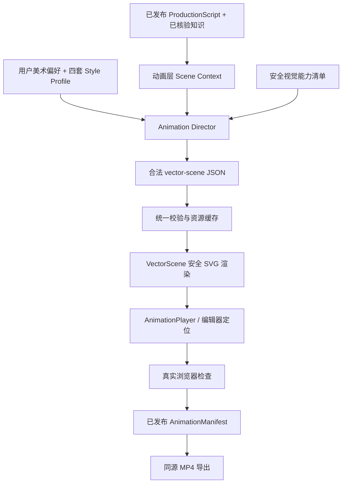
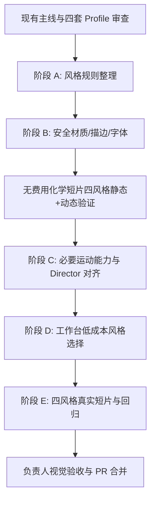

# Knowledge.show(me)｜视频画风系统优化与化学跨风格试片执行方案

> **任务类型**：视觉设计 / 动画能力增强 / 体验优化 / 集成验收  
> **审查仓库**：`LIZZYGREAT/knowledge-show`  
> **审查分支**：`main`  
> **审查基线**：`0c74d0ab7ace93ec8e0e29b58bb4b3543f81d0d2`（PR #18 已合并，2026-11-15）  
> **建议仓库路径**：`docs/tasks/open/frontend/视频画风系统优化与化学跨风格试片执行方案.md`  
> **任务状态**：待实施。本文依据远程源码和已有测试设计，未在本轮执行本机渲染、真实模型生成或视觉验收。  
> **负责人**：动画/前端负责人主实现；涉及 `backend/src/animation/` 时与后端负责人对齐。公共 `contracts/` 仅在确实需要时，经双方确认后修改。

## 一、目标：让视频画风成为真正的视觉表达能力

目前的四种预设为**精密科学风、纸艺编辑风、现代图形风、叙事拼贴风**。截图中纸艺编辑风的整体协调性最好，可以把它当作**完成度参考**；其余三套各自形成不同的美术语言，不能全部做成纸艺风，也不能只换背景。

本轮目标是在**不破坏知识→脚本→动画→预览→工作台→MP4**主线的前提下，让风格真正影响：

- **视觉对象**：同一语义对象的造型、组合方式、轮廓、符号和可识别细节；
- **材质**：纸层、磨砂、金属、印刷、纯色矢量等合理的明暗、纹理与层次；
- **空间与构图**：主体面积、留白、主次关系、镜头推近/回退、层次与遮挡；
- **运动**：连续状态变化、节奏、加减速、路径显现、对象之间的同步关系；
- **文字**：字体层级、排版、重要信息的露出方式及其与动画主体的关系。

**创作模式与美术风格继续解耦。** “天马行空”或“干货精讲”影响脚本叙事；纸艺、科学、图形、拼贴影响美术语言。知识机制、关键事实、时间事件和对象语义始终来自当前知识包和脚本，风格不能重写事实。

**禁止退化成 PPT 式视频。** 避免一堆文字卡片、信息框、图表依次淡入。观众应始终能看到有意义的对象和因果变化。也不要给模型锁死“概率一定用骰子、化学一定用试管、历史一定用旧报纸”的内容模板。

### 本轮边界

做：提升现有四套画风的实际效果、补充适量安全渲染能力、调整模型美术指导与对象表现、建立化学跨风格试片和可比较的验收方式、优化切换画风的费用交互。

不做：重写知识层、脚本层、五类公共 Schema；不开放模型执行任意 JS/HTML；不建设大型三维渲染引擎、影视资产库、训练美术模型或新微服务；不为每个领域制作固定业务动画模板。首版不强求新增六种八种风格，**先使现有四种真正成立**。

## 二、最新 main 的实际审查结果

### 1. 已经有的能力，应直接保留

| 模块 | 实际代码 | 可以复用的内容 |
| --- | --- | --- |
| 四套美术档案 | `frontend/src/animation/styles/profiles/profiles.json` | 名称、配色、材质方向、光照、运动气质和注意事项 |
| 画风选择与基础自动选择 | `backend/src/animation/director.py` | `resolve_profile()`、`automatic_profile_id()`、`preferred_profile_id()` |
| 新主题通用动画生成 | `backend/src/animation/director.py::direct_scene()` | 模型生成受控 JSON、几何/关键帧校验、字幕与事件引用 |
| 上下文和逐幕缓存 | `backend/src/animation/service.py` | 本幕已核验知识、相邻场景、前序身份、失败场景有限修复与缓存复用 |
| SVG 通用场景 | `frontend/src/animation/runtime/VectorScene.ts` | 可确定性 Seek、对象身份、包围盒及与工作台衔接 |
| PN 固定样片 | `frontend/src/animation/scenes/pn-junction/{S01,PnScenes}.ts` | 单独绘制的物理机制示例及版本回退，不是通用渲染能力的证据 |
| 正式发布与实际播放检查 | `backend/src/animation/service.py`、`frontend/scripts/render-video.mjs` | 精确版本、Chromium 验证、MP4 导出、失败不覆盖旧版本 |
| 工作台选择和风格切换 | `frontend/src/features/revision/Workbench.ts` | 风格下拉、生成新版本、原版本继续播放、修订与回退 |

现有 `SceneResource.kind = pn-scene | vector-scene` 可继续使用，内部资源允许**可选、向后兼容**的扩展。`AnimationManifest`、`ProductionScript`、`ProjectState` 的对外契约不需要因画风设计重新定义。

### 2. 已证实的表现瓶颈与缺口

| 等级 | 代码事实 | 实际问题 | 修改方向 |
| --- | --- | --- | --- |
| **P0** | `VectorScene.ts` 仅对 `circle/rect/path/text` 创建节点；对象主要用 `fill`、固定 `rx=8`、固定 `font-size=32` | Profile 写了“层叠纸边/印刷网点/磨砂金属”，通用渲染却基本无法表达 | 增加少量通用材质、描边、层级、文本和运动参数 |
| **P0** | 每对象关键帧只控制 `x/y/opacity/scale/rotation`，默认同一种平滑插值 | 纸艺、科学和现代图形之间的**运动质感**缺乏真实差异；无法自然呈现路径绘制、整体镜头运动 | 按需增加曲线/easing、路径显现、分组/镜头（分阶段） |
| **P0** | PN 固定 S01 的器件和仪表结构硬编码，只按 Profile 改部分颜色、纹理、轮廓 | 四张 PN 截图构图及视觉对象几乎一致；这条特殊路径不代表生成器的通用上限 | 使用**新的化学主题**经 `vector-scene` 进行四风格对比，而非继续以固定 PN 验收 |
| **P1** | 各 Style Profile 的 `consistencyRules` 都出现“红蓝载流子语义稳定” | 把 PN 专有的物理语义错误混入通用美术规则 | 改成通用“角色与含义一致”；PN 专属物理条件仍由脚本/知识上下文提供 |
| **P1** | `backend/src/animation/api.py::run_generation()` 仅在 `style_id=auto` 时把 `art_preference` 注入导演上下文 | 显式选纸艺等画风后，用户补充的自由美术偏好可能在模型创作上下文中消失 | 明确风格 ID 与文字偏好**同时传入**；优先尊重二者，冲突时以明确用户要求为准 |
| **P1** | `frontend/src/animation/styles/resolveStyle.ts` 对 `auto` 固定回落科学风；后端真实生成会按题材自动选择 | 本地预览默认行为可能与正式生成决策不一致 | 后端/正式产物给出解析后的明确 `style.id`，客户端只展示实际风格；开发预览保留显式默认即可 |
| **P1** | `Workbench.ts` 的 `styleSelect.onchange` 直接 `POST /animations` | 用户浏览画风就可能触发整片重新生成及费用 | 下拉浏览只更新选择，提供轻量风格示例；点击**“应用并重新制作”**才创建付费任务 |
| **P1** | 当前 `VectorObject.fill` 必须是六位十六进制颜色，`resource.style` 的材质多是文字描述 | 风格与具体对象外观缺少可执行的对应关系 | 增加可控的样式 token / 材质能力，保留旧 hex 输入兼容 |
| **P2** | 测试侧重 Schema、时间、渲染成功，缺对跨风格对象/运动的比较 | “四种风格都能跑”不能证明风格确实不同 | 新增跨风格短片及视觉验收；不设机械审美分数硬门槛 |

**保留现有安全与工程保障**：稳定 `element_id`、所有文字/事件锚点、时间精度、几何数值检查、预览/导出同源、已发布产物不可覆盖、模型不执行任意代码、失败缓存与局部重试。这些不会压制创意，反而保护可用性。

## 三、四套画风应该如何真正区分

美术档案描述的是**表达倾向和可用的工具**，不是固定分镜，也不是每一幕的必选清单。可以对同一个化学知识对象采用完全不同的美术手法，同时保留其科学含义。

| 画风 | 对象与材质 | 文字/构图 | 运动语言 | 避免 |
| --- | --- | --- | --- | --- |
| **纸艺编辑风**（优先打磨） | 带厚度的剪纸、层叠卡片、纤维质感、柔和落影；对象由纸片或印刷图形构成 | 米白底与低饱和色；优雅的标题/标签、自然留白，局部突出主体 | 纸片滑动、折叠、揭开、拼合、轻微回弹；动作有实体重量 | 仅把科学示意图的背景换成米白；整屏白色卡片轮播 |
| **精密科学风** | 可辨认的装置、结构截面、半透明材料、仪器、清晰粒子/场线 | 信息排布精确；强弱清楚的描边、尺度与局部说明 | 结构剖切、镜头推进、机制可视化；速度可观察、关系可解释 | 大量发光粒子抢占主体、模糊设备、过量仪表 |
| **现代图形风** | 大胆而克制的几何角色、强烈轮廓、色块组合、简练符号 | 动态构图、大字号与节奏性布局；高饱和色用于重点而非强制全屏铺色 | 图形吸附、展开、拆分、聚合、变形、节奏性对齐 | 只是把背景调成亮黄，图形造型却完全不变 |
| **叙事拼贴风** | 手绘插画、旧印刷/网点、拼贴纸边、图像与插图层叠、生活道具 | 有章节气氛与故事重心的分层空间；不必全程深色 | 前后景推进、道具接力、卷入/揭示、拼贴对象形成转场 | 把科学风调成暗灰并加颗粒；与知识无关的装饰堆叠 |

### 1. 画风应该影响画面的什么层次

1. **保留语义对象**：例如“油滴”“两亲分子”“水”“分散的油滴”始终正确，关键知识事件、相互作用与条件一致。
2. **重新设计视觉形态**：油滴在科学风里可以是半透明液滴，在纸艺风里是有厚度的金色纸片，在现代图形风里是完整的高对比色块，在拼贴风里可以是手绘油污贴片。
3. **重新设计对象之间的关系和运动**：科学风强调分子头尾的朝向，纸艺风用成组剪贴对象逐步围拢，现代图形风用几何节奏体现分散，拼贴风可从厨房场景逐步揭示微观过程。
4. **保留模型创作自由**：以上属于可选设计资源，不要求每幕都必须出现纸纹、镜头推进、箭头或标题。模型可以基于实际知识和画面，自行选择最能解释问题的视觉动作。

### 2. 哪些内容应该抽象成可复用能力

**值得复用的底层能力**：材质/纹理、描边/渐变、SVG 分组、遮挡/层叠、路径绘制、镜头平移缩放、若干 easing、文本层级、视觉对象的稳定身份、编辑器 bbox。

**不应写成强制模板的内容**：固定开头“提出问题→三点解释→总结”、每幕必须有多少粒子/框/文字、每个学科固定的图像角色、某画风专用的一个科学器件结构、强制同一组镜头运动。

> 推荐形成**风格档案 + 渲染能力库 + 模型自主构图**的关系。能力库解决“能不能画、能不能动”，风格档案描述“应该有何种美感”，模型根据知识决定“具体画什么、怎么变”。

## 四、实现方向：保持现有运行时，逐步补齐安全的表现能力

### 1. 整体数据流（只改变动画内部）



`KnowledgePackage`、`ProductionScript`、`AnimationManifest` 公共字段原则上**不变**。新增内容放在内部 `SceneResource` / `VectorObject` 或通用渲染器中，并通过同一个 JSON 结构在 Python 生产者与 TypeScript 消费者间同步。不要增设供用户填写的“对象节点配置表”。

### 2. 第一批优先落地的能力（高收益，低复杂度）

| 能力 | 推荐内部实现 | 用户实际看到的差异 |
| --- | --- | --- |
| **可控描边与对象形态** | 对现有 VectorObject 增加可选 `stroke`、`strokeWidth`、`cornerRadius`、`fillOpacity`、`lineCap` 等；旧字段照常工作 | 纸艺有裁纸轮廓，现代图形有粗细强对比，科学风有细密结构线 |
| **材质/配色 token** | 允许对象使用受控 `palette` token 或预设安全材质 key，经渲染器映射 SVG `defs`；旧 `#RRGGBB` 保留 | 同一个对象真正使用纸层/哑光/半透明/印刷层次，而不是只有背景变色 |
| **可选 SVG 纹理/渐变/阴影** | 仅允许有限的 SVG `pattern/linearGradient/filter` 配置，由代码生成，不接受模型原生 HTML；`defs` ID 以场景/元件命名空间隔离 | 纸张厚度、科学材料层次与拼贴网点有可见差异 |
| **文字可读性参数** | 字号、字重、对齐、行距/换行规则可选，默认保留旧版；长度较长的字幕按安全范围换行 | 标题与字幕不再全部固定字号、同一风格 |
| **图层关系与主体聚焦** | 可选 `zIndex` / 图层顺序（不用于语义强制），明确主体与辅助图形的对比；必要时轻量摄像机组 | 画面主体突出，减少截图里大量空白与固定平视构图 |

建议**先做上述能力**，不急于引入完整材质编辑器。实现时可只选择几个最能让四种风格产生差异的参数，避免一次性加十几个无人使用的字段。

### 3. 第二批：连续运动表达（第一批验证后按需增加）

现有 keyframes 对每段统一使用 `smoothstep`。它可确保确定性，但在动画质感上过于单一。建议渐进加入：

- **插值变化**：可选 `easing`（例如线性、缓入缓出、快速落位与缓冲），缺省仍沿用旧插值。所有运动都由 `seek(time)` 计算，不能依赖真实时间累积。
- **路径显现**：通过 `stroke-dasharray`/`stroke-dashoffset` 等安全 SVG 属性，表现线条逐渐绘制、路径生长和结构边界形成。不能把这种能力硬编码为“某领域必须有箭头”。
- **逻辑对象分组**：例如油滴及围绕它的一组两亲分子可作为一个可动组合，同时保留子对象身份。逐幕实现可选的 `group` 或 `parentId`，必要时再扩展；避免一开始做通用三维场景图。
- **镜头行为**：可选 camera pan/zoom 的时间轨迹，帮助表现微观/宏观转换；新能力仍接受固定时间 Seek，不能依赖浏览器滚动或任意 JS callback。

**暂不要求**复杂 SVG 路径形变、物理模拟、着色器、自定义脚本或 3D 模型。若化学样片暴露了具体需求，再选择最小的受控实现。例如希望油滴变形，可先用若干安全预设路径形态和离散连续过渡，而非允许模型生成任意变形脚本。

### 4. 内部资源兼容方式

建议保留原有 `kind: "vector-scene"`，可选新增字段由生产者和渲染器共同支持，旧资源未携带时走原有默认行为。

示意（**目标概念草案，不能直接作为当前 Schema 提交；字段需在 Python 校验和 TS 类型中同时落地后才能生成**）：

```json
{
  "kind": "vector-scene",
  "sceneId": "S02",
  "style": { "id": "paper-editorial", "palette": "...完整现行 StyleProfile..." },
  "parameters": { "speed": 1 },
  "objects": [
    {
      "id": "EL_OIL_DROP",
      "label": "油滴",
      "shape": "path",
      "path": "M ... Z",
      "fill": "#c9964f",
      "stroke": "#7a593b",
      "strokeWidth": 3,
      "materialKey": "paper-layer",
      "keyframes": [
        { "time_ms": 0, "x": 630, "y": 420, "opacity": 1, "scale": 1, "rotation": 0 },
        { "time_ms": 9000, "x": 710, "y": 420, "opacity": 1, "scale": 0.8, "rotation": 7 }
      ]
    }
  ]
}
```

`style` 在真实产物中继续保留完整 StyleProfile。材质 key 由受控映射器读取，不能把用户/模型原始 CSS、SVG DOM 字符串或 URL 注入渲染。未识别 token 应在**生成阶段或 Schema 验证阶段**报告并按既有有限修复策略处理，不要悄悄变成错误材质。

一个逻辑对象可以由多个 SVG 子节点组成，但编辑器只需要定位逻辑元件 `element_id` 的合并包围盒。旧版本、原 `pn-scene`、旧 `vector-scene` 全部必须继续可播放及回退。

### 5. 风格选择与自定义偏好的正确关系

- `style_id` 是大方向，如 `paper-editorial`；`art_preference` 是用户额外文字，如“纸层更有手工纤维感，少用深色”。**显式选择风格不应吞掉用户的自由偏好。**
- `auto` 由动画生产者根据脚本题材、明确偏好与四套风格选择，最终把实际选定的 Profile **写入 SceneResource**，正式播放器不应再二次猜测。
- 不把 `red/blue carriers` 等 PN 专属知识写进所有 Style Profile。通用规则只有“重要对象身份与含义一致、视觉效果不误导、编辑覆盖层不进入视频”；具体事实来自脚本的语义约束。
- 允许模型从已有样式能力中组合出新的构图，不需要新增 `story_template_id`、`scene_layout_id` 等强制决定内容的字段。

## 五、核心验收示例：化学《肥皂为什么能把油污带走？》

**本轮不再使用 PN 结作为画风优化的主验证题材**。选择一个大众熟悉、视觉对象明确、包含真实连续变化的化学示例：

> **问题**：为什么只用水很难洗净油污，而加少量肥皂/洗涤剂就容易洗掉？
>
> **主要知识**：表面活性剂分子通常有亲水端与亲油（疏水）端；它们可以排列在油—水界面，帮助油污在搅动和冲洗中分散，并被水带走。画面应表达这种**界面作用和分散过程**，不把它讲成“油被化学反应直接消失”。

示例用于**验证画风的表现能力**，不是规定未来所有化学视频必须使用分子球模型。尤其避免错误地表现为“所有肥皂分子都立刻形成完全规则的球壳，油滴自动无条件消失”。可进行适当动画抽象，保留明确的分子方向和过程条件。

### 1. 用一个短片验证四种风格，先不要耗费四条全片的费用

建议测试用**24–30 秒、三个连续场景**的可播放短片。真实产品仍保持约 2:30–3:00；此处专门做视觉系统的低成本验收。

| 场景 | 知识功能与主线 | 必须观察到的对象变化（允许自由构图） |
| --- | --- | --- |
| S01 · 直观问题 | 水经过有油污的表面，油依然附着，产生好奇 | 水/油/表面有明显接触和运动，油未被简单抹去 |
| S02 · 机制特写 | 介绍表面活性剂的亲水端与亲油端，以及在界面处的定向排列 | 带不同两端的分子逐渐接近并排列在油—水界面，观众能理解头尾朝向 |
| S03 · 结果形成 | 搅动后油污逐渐分散、脱离并被水带走 | 从较大油滴/油膜向分散的小油滴变化，再随水流离开；过程连续可追踪 |

每个场景可以有必要字幕，但不施加固定字幕占比，也不限制必须出现哪个仪器、图框或背景。**核心不是画三帧图轮播，而是让观察到的状态随时间发生实际变化。**

### 2. 同一主题下，四套画风应如何明显不同

| 画风 | S02/S03 的参考性表达方向（**非必须采用的固定分镜**） |
| --- | --- |
| 纸艺编辑风 | 用纸片边缘表现油污和界面，亲水端/亲油端由不同形态的剪贴对象组成，纸层接近、聚拢、分离，阴影随遮挡变化；背景暖白、画面留白舒服 |
| 精密科学风 | 显示液体截面、分子两端、接触界面、油滴运动和局部放大；适当半透明与精密轮廓，始终保证分子朝向的科学含义 |
| 现代图形风 | 用不同几何形态编码亲水端和亲油端；几何图形有节奏地围拢、排列、拆散和扩散；高对比色用在关键变化上而非整幕黄色 |
| 叙事拼贴风 | 从厨房油渍/实验小记的拼贴画面切入，贴纸与手绘对象逐步揭开微观界面，局部纸张翻起/重叠形成过渡；有情境，但仍能看清核心分子过程 |

### 3. 建立专门的对照验收方式，而不是再次在 PN 下拉框换背景

第一步制作**同一个合法 ProductionScript 的无模型 fixture**，包含 S01–S03、`events`、`timed_text` 和必需的知识解释/约束。脚本内容应经过人工核对化学准确性，但**不需要建立新 ResearchStore 或证据评分平台**。

第二步用手工/固定 Fake Director 生成 **四套可播放 vector-scene 资源**，先验证新增的材质和运动能力确实能被运行时渲染。这里花费 **0 次模型 API**。这一阶段四套可以共用相同语义事件，不要求构图完全一致。

第三步在研发页面同时比较四套同一片段的**开始/机制中段/结果**三个时刻，以及真实播放。建议直接利用现有 `animation-render.html` 和 Playwright 截图能力；可新增一个很小的开发验收入口或截图脚本，**不需要重做一整套风格编辑器**。每套记录：主视觉对象是否不同、材质是否真实可见、动作是否不同、知识是否仍清楚、是否明显变成 PPT。

第四步确认技术实现可用后，**用户明确允许费用时**，让真实 DeepSeek Director 只生成同一个 8–12 秒 S02 片段的四种风格，用于验证“模型是否会实际使用新的视觉能力”。不要求立即为四种风格分别生成 165 秒成片，也不反复调用模型直到审美分数达到某个机械阈值。

第五步任选通过质量检查的一种风格，打通 S01–S03 的真实动画→预览→工作台→局部修改→导出短片。最后再回到正式 165 秒任务，检验连续性与成本。

**交付物建议**：

```text
frontend/tests/fixtures/soap-style-lab/     # 精确路径可微调
├── production-script.json                   # 统一脚本，不复制真实用户项目
├── style-paper.json                         # 可播放受控资源（研发样例）
├── style-science.json
├── style-modern.json
└── style-collage.json

# 开发者本地生成的 screenshots / mp4 / 日志不要求进 Git，
# 最终审查报告可引用，不与产品正式产物混淆。
```

固定 fixture 仍须通过相同 `validate_program`、`validateBundle` 和播放器检查；不能用“看起来像视频”的静态图冒充已实现运行时。示例中的化学概念只是测试内容，绝不能硬编码进通用风格档案。

## 六、具体工程实施分期

### 阶段 A：锁定视觉基准并清理风格概念（先做）

**主要文件**：`profiles.json`、`backend/src/animation/director.py`、必要的动画风格文档。

1. 保留现有四个风格 ID、公开名称及工作台选择项，避免旧视频版本失去对应样式。
2. 每套 Profile 的指导语言重新整理为“视觉对象/材料表现/空间组织/运动气质/字体”五方面；可沿用已有字段，而不必发明很多新的 Schema 字段。
3. 纸艺风基于用户当前喜欢的米白配色与优雅层次，提升材质和动作；其它风格保持各自独立辨识度。删除与 PN 物理相关的全局规则。
4. 确保显式 `style_id` 和文字 `art_preference` 能同时参与生成上下文，`auto` 在正式发布后以实际解析的风格 ID 为准。
5. **第一提交检查点**：既有 Profile 测试通过；无外部 API 调用；原 PN 样片继续正常显示和回退。

### 阶段 B：扩充通用 SVG 表现能力（先最小集）

**主要文件**：`frontend/src/animation/runtime/{BundleTypes,VectorScene}.ts`、少量新渲染 helper（如 `styleMaterial.ts`，确有需要才加）；同步 `backend/src/animation/director.py::validate_program()`。

1. 为已有对象增加必要的可选外观字段：描边、圆角、透明度、字体参数及材质标识。**保持已有对象 JSON 合法**。
2. 建立安全的 SVG 材质和 `defs` 生成器：根据每种风格的配色和材质表生成纸纹、半透明、高光、印刷图案等；限定合法颜色与参数，不支持任意 HTML/JS/CSS/URL。
3. 至少在通用场景里表现不同对象轮廓与真实材质，不依赖固定 PN 特判。为材质结果添加稳定的场景前缀，避免 `<defs>` ID 在多幕/同屏对比时冲突。
4. 在渲染器里做好视觉对象分层与文字样式；长期大片持续运行要注意性能，避免每次 `seek()` 都重建 SVG DOM 或重新计算不必要的 filter。
5. **第二提交检查点**：旧 vector-scene 和 PN fixture 不回归；四套 soap 静态/动画 Mock 能通过 `validateBundle` 与 `getElementBounds()`。

### 阶段 C：增加最必要的运动语言，并对齐 Director

**主要文件**：`frontend/src/animation/runtime/VectorScene.ts`、`backend/src/animation/director.py`、`backend/src/animation/service.py`（如有必要）、动画单测。

1. 从化学样片中最明显的需求出发，先实现可选 easing 与路径描边显现；若需要一组分子同步围绕油滴运动，再增分组能力。镜头移动能力可在这一步或下一小步完成。
2. 更新 Director 的能力说明：告诉模型可使用的对象、材质、相机与运动能力，以及对应 JSON 结构。禁止把“纸艺必须有三层纸”“科学必须有仪表”写成硬性规则。
3. 不得改变已核验知识、字幕、脚本锚点和模型不能执行 JS 的边界。局部修订保留逻辑对象 ID；新风格重制尽量复用相同语义角色的 ID，但可重新设计真正新增的装饰对象。
4. 模型输出格式不正确时沿用**单幕一次有限修复 + 已通过场景缓存**，不要为画风强制增加新的审查 Agent。材质/Profile 变化应自然改变缓存 key，避免错用旧场景。
5. **第三提交检查点**：同一语义过程在四种风格下不仅颜色不同，而且对象/运动特征实际不同；连续 Seek、倒退播放、导出帧不漂移。

### 阶段 D：工作台画风切换与费用体验

**主要文件**：`frontend/src/features/revision/Workbench.ts`、`editor-layout.html`，按需要在 `backend/src/animation/api.py` 做小范围调整。

1. **浏览风格**与**应用风格**分成不同动作。下拉切换只改变当前选择/显示现成风格示例，不创建付费 Job。只有明确点击“应用并重新制作”才调用现有 `POST /animations`。
2. 提示本次将根据当前脚本重新生成美术版本、可能发生模型调用；不必暴露 token/模型内部日志。若已存在符合目标风格和脚本引用的可用版本，可优先引导直接切换，避免重复生成。
3. 正式新版本发布后再切换工作台当前 `ArtifactRef`；生成中保留旧预览可播放，失败后保留旧版与既有选择。
4. 允许用户写一个自由美术偏好，并与已选预设一起传给后端；这只是可选项，不新增一组强制问卷。
5. **第四提交检查点**：来回切换预览选项不会触发多次生成；确认后只提交一次任务；保存、版本回退、元件框选、导出无回归。

### 阶段 E：跨风格化学试片与最终验收

**主要文件**：`frontend/tests/fixtures/soap-style-lab/`（可调整路径）、`backend/tests/animation/test_runtime.py`、`frontend/tests/e2e/` 内相关测试、任务验收记录。

1. 用确定性 fixture 先做无费用的四风格对照；为每种风格截图至少三个关键时刻并观看动态，确认不同的对象形态、材质、运动和构图。
2. 用受控 Fake Director 验证新 JSON 能由 Python 校验器输出，经 TS 渲染器加载，并在工作台准确获取对象 bbox。
3. 对**真实模型测试**设费用边界：先一个 8–12 秒机制场景 × 四风格，再按结果选择扩展；若用户未授权真实费用，仅报告 Mock 与浏览器检查通过，不说真实生成画风已通过。
4. 选择一种风格完成三幕化学小样的预览和 MP4，核对画面帧、时间、字幕、元素高亮不进成片。
5. 记录真实遇到的画风质量问题，如“颜色区分明显但对象没变”“画面太空/太拥挤”“科学对象被装饰盖住”，然后针对对应渲染能力或 Prompt 修正；避免无条件扩大能力库。

## 七、明确的验收矩阵

| 验证项 | 预期结果 | 不通过的典型表现 |
| --- | --- | --- |
| **四风格可区分** | 同一化学机制在纸艺/科学/现代/拼贴中，至少从对象造型、材质、运动和构图中的多个维度呈现真实差异 | 只有背景色和调色板变化 |
| **知识正确** | 分子亲水/疏水端、油水界面、分散与冲洗的核心关系没有被画错 | 画成“肥皂令油化学消失”或分子方向反转 |
| **连续视觉重心** | 观众能追踪油污及表面活性剂如何接近、排列和带走油滴 | 主体一会消失一会重置，大量无关粒子乱飞 |
| **拒绝 PPT 化** | 用对象状态变化解释机制，字幕只作辅助 | 靠三张大字卡片淡入完成全部说明 |
| **画面布局与可读性** | 主体面积合理，有明确层次；长文字不被裁剪，关键标签能看清 | 主体始终很小，上下大片死板空白，文字重叠 |
| **旧资源兼容** | 现有 PN 样片、旧 vector-scene、旧版本加载与回退不受影响 | 老版本解析失败、旧对象丢失、历史画风改变 |
| **元件编辑** | 选中对象仍能得到当前帧真实 bbox，字幕和编辑器覆盖层正确 | 材质分组后选中框漂移，或高亮被导出到视频 |
| **时间可复现** | 同一时间 Seek 得到相同画面；预览与导出一致；倒退和跨幕切换稳定 | CSS 实时动画/随机性使导出帧与预览不一致 |
| **低成本切换** | 浏览下拉不触发生成；确认重制后只创建一个任务，失败可回退 | 浏览四个风格就生成四条 165 秒成片 |
| **真实模型验收** | 一幕四风格试验的实际产物可播放、能辨别视觉差异、记录调用费用 | 只根据 Prompt 和单元测试宣称真正美术质量已达标 |

**不要**引入“所有视频的审美分数 ≥ 90、主体必须占画面 50%、每幕至少有一个特效”等机械验收规则。具体画面以实际观看、可读性、知识表达和真实动画为准。只有脚本/时间/资源安全等客观约束适合自动严格校验。

## 八、建议执行命令与测试顺序

以下命令以仓库已有 WSL 环境为准；新增的 style-lab 测试文件应由 Codex 按实际代码组织。

```bash
# 1. 定位代码与工作树（避免覆盖别人工作）
git status --short
git fetch origin
git switch main
git pull --ff-only origin main
git switch -c feat/video-art-styles

# 2. 原有公共契约与后端动画回归
PYTHONPATH=backend/src .venv/bin/python -m pytest backend/tests/animation/test_runtime.py -q
.venv/bin/python contracts/validate_contracts.py

# 3. 前端类型、单测、浏览器动画测试
cd frontend
npm ci
npm run build
npm test
npm run test:e2e -- --grep 'animation|workbench|style'

# 4. 风格短片研发预览/截图：实现 style-lab fixture 或脚本后执行。
# 别将未实现的脚本或 URL 当作已经存在的命令。
```

注意：Playwright Chromium 在 WSL 可能需要对应系统库、浏览器路径和字体设置。沿用 `frontend/README.md`/现有测试环境配置，区分环境失败与动画失败。正式导出使用现有 `frontend/scripts/render-video.mjs` 及 API/服务内的 FFmpeg 流程；不要建立另一套与预览不同的绘制引擎。

## 九、实现顺序、协作和结果对照



| 负责部分 | 改动重点 | 跨模块交接 |
| --- | --- | --- |
| 前端/动画负责人 | `VectorScene`、样式材质 helper、工作台 UI、style-lab、Playwright | 保留稳定 SceneResource、ElementRegistry、AnimationPlayer 接口 |
| 后端/导演负责人 | `director.py` 的生成指令、校验和 `api.py` 的美术偏好传递 | 与前端同步内部新字段及默认值，不触及知识/脚本事实 |
| 双方共同 | 化学案例事实核对、四种画风的实际动态验收、成本控制 | 确认旧 PN、正式 Manifest、用户预览/导出没有回归 |

每个阶段完成必要测试后单独 Commit；不要同时大改首页。首页美术与视频美术**彻底解耦**，此任务不得修改 Landing 的纸艺骰子知识剧场、网站配色或布局。新功能验收后由负责人决定合并与归档。

### Codex 完成报告必须提供

1. 实际修改文件与 Commit；说明哪些是运行时新能力、哪些只是风格描述/提示词调整。
2. 四种风格在“肥皂去油”样例中的**真实差异**，附同一时刻的关键帧截图位置，以及至少一段实际播放验证结果；不要只放四张背景色不同的图片。
3. 列出所有新增内部字段及其 Python 校验、TS 类型/渲染实现、向后兼容处理；说明公共五类 Schema 是否保持不变。
4. 报告原有动画单测、前端 build/test/E2E、旧 PN 工作台选择、版本回退、预览/导出一致性检查的实际命令与结果。
5. 报告真实 DeepSeek 是否被调用、调用次数/大致费用/失败重试情况；未调用就标注“仅 Mock 与渲染验收”。
6. 说明现在还不能实现或视觉效果尚未到位的地方，**不把四套 Profile 存在或 JSON 校验通过当作美术质量验收通过**。

**完成定义**：四套预设在通用新主题短片中有可感知的真实美术差异；模型可使用新增的安全对象/材质/运动能力自由构图；用户切换风格不会因浏览而付费；正式预览、工作台、版本与导出继续同源可靠。达到这些条件后再决定是否增加手绘解释风、柔和立体模型风等新的可选画风。
