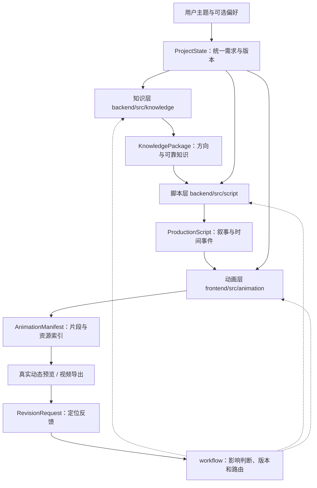
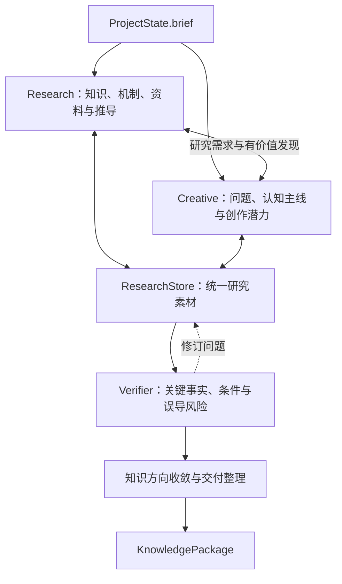

# knowledge-show 系统架构与数据流

> 本文描述当前集成分支的概念架构与模块边界。集成内容包含主链路需求快照和恢复、脚本摘要独立重读、动画候选校验、精确修订锚点及安全失败诊断，以及正式动画生成、检查后发布、工作台、定向修订和同源导出。完整 PN 样本已验收；新主题模型美术质量仍需逐片审核。公共字段及类型以 `contracts/` 为准；这些改动尚未进入 `main`。

## 一、整体工作流



生产主线为 **知识 → 脚本 → 动画**。协调器维护共享需求、当前产物引用和修订路由。用户可提前选择方向，也可直接采用系统推荐生成首版。知识层内部不限制单向研究流程：知识发现与创意构想互相提出问题，经过必要核验后再收敛为公开的 `KnowledgePackage`。React 创作页通过本地 API 创建 ProjectState 并启动可恢复查询的后台 Job，工作流读取精确 KnowledgePackage、生成或复用 ProductionScript。主链路修复保证完整用户偏好与 ProjectState 一致，并允许 `script_ready` 后单独恢复脚本摘要。`script_ready` 代表脚本已正式发布；动画交接 API 返回精确脚本版本。候选 Manifest 按当前脚本/Brief 精确引用和关键关系校验后独立保存；正式动画服务生成受控场景，经真实浏览器关键帧检查后以 CAS 发布当前 Manifest。React 动画入口、工作台 iframe 和逐帧导出共用同一 Player；渲染子进程不接触模型凭证。RevisionRequest 的实体锚点从精确目标版本读取；动画目标只允许解析当前已发布且通过播放器检查的 Manifest，候选不作为发布产物。

**共同创作目标**：最终作品应围绕值得观看的知识主线，建立真实可感知的视觉对象、清楚的观看重心和自然连续的变化。纯标题、公式、静态卡片和图表的轮流切换不构成合格的主要动画表达。这是三层共同保障的产品目标，不能靠单一层的字段或 Schema 自动验收。

## 二、知识层内部数据与职责边界

知识层内部建议围绕三个逻辑角色和一份共享研究状态协作：



- **Research** 可以从模型已有知识、可复核推导或必要的外部 Search/Fetch 获得材料，不要求基础知识一律先搜索；所有拟正式采用的知识都需进行适当核验。
- **Creative** 基于知识关系探索真正有价值的核心问题、因果变化和认知主线。它可以向 Research 请求具体知识补充，Research 也可以主动反馈值得进一步创作的发现。
- **ResearchStore** 在逻辑上统一保存研究问题、资料、知识主张、证据关系、创意线索和未解决问题。知识层已在 `main` 中以项目隔离的 SQLite 实现；Agent 先检索已有成果，有明确缺口时再补充研究。它是知识层内部状态，不新增跨阶段机器契约。
- **Verifier** 以风险驱动方式检查重要事实和误导风险，优先指出能保留创意的局部修正；不代替 Creative 判断故事形式，也不作为动画审美审核者。
- **收敛** 优先深入推荐方向，其他可行方向保留适量可靠材料；只要方向值得做、知识足以支持脚本且没有关键事实问题，就可以交付，不设置固定知识单元数或机械搜索配额。

知识层内部细则统一维护于 `docs/work/backend/knowledge/知识层探索与创意策划.md`；实现已进入 `main`，本架构文档只描述公共数据流和模块连接。

## 三、五种跨模块对象

| 对象 | 数据持有方 | 主要内容 | 下游用途 |
| --- | --- | --- | --- |
| `ProjectState` | 协调器 | `brief.user_input`、`brief.effective`、已选择方向、当前产物引用 | 各层共享用户意图和版本 |
| `KnowledgePackage` | 知识层 | 候选、知识单元、证据、必要条件与限制 | 供脚本层选材与策划 |
| `ProductionScript` | 脚本层 | 选定方向、时间线、可选关键事件锚点、文字及语义引用 | 指导动态场景实现 |
| `AnimationManifest` | 动画层 | 动画片段、时间范围、脚本引用、资源及可选元件 ID 索引 | 支持预览、定向修订和导出 |
| `RevisionRequest` | 反馈发起方 / 协调器 | 修改目标、原版本、对象锚点（含渲染元件）、反馈与保留要求 | 定位问题并控制修订范围 |

**权威字段与校验**：`contracts/schemas/`、`contracts/examples/`、`contracts/validate_contracts.py`；职责和引用语义见 `contracts/接口契约与协作规范.md`。这份文档不复制全部 Schema 字段。

当前知识包允许在 `knowledge_units[]` 中使用 `verification_status = needs_review` 保留待处理线索，但**候选方向和脚本只能引用 `verified` 知识**。内部 ResearchStore 可保留更丰富的研究草稿；对外引用权限由现行契约决定。

知识层以 `${KNOWLEDGE_EXPORT_DIR}/{artifact_id}-r{revision}.json` 交付具体版本。写入使用原子发布并在运行完成前重新读取和校验；版本内容不可被静默覆盖。脚本消费者应使用协调器发布的精确 `ArtifactRef`，不读取知识层 SQLite。main 上的工作流持久化 ProjectState revision JSON，读取精确知识包版本并选择系统默认方向；脚本层调用 DeepSeek Responses API（客户端可注入 Fake），按契约生成并校验 ProductionScript，最多执行一次受限修复，最后以不可覆盖的版本文件发布。真实模型验收尚未进行。上游知识包或方向变化时会失效当前脚本/动画引用；脚本任务可复用仍匹配当前项目版本的已发布脚本。

## 四、目录到模块的映射

| 仓库位置 | 规划中的职责 | 当前情况 |
| --- | --- | --- |
| `backend/src/knowledge/` | 研究、创意探索、知识管理、事实核验与知识包交付 | 首版与 16:9 配置已进入 `main` |
| `backend/src/script/` | 选材、叙事主线、场景事件、时间规划和脚本输出 | main 有模型客户端、结构化生成、有限修复、契约校验和版本发布；真实模型验收待做 |
| `backend/src/workflow/` | 跨层项目状态、执行编排、版本与修订路由 | 提供 ProjectState 版本存储、知识包到脚本编排、候选校验、精确锚点验证和请求持久化；自动处理上游修订仍未实现 |
| `backend/src/api/` | 前后端本地任务入口 | 提供项目、任务、产物、动画交接、预览、动画制作及修订端点；锚点从当前已发布的精确产物解析；仅限本机开发 |
| `backend/src/common/` | 确需共享的后端基础逻辑 | 占位目录 |
| `frontend/src/features/creation/` | 需求表达与提交确认 | 完整偏好提交与恢复、变化后创建新项目；API Key 不持久化 |
| `frontend/src/features/landing/`、`progress/`、`settings/` | 品牌入口、阶段展示、会话连接设置 | 真实脚本任务状态、连接检查和脚本摘要独立重读 |
| `frontend/src/features/preview/` | 动态预览与产物查看 | 正式预览重验精确资源和播放器检查回执 |
| `frontend/src/features/revision/` | 用户反馈入口及修订结果呈现 | 时间轴工作台连接真实脚本、Manifest 和 Player；后端持久化可解析的修订请求，不自动执行所有上游反馈 |
| `frontend/src/animation/runtime/` | 动画播放、场景装配和渲染运行时 | 单一 Player、Manifest 解析、多场景全局时间、稳定元件 bbox；预览和导出复用 |
| `frontend/src/animation/scenes/` | 场景实现与必要复用 | PN v2 七幕固定验收实现；新主题使用受控 VectorScene，四种风格独立于网页 |
| `backend/src/animation/` | 动画 Director、版本与生成协调 | 精确脚本输入、场景数据校验、实际浏览器检查、CAS 发布、定向修订、回退及导出任务 |
| `frontend/scripts/render-video.mjs` | 同源逐帧编码 | Playwright 驱动纯 Player，FFmpeg 编码与 ffprobe 验证，不含编辑器 UI |
| `contracts/` | 独立于业务代码的机器契约和 Mock | 已建立 |

业务目录是否已出现实际功能由 `STATUS.md`、代码和运行结果确认；本文不将设计描述视为已实施。

## 五、阶段更新与最小修订闭环

1. **初始化**：由用户输入构建 `ProjectState.brief`，区分明确要求和系统补全配置。主题为唯一强制输入。
2. **知识产出**：知识层依据主题和有效深度进行研究与创意探索，复用内部知识状态，核对关键事实，形成 `KnowledgePackage`。推荐方向优先准备到能够直接供脚本创作；不固定候选数或知识单元数。
3. **脚本产出**：脚本层读取当前需求和知识包，决定方向、内容取舍和贯穿全片的认知推进，产出 `ProductionScript` 并精确引用知识包版本。
4. **动画产出**：动画层根据时间与语义，自主实现清楚的视觉对象和自然连续的变化，产出可播放结果及 `AnimationManifest`。一个脚本场景可以对应多个动画片段。
5. **反馈与替换**：用户或模块提交 `RevisionRequest`，协调器根据对象、时间和版本判断影响范围。知识问题先使用知识层已有研究成果，确有缺口时补充；脚本与动画只重做必要部分。待新产物验证后才更新 `ProjectState.artifacts`。
6. **导出**：尽量复用预览已经运行的动画实现，检查实际预览和视频成片的一致性；具体技术方案不在此预先锁定。

事实错误由知识层处理；选材、主线和时间问题由脚本层处理；视觉对象与运动表达问题优先由动画层处理。各层不得静默改写其他层持有的事实或强约束。

## 六、架构验收边界

仓库已有的跨阶段结构校验入口：

```bash
PYTHONPATH=backend/src .venv/bin/python -m pytest backend/tests/knowledge -q
.venv/bin/python contracts/validate_contracts.py
```

本次集成分支的验证结果记录在 `STATUS.md`。分支历史中的主链路和动画验证不代替集成后的验证。真实模型脚本验收尚未进行；Mock 结果不代表真实脚本生成质量。新主题也仍需人工检查知识准确性、创意质量、脚本可看性与最终观感；契约校验不能代替这些检查。

分工与协作规则见 `docs/work/目录结构与分工.md` 和 `docs/work/workflow.md`。
