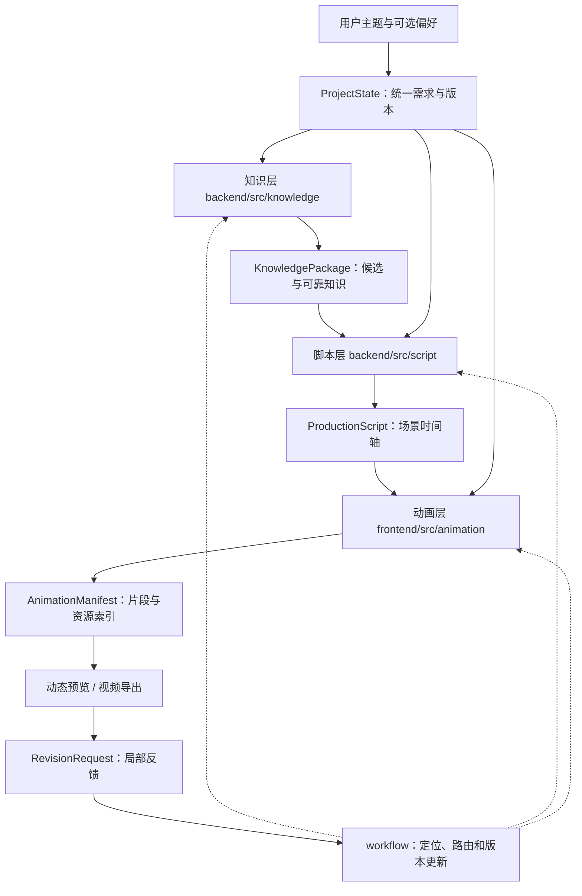

# knowledge-show 系统架构与数据流

> 本文描述已确定的**概念架构与仓库模块边界**，不是已实现架构的运行报告。当前技术栈、模型、API 传输协议、存储方案与渲染框架尚未锁定。字段和类型只引用 `contracts/` 中的现行定义。

## 一、整体工作流



生产主线为 **知识 → 脚本 → 动画**。协调器管理共享上下文和任务交接，允许下游提出需要上游修订的请求。用户可以直接采用系统推荐方向生成预览，也可以提前选择候选；预览后的反馈可以路由到任何相关层。

知识层内部同时包含**知识研究与创意方向探索**：研究知识规律、现象和依据，也探索知识如何引出明确的问题、因果变化与连续可理解的认知主线。两类探索可以按需相互补充，经过事实核验后再汇总为可靠知识包。内部角色与具体流程见 `docs/work/backend/knowledge/知识层探索与创意策划.md`。这不改变公开契约或下游对脚本、视觉实施的所有权。

## 二、五种跨模块对象

| 对象 | 数据持有方 | 主要内容 | 下游用途 |
| --- | --- | --- | --- |
| `ProjectState` | 协调器 | `brief.user_input`、`brief.effective`、已选择方向、当前产物引用 | 各层共享用户意图和版本 |
| `KnowledgePackage` | 知识层 | 多个候选、知识单元、证据和必要限制 | 供脚本层选材与编排 |
| `ProductionScript` | 脚本层 | 选定方向、场景、时间、事件、文字和引用 | 指导实际动画实现 |
| `AnimationManifest` | 动画层 | 动画片段、时间范围、脚本引用、播放资源索引 | 支持预览、修订、导出 |
| `RevisionRequest` | 反馈发起方 / 协调器 | 修改目标、原版本、对象锚点、反馈与保留要求 | 路由到对应层并控制影响范围 |

**权威字段与校验**：`contracts/schemas/`、`contracts/examples/`、`contracts/validate_contracts.py`；语义和责任见 `contracts/接口契约与协作规范.md`。本文件只讲数据流和模块关系，避免复制完整字段表。

## 三、目录到模块的映射

| 仓库位置 | 规划中的职责 | 当前情况 |
| --- | --- | --- |
| `backend/src/knowledge/` | 知识与创意线索探索、事实核验、候选组织、知识包输出 | 占位目录 |
| `backend/src/script/` | 知识选材、叙事主线、场景事件与时间线规划 | 占位目录 |
| `backend/src/workflow/` | 项目状态、执行编排、版本、修订路由 | 占位目录 |
| `backend/src/api/` | 前后端入口；具体协议待定 | 占位目录 |
| `backend/src/common/` | 确需复用的后端基础逻辑 | 占位目录 |
| `frontend/src/features/creation/` | 需求表达与候选浏览 | 占位目录 |
| `frontend/src/features/preview/` | 动态预览与产物查看 | 占位目录 |
| `frontend/src/features/revision/` | 用户反馈入口及修订结果呈现 | 占位目录 |
| `frontend/src/animation/runtime/` | 动画播放、场景装配和渲染运行时 | 占位目录 |
| `frontend/src/animation/scenes/` | 场景实现及必要复用 | 占位目录 |
| `contracts/` | 独立于业务代码的机器契约和 Mock | 已建立 |

实际文件名、语言、框架、API 路由将在模块落地后填写；不要预先发明运行入口。

## 四、阶段更新与最小修订闭环

1. **初始化**：根据用户输入创建或更新 `ProjectState.brief`，保存明确偏好与补全的有效设置。只有主题必填。
2. **知识产出**：知识层研究可靠知识并探索具有主线潜力的创意方向，发布带稳定 ID 和 `brief_revision` 的 `KnowledgePackage`。只给出视觉潜力标注，不预先固定画面对象或动画方案；不要求固定知识单元数量。
3. **脚本产出**：脚本层读取当前需求与知识包，确定方向、知识取舍，组织连贯的内容推进和时间事件，产出 `ProductionScript` 并精确引用知识包版本。
4. **动画产出**：动画层读取当前脚本，自主设计可持续追踪的视觉对象和自然连续的运动，产出可预览场景及 `AnimationManifest`，片段与场景/事件保持稳定引用。一个场景可对应多个片段。
5. **反馈与替换**：用户或模块提交 `RevisionRequest`。协调器根据对象、时间、版本判断影响范围，交给持有该产物的层执行；新产物验证成功后更新 `ProjectState.artifacts`，不在验证前覆盖当前已发布版本。
6. **导出**：应尽量复用预览已经运行的动画实现，确认实际预览与输出视频的一致性。具体技术方案尚未决定。

知识事实出错需要回到知识层；选材或叙事、时长变化回到脚本层；视觉对象与运动的实现细节优先在动画层处理。没有理由时不向上追溯、不重跑无关阶段。

## 五、架构验收边界

当前可用的跨阶段结构校验：

```bash
python -m pip install 'jsonschema>=4.18'
python contracts/validate_contracts.py
```

上述脚本验证 Schema、对象引用与部分时间/版本关系。**不验证**研究事实真伪、脚本吸引力、动画运行或视频编码。相关能力实现后由各模块提供实际测试与运行命令。

分工与文档定位见 `docs/work/目录结构与分工.md`，日常协作见 `docs/work/workflow.md`。
