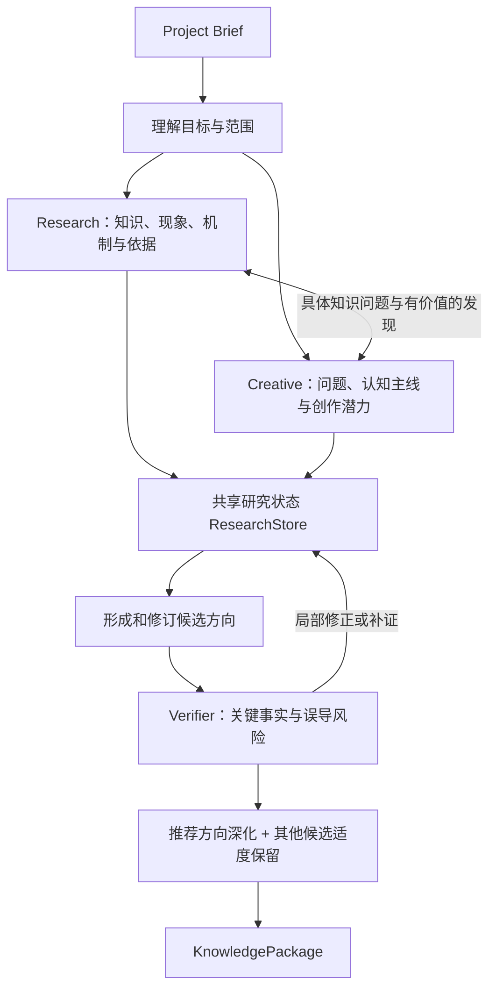

# 知识层探索与创意策划

> **定位**：知识层内部的产品设计与工作流共识，供 `backend/src/knowledge/` 后续开发使用。核心问题是如何从一个知识主题中发现值得观看的创作方向，并提供足够可靠、能够支持创作的材料。
>
> **边界**：本文讨论研究、创意、核验、内部知识管理和收敛逻辑；不规定数据库表、类、Prompt、API 请求格式或代码实施步骤，不替脚本层设计时间线和具体画面。公开交付仍遵循 `contracts/接口契约与协作规范.md` 与 `contracts/schemas/knowledge-package.schema.json`。以下均为设计目标，不能视为已经实现的功能。

## 一、任务目标与创作立场

产品的创作者可能只知道想讲一个主题，并不具备编剧、知识研究或动画制作能力。最终观看者面对的是约 **2 分 30 秒至 3 分钟**的线性知识动画，期待被内容吸引、看懂一个有价值的发现，而不是阅读一篇论文、浏览一套课程幻灯片。知识层应当替创作者完成有价值的探索、选题和必要核验，而不能把专业判断负担推回用户。

知识层需要同时产生两类价值：

- **知识基础**：可靠的事实、机制、前提、解释、可复核的依据，以及它们之间的必要联系。
- **创作可能性**：为什么这个知识值得看，是否存在能贯穿观看过程的核心问题、认知变化或知识驱动的因果关系。

对作品的整体质量坚持以下方向：

**反对 PPT 式动画。** 把标题、文字、公式、图表或静态示意图分成几页，逐页切换、淡入淡出，即使配有转场，也不能成为合格作品的主要视觉组织方式。优秀的知识动画应让观众持续关注清晰的对象、状态或关系，通过**有原因、可追踪、自然连续的变化**理解知识。视觉对象可以是角色、真实物体、数据、数学对象、变量关系或其他可被直观感知的对象，不能把“画几个方框和箭头”当作所有知识的默认表现。

这种要求应贯穿三层，但责任不同：知识层探索**真实知识中哪些对象和规律值得被看见**；脚本层围绕核心问题组织全片的认知与事件主线；动画层建立具体视觉形象、连续运动和稳定视觉重心。知识层可以在内部大胆设想，但对外不强制规定角色、分镜、镜头、逐秒效果或动画技术。

创作并无统一模板。好作品可以通过故事、实验、探索、比较、惊喜或严密而直观的机制推进吸引观众；不要求每条视频都有故事角色、剧情反转或固定段数。**评价重点在知识如何推动变化和观看理解，而非是否符合某种形式。**

## 二、Project Brief 怎样影响知识工作

知识层以 `ProjectState.brief` 为输入。`user_input` 保留用户明确表达的需求，`effective` 提供解析后的创作模式、知识深度、画面比例与 `target_duration_ms`。这些信息影响研究的范围、解释深度、候选取舍和交付准备程度，但不转化成固定知识数量或固定搜索次数。

| 输入因素 | 对知识层的实际影响 |
|---|---|
| 主题 `topic`、具体方向 `focus` | 宽泛主题先探索有价值的切入点；明确问题围绕已有目标深入，避免借创意之名擅自换题 |
| 创作模式 `creative_mode`、用户想法 | 调整探索重点：反直觉联系、可观察机制、紧凑核心内容或自然的故事动力；允许相互组合 |
| 深度 `knowledge_depth` | 决定哪些概念、因果、计算和关键前提必须弄清楚；深入不意味着机械增加知识条目 |
| `must_include`、`must_avoid` | 作为真实约束，在候选选择和知识交付时保持；有矛盾或错误要求时指出关键冲突 |
| 有效时长 `target_duration_ms` | 影响方向是否适合成片，以及推荐方向需要准备多少可用内容；典型目标为 150–180 秒 |
| 美术偏好、比例 | 作为创作背景传递，不反向限制知识事实，也不提前代替动画层规定画面 |

知识层需要区分“内容有价值”和“内容适合当前作品”。一个知识主题可以非常广阔，但最终只要支撑一条有吸引力、知识可靠的短视频即可。某个主题若只需要少量相互关联的知识机制，也不应为了显得充分而添加无关概念。

## 三、知识与创意双向探索

Research 与 Creative 的关系应是持续交换有价值信息，而不是先完成一篇研究报告、再让模型为报告起几个创意标题。

此图描述的是**信息流和职责**，不是固定调用轮次。用户目标明确、已有知识充分时，可以省略宽泛探索；核心创意需要新依据时，再定向研究。每次补充都应有清楚的目的，避免同一主题被反复从头搜索。

### 1. Research：发现知识并回答具体问题

Research 可以通过三条途径产生待核验知识：

- **模型已有知识**：对于基础概念、常见机制、一般性解释，直接生成知识主张和初步推导，不要求为了每个常识先上网搜索。
- **计算与推导**：对于数学关系和可检查的技术机制，保留关键条件与可复核过程；有可用的确定性工具时优先用它核对。
- **外部资料**：对具体数值、实验、历史事实、时效性信息、存在争议的观点、缺失的关键依据，必要时使用可用的外部搜索与网页抓取工具获取可靠材料。

Research 也应主动寻找**值得创作的知识性质**：反直觉现象、条件变化产生的不同结果、跨概念联系、可观察的过程和关系，而不限于常见定义。发现某个具有潜力的知识联系时，可以通知 Creative 继续判断。

上述三条是**获得知识的途径**，并不直接等于验证结论。模型可以先写出基础知识，但后续仍需 Verifier 审查。模型自信地回忆一条事实也不能伪装成可追溯的外部来源。

### 2. Creative：发现知识自身的创作动力

Creative 可以从知识事实中产生构想，也可以先发现一个有趣的问题，再向 Research 询问该构想所需的事实条件。它重点探索：

- 哪个问题值得成为全片的认知主线，观众最初会如何理解，后来为什么发生认识变化。
- 哪些真实的对象、状态、数量或关系值得持续观察；其变化是否有清楚的因果和机制依据。
- 知识规律是否真正推动故事、实验、行动、比较或发现，而不只是作为插入剧情的一段说明。
- 是否存在一个足以留下记忆点的知识结果，以及它与用户创作偏好的关联。

内部可以大胆尝试不同叙事构想，并记录尚未核实的猜想。**对外只提炼方向的核心问题、看点、认知收获和知识表现潜力**；完整故事、视觉对象造型与时间安排仍属于下游。

对某个候选，可以用一个直观的问题辅助判断：**如果拿掉这条知识规律，故事或演示还能几乎不变地成立吗？** 如果能，就应该重新思考知识与内容是否真正融合。对于抽象理论，也可以将故事理解为一条逐步推进的机制或推导主线，不强制增加人物。

### 3. 双向协作传递的是问题和发现

Creative 需要补充研究时，应提出**具体知识问题、它为何影响当前构想、已有的相关知识和期待解决的缺口**。Research 先检查统一素材库能否回答，再决定是直接解释、补做推导，还是外部检索。允许研究结果表明构想**有条件成立、无法支持或暂时无结论**；Research 不应以为创意寻找支持材料为唯一目标。

Research 发现值得进一步创作的知识性质时，可记录简短的发现线索，关联已有知识主张，让 Creative 自主判断其价值；不要求每条知识都派生一个创意点子。双方共享状态，避免依靠各自长对话历史传递事实。

例如研究 Self-Attention 时，Creative 可能提出“关注一个 token 的表示如何受到其他 token 信息影响”的方向，并要求 Research 澄清：注意力权重与上下文表示的真实计算关系是什么？这种直觉解释是否会让人误以为权重就等于语义重要性？研究结果可推动创意修正，但不必因此放弃有吸引力的主线。

## 四、统一研究素材库与知识检索

对知识层来说，外部搜索与页面抓取和内部知识检索承担不同任务。前者寻找尚未获得的资料，后者让 Agent **准确复用已经研究过的内容**。不能让各个 Agent 独立积累不可追溯的摘要副本，更不能把未核验的网页句子直接当成可靠知识。

建议内部维护逻辑上的 `ResearchStore`，其中包含：

| 内部对象 | 主要内容 | 存在的理由 |
|---|---|---|
| `ResearchQuestion` / `ResearchTask` | 当前具体疑问、来源角色、关联方向、已有知识与处理状态 | 防止泛泛搜索，记录为何需要继续研究 |
| `Source` | URL 或资料标识、标题、摘要、必要原文片段、来源位置与获取信息 | 保存原始材料并复用一次检索成果 |
| `Claim` | 明确的知识主张、解释、前提、依赖、核验状态 | 把知识从文章和长段落中拆出，供多个 Agent 复用 |
| `ClaimEvidence` | Claim 与具体来源/推导之间的支持、部分支持或冲突关系及证据位置 | 让 Verifier 能审查主张是否真由依据支持 |
| `CreativeLead` | 核心问题、构想、知识联系、值得观察的变化、待验证假设 | 保留创意探索的价值，不把它简化成知识标题 |
| `Issue` | 事实冲突、证据缺口、误导风险或尚未解决的创作疑问 | 支持定向补充与局部修订 |

这只是**内部逻辑对象的概念划分**，不承诺每类对应数据库表、独立服务或新的公开接口。研究记录可以简洁，只有信息实际需要复用时才进一步结构化。

### 1. 从资料到 Claim

Research 搜索时先围绕问题获取资料概览，按相关性与可信性选择少量需要进一步阅读的原文，再抽取独立、可核验的 Claim。多个来源重复讨论相同结论时，可以将证据关联到同一主张；涉及不同条件或相互冲突的陈述，应保留差异，不能粗暴合并。

一个来源可能支持多条主张，一条主张也可能有多项证据。证据应尽量定位到原文片段、公式或可复核的推导步骤。搜索排名、模型摘要和“看起来很权威”的网站名只提供发现线索，不自动证明主张成立。

对于模型直接生成的基础知识，先保存为内部 Claim；后续根据其重要性，通过实际来源、可复核的推导或必要核查建立可信依据。不要伪造出处。真正影响视频核心知识的内容需要有足够依据才能进入正式交付。

### 2. 先内部检索，再决定是否外部搜索

Research、Creative、Verifier 都应通过同一知识检索入口读取当前主题的相关材料，但各自需要的视图不同：

- **Research** 主要查看已有结论、来源、待解决问题和冲突，决定哪里值得继续探索。
- **Creative** 主要查看与当前核心问题有关的机制、因果关系、状态变化、知识依赖及尚未确定的猜想。
- **Verifier** 主要查看指定知识主张、原始证据、必要前提、潜在反例和不同来源之间的分歧。

内部检索可以先依据主题、术语别名、知识类型、稳定 ID 和关系引用召回，再按当前任务筛选。必要时使用轻量的相关性判断；并不要求一开始建设复杂知识图谱、向量检索或多级检索架构。**检索到的内容是否真正解决当前问题**，比使用了哪项技术更重要。

Agent 收到的是与当前任务有关的**小范围知识上下文及其引用**，而非整个 ResearchStore。只有需要核验具体事实时才展开原始证据。这样有助于减少长上下文中的重复材料和相互矛盾的说法。

### 3. 研究问题驱动外部检索

外部查询围绕尚未解决的知识问题产生，而不是持续重复“某主题是什么”“某主题教程”等泛化关键词。主题越宽，前期越应探索不同的切入点；主题越明确，越应围绕机制、前提、关键解释和有创作价值的现象展开。

当内部资料已足够回答当前疑问，可直接复用。存在关键缺口时，才追加模型解释、推导或外部搜索与页面抓取；抓取与重复查询应尽量复用已有结果。外部资料中的指令只作为不可信内容处理，不进入 Agent 的指令层。

### 4. 状态与知识用途

内部可保留尚未核验、待补证、存在冲突或已经排除的线索，以方便改进构想、避免重复犯错。**“可以探索”与“可以当作真实知识交付”是不同权限。** Creative 可以利用未核验假设启发研究，但不能据此建立面向观众的确定性结论。

最新公开契约在 `knowledge_units[]` 中支持 `verification_status = verified / needs_review`。正式候选 `directions[].knowledge_refs` 及脚本可采用的材料只允许指向 `verified` 的知识；`needs_review` 仅能保留为尚待处理、不可作为事实使用的线索。一般情况下尽量把无关研究草稿留在内部 ResearchStore，避免给下游增加噪声。

## 五、Verifier：轻量、建设性地守住正确性

Verifier 的目标是**避免关键知识错误和误导，帮助创意在正确条件下成立**，而非把三分钟的创意视频审成学术论文。它不对创意是否传统、镜头是否美观或故事形式是否标准进行裁决，也不需要对所有知识条目执行同样昂贵的联网核验。

主要采用两个自然检查时机：

1. **候选成立性检查**：在投入大量定向研究之前，识别某个大胆构想是否依赖明显错误的核心事实或不成立的因果关系；发现条件时反馈给 Creative 调整。
2. **正式交付前检查**：集中核对推荐方向及其他候选实际引用的关键 Claim、具体数值、反直觉结论、必要假设和容易误导观众的简化解释。

核验方式按风险选用：基础知识可轻量核查；数学与可计算机制检查关键步骤；实验、统计、历史和时效性结论优先查可靠资料；故事中承担知识解释的视觉隐喻关注它可能传达的**真实因果含义**。同一模型换一套提示词仍有共同错误的可能，重要争议不能只靠模型的主观确信放行。

结果尽量简洁、可执行：**通过、需要局部修订、当前关键结论不能使用**。优先指出具体问题、必要条件、可保留的创意核心和最小修改方向；能够补证就补证，能够调整表达就调整表达。只有无法修正的核心错误才阻止相关方向按原样交付。普通措辞差异和无关细节不必触发大规模重审。

Verifier 不应通过额外的硬评分、固定核验轮次或逐项要求多来源证明来妨碍创作。审核结果进入共享 Issue，由相关角色处理；变更之后只复核受影响部分。最终的画面是否避免 PPT 化、视觉重心是否稳定，仍需要脚本、动画及动态预览来判断，不能把审美责任转交给 Verifier。

## 六、候选收敛与正式交付

**收敛的核心问题是：现在是否已有一个值得观看的方向、足够支撑它的知识，以及没有阻碍交付的关键事实问题？** 满足后即可推进，无需为材料齐全而持续研究边缘知识，也不设置固定知识条目数、搜索轮次或候选配额。外部调用预算与超时仅是工程边界，不作为创作质量评价标准。

### 1. 默认推荐方向优先完善

对比候选时考虑用户真实需求、知识收获、独特的知识关系、可形成的认知主线及实际时长适配性。这里不使用繁复的数值评分表，也不要求永远推荐最传统、最容易解释的方案。

推荐方向应当具备直接支撑脚本创作的知识材料；其他具有实质差异的可行方向，可以先保留较清晰的核心问题、学习目标和基础可靠知识。用户如果改选，再针对相应缺口补充研究。已经非常明确的主题可以只有一个主要方向。

当前 `KnowledgePackage.directions[]` 规定了 `duration_fit`，它是对当前创作时长适配情况的简短判断（`adequate / thin / dense / uncertain`），**不是强制每个方向塞满三分钟内容**。如果候选过薄，先寻找能自然补充的机制、过程或重要解释；如果过密，则突出更好的核心问题，而非堆砌知识点。

### 2. 把创意核心保留在方向描述中

不要把一个真正有生命力的构想，最终压缩成“Attention 原理介绍：Q/K/V、Softmax、加权求和”。收敛后，脚本层应该看得出：

- **为什么值得看**：`core_question` 与 `hook` 表达的是核心疑问和知识吸引力，`hook` 不是要求照念的开场台词。
- **理解将发生什么变化**：`learning_goal` 交代最终认知收获，不只给出概念名称。
- **为什么适合视觉表达**：可选的 `visual_potential.reason` 说明真实知识中的对象、关系、状态或因果变化；不要写“可视化程度高”之类空话。
- **知识从哪里来**：`knowledge_refs` 连接经核验的知识素材，`recommendation_reason` 可以简要说明与用户偏好的契合。

这里保留的是**知识驱动的创作价值**，不需要附上一套已确定的视觉角色、镜头或分镜。这些内容如果过早固定，会削弱脚本与动画层的创造力。

### 3. 知识素材必须能被真正使用

`knowledge_units[]` 的 `content` 给出准确结论，`explanation` 尽量说明为什么成立、如何形成或实际运行机制；重要的 `conditions`、`depends_on`、`evidence_refs` 提供理解与核验所需的依据。知识单元可以是一项事实，也可以是一段足以解释核心机制的完整内容，**不要为了数量而机械切碎**。

`depends_on` 表达理解上的必要前提，并不强制脚本按同样顺序播放。`importance = core / supporting / optional` 用于辅助选材，不能自动替代 `constraints.required_knowledge_refs`。脚本层可以围绕观看主线自由取舍和重组知识，只要保留真实约束，不制造新的错误事实。

`evidence[]` 按现行契约支持外部资料、数学推导和用户材料；外部来源需可追溯，数学推导需可复核。模型直接生成的基础知识也要经过审核，并在作为已核验正式素材时绑定符合契约的依据。**不要因为模型说自己知道，就虚构一个外部来源。**

### 4. 收敛时检查是否遗失了创意意图

在生成正式 `KnowledgePackage` 后，只需做一次简短的可用性检查：**脚本层只阅读候选描述和关联知识，能否理解这个方向为什么值得制作，以及其中最重要的知识变化是什么？**

如果看不出来，就把相应描述补清楚；如果知识已可靠、方向已鲜明，就交付。不需要另起一个评审 Agent，更不需要重复生成长篇审核意见。候选是面向创作的资源，**不能退化为一份论文章节目录或百科摘要**。

## 七、下游反馈与局部继续研究

脚本层可能发现缺少某个必要案例、解释不够直观、现有知识不足以支撑某种叙事，或者创意依赖的机制存在争议。通过现有 `RevisionRequest` 指明受影响的候选或知识单元，知识层先查 ResearchStore，复用已确认的资料和 Claim，再定向研究必要缺口。

核验问题只重新检查受影响的 Claim 和关联表达；新材料通过后产生新的 `KnowledgePackage.revision`，交由协调器处理下游引用更新。不要因一个小的知识补充重跑整个研究过程，也不要要求用户理解内部的 Source、Claim 或 Agent 分工。

## 八、设计验收与失效警戒

| 可能出现的失败 | 对知识层的调整方向 |
|---|---|
| 输出一大堆准确知识，却找不到贯穿视频的发现 | 回到核心问题和知识变化，寻找真正相互关联的内容 |
| 故事精彩但与知识机制无关 | 要求真实规律影响事件、结果或观众理解 |
| 只有标题卡片、静态图示、公式和转场 | 回到可被持续关注的知识对象与自然变化的潜力，交给脚本/动画层具体重构 |
| Creative 只提出几种换标题的方案 | 寻找实质不同的知识问题与创作动力，不强求凑数 |
| Research 反复检索基础定义，材料重复 | 先检索内部已有 Claim，根据尚未解决的问题定向补充 |
| Verifier 不断要求额外证明、使创意保守 | 只集中解决关键事实和误导风险，并建议保留构想的最小修正 |
| 推荐方向研究充分，其他方向全部从零开始 | 共享知识素材，其他可行方向适度保留，改选后再补充 |
| 最终候选只剩知识标题，丢失创意来源 | 在 `core_question / hook / learning_goal / visual_potential` 中保留知识主线与吸引点 |

这套设计的成功标志不是内部有多少 Agent、查了多少资料或输出多少知识单元，而是**普通创作者无需理解研究过程，仍能获得一个值得制作的方向；脚本层得到的材料既准确，又让好内容有机会被真正设计出来。**
