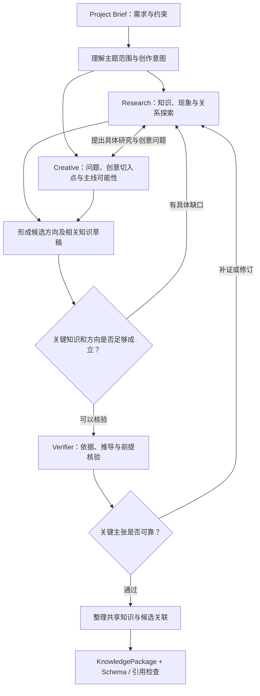

# 知识层探索与创意策划

> **定位**：知识层内部设计与质量原则，面向 `backend/src/knowledge/` 的实现。记录如何从用户主题发现有价值、可靠且具有创作潜力的内容；不更改 `contracts/` 的公开数据结构，不规定脚本、动画的具体实现。
>
> **状态**：内部工作流设计方向，尚未代表功能已经实现。跨层交付字段遵循 `contracts/接口契约与协作规范.md` 和 `contracts/schemas/knowledge-package.schema.json`。

## 一、知识层的核心目标

知识层拿到的输入是 `ProjectState.brief`，其中包含主题、可选的细化问题、创作模式、知识深度、用户创意和内容约束。用户可能只知道自己想讲的领域，未必知道哪些内容值得制作，因而不能把知识层简化成“对主题写一篇科普文章”。

知识层需要同时完成两件彼此促进的事：

1. **知识研究**：确认概念、机制、现象、前提、推导与可靠依据，整理足以让脚本层创作的知识素材。
2. **创意发现**：探索这个主题有哪些真正值得观看的切入点，以及知识规律能否自然产生问题、冲突、变化、实验、发现或意外结果。

两者可以互相驱动。某种知识关系可能触发创意构想；一个有趣的构想也可以促使进一步研究支撑它的原理。**创意不能代替依据，资料丰富也不能自动等同于有好的创意方向。**

最终交付仍为 `KnowledgePackage`：候选方向、共享知识单元、依据和必要约束。知识层**不输出完整旁白、时间轴、固定视觉隐喻、逐秒分镜或动画步骤**，避免下游直接照抄创意示例而失去设计空间。

## 二、真正有创作价值的知识方向

### 1. 主线意识

值得关注的不只是“有哪些知识点”，还包括它们**为什么需要依次被理解**。一个优质方向通常能够提出明确的问题，让后续知识不断推动问题的理解，最终产生某个可以记住的结果。

在内部策划时，应尝试识别：核心问题是什么，观众最初会如何理解它，哪种规律或现象促成认知变化，各部分知识之间存在什么因果、对比或依赖联系。这个思考过程帮助候选形成清楚方向，**不要求将它固定为某种三幕式、四阶段式或其他统一模板**。

如果一个方案只是在相同主题下并排罗列多个趣味事实，却缺少能贯穿全片的关系，应该继续研究知识联系或缩小主题，而不急于将其作为推荐方向。

### 2. 知识与叙事的融合

叙事可以由人物、任务、实验、规则、数据或抽象关系承担。值得追求的状态是：**知识规律会改变对象的行为、环境的结果、实验的观察，或观众对正在发生的事情的解释**。故事或演示因知识而成立，观众在观察变化时自然学习知识。

单纯给知识配上装饰性的剧情、将几个知识点包装成问答台词，可能仍然缺少生命力。反过来，如果为了惊喜、戏剧冲突或画面效果而歪曲知识规律，则没有满足基本事实要求。

对于偏理论的主题，也不必硬塞角色和故事：完整的逻辑推进、同一对象在多轮计算中的变化、条件改变后的结果对比，都能形成富有吸引力的内容主线。

### 3. 视觉重心与连续变化的潜力

知识层应该主动识别：知识中是否存在**可辨认的核心对象、变量、关系或状态**；它们是否可以随着规律发生自然变化；观众能否持续追踪一个重点，理解从初始状态到最终结果的内在原因。

这类分析旨在确认方向是否值得进行视觉表达，而不是替脚本层选择固定画面。如果知识暂时显得抽象，可以继续寻找其可观察的现象、比较关系或状态更新过程；也允许最后发现某个题目更适合精炼解释，不能因此机械判定不合格。

对外交付时，使用已有的 `visual_potential` 及简短依据，**不要把内部探索过的具体视觉想法变成强制视觉方案**。具体的核心视觉对象、画面组织、动画连续性、视听节奏分别由脚本层与动画层根据真实创作条件决定。

## 三、灵活的内部工作流

这是**建议的数据和任务流**，不是需要机械执行的固定轮次。主题已经明确时，可以直接定向研究并整理素材；用户只给出宽泛领域时，应先探索可行切入点。若证据已经充分，就不必再次调用搜索；若创意与事实存在缺口，就围绕缺口补充，而非全量重做。

### 1. 需求理解

识别用户明确要求的知识范围、创作模式、知识深度及必须包含/避免的信息。区分用户已明确指定的内容与系统可自主判断的部分。

创作模式影响探索偏好：创意优先可以更积极关注反直觉联系，直观演示更关注过程与关系变化，干货精讲更关注关键机制与解释完整性，故事悬念更关注问题背景与发现过程。**模式仅影响方向的探索和选择**，不改变事实标准，也不把后续叙事限制为固定形式。

### 2. Research：知识与现象探索

从主题出发发现核心概念、事实、推导、现实或理论现象以及知识之间的联系。围绕候选构想提出的问题进行进一步研究；寻找可靠来源或可复核的计算依据。

研究可以先保持开放，随后根据用户要求和创作潜力收束。过宽泛的主题优先找切入点，明确的主题优先补足解释与前提。记录实际尚未核验的主张及其证据状态，防止在后续组合中被误当成可靠事实。

### 3. Creative：创意方向与主线探索

结合知识线索，探索不同的核心问题、认知反差、因果推进、结果揭示和可持续追踪的知识关系；必要时反向向 Research 提出具体的补证问题。

判断方案时，优先考察**知识规律是否真正影响内容推进**、观众是否有可能看到明确变化、最终能否获得清晰的认知收获。候选之间应有实质性的知识角度或创意机制差异；主题范围明确时可以只有一个主要方案，不必为凑数改变用户目标。

不要给所有方向套用同一套“悬念—解释—反转—结尾”模版，也不需要所有方案都包含故事角色或复杂视觉特效。

### 4. Verifier：独立事实核验

对候选及其知识草稿中的关键事实、推导、条件和来源进行审查。对数字结论优先复核计算，对经验性或专业性论断检查其资料来源及适用范围。审核应围绕可识别的主张与依据展开，模型对自己生成内容的主观确信不能替代证据。

发现不可靠内容时，明确需要修订的知识与来源问题；能补证则定向补证，无法核验则删除或不作为可靠知识交付。创意若依赖错误事实，应修改或放弃对应构想。

### 5. 组装与交付

从经核验的素材组织候选方向、共享 `knowledge_units`、`evidence` 和 `constraints`，维护稳定 ID、知识依赖及证据引用。将可供下游使用的核心、辅助和拓展知识一并保留；实际使用比例由脚本层决定。

结构化交付时可以引用知识的视觉潜力，但不提供镜头脚本、预设角色、动画示例等具体设计。脚本层应能独立完成选材和叙事规划，无需重新进行全部基础知识研究。

## 四、Agent 角色与实现边界

内部可以按任务划分 **Research、Creative、Verifier** 三种逻辑角色，使用轻量协调器管理输入、状态、按需回退和最终发布。这些是**职责划分**，不要求三个长期独立运行的 Agent、三个模型实例或复杂的对话框架；具体调用方式由实现者根据时间和稳定性决定。

| 角色 | 输入侧重点 | 输出侧重点 | 职责边界 |
|---|---|---|---|
| Research | 项目需求、现有线索、具体研究问题 | 知识线索、来源、解释和待核验主张 | 不决定最终场景与时间线 |
| Creative | 项目创作模式、知识线索、已有候选 | 不同创意切入点、主线可能性、知识研究需求 | 不发明事实或固定动画方案 |
| Verifier | 具体知识主张、依据、前提 | 可用性判断、事实修订与补证要求 | 不以个人喜好替代证据检查 |
| 协调器 | 各角色中间结果和状态 | 调度、去重、契约组装、异常处理 | 不自行进行开放式知识创作 |

建议维护一份知识层**内部工作状态**，分别保存研究线索、候选草稿、待核验知识和审查结果。正式交付只公开经过整理与核验的 `KnowledgePackage`，避免把检索噪声、冲突草稿和无依据构想推给脚本层。

## 五、收束标准与后续修订

**不对知识单元、候选数量、探索次数或故事段数制定固定额度。** 判断是否可以结束研究时，重点查看：

- 候选是否具有清楚的核心问题、真实的知识收获及与用户要求相符的创作可能性。
- 主要知识事实、解释、条件与证据是否可靠，知识之间是否存在可理解的联系。
- 知识素材是否足以支持脚本层展开完整创作，并允许其自主选择内容。
- 剩余问题是否会影响事实准确性或根本的创作方向；如果不会，则不必继续扩展无关知识。

来自下游的 `RevisionRequest` 可以要求补充知识、修正事实或重新探索某个方向。协调器按候选、知识 ID 和版本定位问题，只重做受影响部分；原有可靠且未受影响的知识尽量复用。

## 六、需要避免的失效模式

| 常见问题 | 应调整的方向 |
|---|---|
| 研究结果像百科词条集合，缺乏观看主线 | 寻找核心问题、认知变化以及知识间的因果和依赖 |
| 先有通用剧情，再机械插入讲解 | 让真实的知识规律影响事件、观察或结果 |
| 有很多动画点子，却缺少明确知识重心 | 回到核心知识对象、关系或问题，判断观众应该跟踪什么 |
| 内容由互不相干的片段构成 | 分析状态与知识如何自然衔接，留给脚本层建立连续推进 |
| 为了视觉效果忽略前提或夸大事实 | 回到知识依据、条件及必要限制进行核验 |
| 每次输出固定数量、固定模式的候选与知识单元 | 根据用户目标和主题实际结构决定内容广度与深度 |
| 知识层提前编写逐秒画面与角色脚本 | 只保留知识线索、创作方向和视觉潜力标注，将实施设计交给下游 |

**交付标准**：在保持知识真实性的前提下，让脚本层同时拥有**可用的知识基础和足够开放的创意空间**。知识层的价值体现在发现值得观看的知识关系及其潜力，而不是提前替下游完成整个视频。
