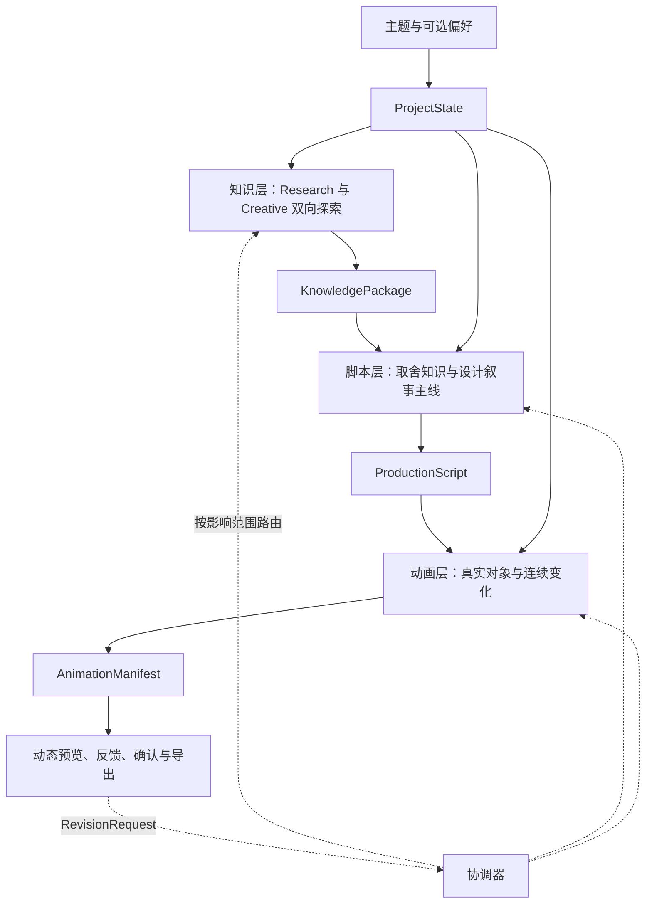

# knowledge-show 产品理念与工作流共识

> 记录产品定位、创作输入、内容体验和三层生产职责，供知识、脚本与动画模块对齐。本文是**产品设计共识**，不代表相应功能已实现。准确字段查 `contracts/schemas/`，跨层交接查 `contracts/接口契约与协作规范.md`；知识层内部工作细节以 `docs/work/backend/knowledge/知识层探索与创意策划.md` 为准。

## 一、产品定位

### 1. 创作者与观看者

产品主要面向想制作知识短视频、但缺少专业研究、编剧和动画经验的普通创作者。用户可能只知道想讲什么主题，对最值得讲的切入点和具体表现方式没有成熟判断。系统应主动开展研究、创意发现、知识取舍、脚本策划和动画制作，让用户可以先看到真实成果，再根据直观感受调整。

最终观看者面对的是一条约 **2 分 30 秒至 3 分钟**的线性知识动画。作品应当能吸引普通观众继续观看，让人通过直观的对象和变化理解一个清楚、有价值的知识发现。观众无需操作才能理解内容；视频也不需要承担完整课程或论文讲解的任务。

### 2. 产品与细致交互教程的区别

需要反复阅读、逐段探索的交互教程，可以围绕完整知识结构细致展开。本项目最终交付的是可观看、可导出的短视频，必须主动处理观看节奏、注意力焦点、认知负担和视觉吸引力。创作者可以在生成过程中做选择与修订，但这些操作不应成为观看者理解视频的前提。

### 3. 作品成功的标准

- **值得观看的主线**：让观众持续关心一个问题、对象、机制或结果，知道前一个变化为什么引出下一个变化。
- **知识与叙事相互依赖**：知识规律可以推动角色行动、实验结果、数量变化、机制运行或认知反转；故事不应只是插在讲解两端的装饰。
- **真正的动画表达**：明确可被持续观察的视觉对象，保持视觉重心，呈现具有前因后果、自然连续的变化。把若干静态文字页、知识卡片和图表轮流展示，不能靠转场效果变成合格的知识动画。
- **正确且有取舍**：核心结论、条件与机制应当成立；可以删去无助于当前作品的细节，不以知识条目数量或论证篇幅衡量价值。
- **低门槛、低负担和可修订**：用户无需审阅研究报告或理解内部 Agent；系统不应因重复搜索、冗长审核、频繁失败而浪费用户时间及费用。用户能基于可播放结果提出简单反馈，并优先局部调整。

这些是对作品质量的共同追求，**不是每条视频必须采用某种角色、三幕剧情或固定公式的要求**。数学对象、信息流、数据关系、真实实验和故事中的人物同样有机会成为观看主角。

## 二、用户创作需求

### 1. 独立选填，系统主动探索

用户可以只填写一个知识主题。其他要求允许独立选填：

| 用户信息 | 对创作的作用 |
|---|---|
| 知识主题、具体方向 | 决定研究范围；过宽主题主动探索切入点，明确方向不随意偏离 |
| 创作模式 | 影响知识研究与创意偏好，如创意优先、直观演示、干货精讲、故事悬念 |
| 自己的创意想法 | 作为明确的创作倾向保留，允许系统结合可靠知识进行拓展 |
| 希望包含 / 避免的内容 | 作为有效约束参与候选判断和脚本选材 |
| 知识深度 | 决定需要解释的机制、必要前提与推导深度，而非固定知识单元数量 |
| 美术风格偏好、画面比例 | 影响最终呈现，与知识事实和创作模式保持独立 |

`ProjectState.brief.user_input` 保存用户原始要求，`brief.effective` 保存可供各层使用的有效配置与 `target_duration_ms`。系统可以补全缺失项，不能静默覆盖已明确的用户意图。

目标受众、用途、精确时长、配音和参考素材暂不作为主入口的额外强制项，具体支持方式以真实能力为准。创作模式描述“希望怎样讲”，美术风格描述“希望怎样看起来”，知识深度描述“需要讲明白多少机制”；三者可以自由合理组合。

### 2. 创作模式引导探索，但不统一内容形式

| 模式 | 知识选择和创作倾向 |
|---|---|
| 创意优先 | 更积极探索反直觉现象、意外联系和有价值的知识惊喜 |
| 直观演示 | 更关注对象、机制、变化、因果和可观察过程 |
| 干货精讲 | 以核心问题和关键机制为主，内容紧凑但仍使用真正的动态视觉表达 |
| 故事悬念 | 寻找有依据的问题、冲突、发现和自然推进的叙事动力 |

模式可以影响 Research 和 Creative 的探索取向，但不能让事实标准发生变化，也不要求脚本或动画套用同一套叙事方法。

## 三、分层生产及创作协作

### 1. 知识层：让研究产生值得观看的方向

知识层应当同时关注知识的**可靠性**与**创作潜力**。Research 可以利用模型已有知识、可复核推导，以及必要的外部检索来认识真实机制、现象和条件。Creative 探索哪些知识关系可以形成核心问题、连续的认知变化及值得观看的结果；有价值的构想也可以反过来要求 Research 定向补充事实。这里的“创意”不能只意味着给常见知识套一个故事壳。

内部研究素材应统一管理：保留资料来源、知识主张、证据、创意线索与待解决的问题，允许各 Agent 按当前任务检索和复用。已有知识能回答问题时，无需重复外部搜索；基本知识允许模型直接产生，按照风险进行适度核验。**稳定、低争议的常识不必为了填满证据字段而反复联网寻找出处**；重要时效事实、具体数字或核心争议结论才需要更有力的可复核依据。内部记录应如实区分模型复核、实际推导和外部来源，不可虚构证据。

Verifier 的职责是减少会误导观众的关键错误，优先保留有价值的创意并完成最小修正。**核验强度应与实际风险相称**；不能因为一条非关键知识没有链接，就让整个候选反复重写，或者把普通的知识短视频制作流程变成论文式证据搜集任务。

知识层应识别可持续关注的**知识对象、状态、规律或关系**，思考知识怎样自然地产生变化以及观众如何逐步理解；但正式交付只说明问题、看点、学习收获、相关知识和视觉潜力。具体画面形象、事件编排、角色、分镜和运动实现由下游自由设计。

### 2. 脚本层：形成一条能观看的主线

脚本层从当前方向及共享知识素材中选择真正有用的内容，设计贯穿全片的核心问题、认知推进和事件关系。脚本要解释每段为什么发生、如何自然进入下一段，让观众持续追踪重要知识对象，而不能把每个知识点对应成一张互不相干的幻灯片。

脚本可以省略可选素材、改变讲述顺序、在合适位置呈现文字或解释；必须保留关键事实和用户明确要求。知识上的依赖关系不直接等于播放顺序。需要新的事实或案例时，向知识层提出具体问题，而不必整条视频重新研究。

### 3. 动画层：把知识变化真正呈现出来

动画层根据脚本的场景目的、时间事件和语义要求，构建观众可持续追踪的视觉对象、关系与运动。变化应尽可能能被观察到其起因、过程和结果；视觉重心明确，字幕、公式、标签和图表服务于对象与机制的表达。

**不能把动画等同于“PPT 元素加运动效果”。** 一系列静态卡片、局部渐入、箭头轮流出现、场景频繁切换，如果缺乏能够贯穿内容的真实变化，就不能达到目标。抽象机制也应尽量让数据流、对象属性和状态更新成为可感知的动态内容。

动画层自主选择表现方法，不受到知识层内部创意草稿的强制限制。交付可播放结果和 `AnimationManifest` 供预览、修订和导出；具体渲染框架由实现阶段确定。

## 四、面向创作者的产品呈现

系统内部可能执行多次模型生成、知识查找、事实核查和结果修订，但**这些工程步骤不能被原样搬到用户界面**。创作者主要关心“现在正在帮我做什么、可以看到什么结果、下一步能做什么”。

- **生成中**：显示简短、真实的产品化进度，如“正在了解这个主题”“正在寻找有趣的切入角度”“正在整理内容”，不展示模型或 Agent 名称、搜索次数、令牌用量、数据库 ID、HTTP 状态或原始阶段事件。
- **生成后**：优先展示推荐方向、为什么值得看、预期知识收获以及可选的其他方向，让人能直接选择“继续制作”或“调整方向”；内部 Claim/Source/Evidence 结构默认不出现。
- **出现问题时**：将技术异常转为清楚、可恢复的自然语言提示，不暴露原始报错、堆栈、API 密钥、模型内部信息。若有部分可靠内容可用，尽量保留用户已经获得的结果。
- **用户希望了解依据时**：可以提供解释或可选来源入口，但不要求用户阅读研究档案，也不默认展开学术式证据列表。

研发人员需要的请求日志、缓存命中、Token、耗时、原文、证据关系和失败原因，应保留在独立诊断能力中。本地开发工具可以同时提供“模拟用户视图”与“开发者诊断视图”，二者有清楚边界；**开发视图不能直接当作正式产品 UI**。

## 五、方向推荐、反馈和收敛

### 1. 允许直接采用系统推荐

系统可以探索多个真正不同的候选方向，也可以在主题已足够明确时集中于一个。用户既能提前选择，也能跳过选择，让系统直接以推荐方向生成首版动画；不必先审阅知识研究材料。

知识层收敛时，**推荐方向应具有足够完整、可靠、适合当前时长的知识支持**；其他可行方向保留清楚的问题和初步素材，在用户改选时再定向补充。不能为凑数量做重复候选，也不能为了研究完整度无限扩展。

值得制作的方向、足以支持脚本的知识、没有阻碍交付的关键事实问题，这三个条件满足即可继续生产。核验应轻量、建设性，让作品能顺畅被普通创作者使用。

### 2. 通过真实动态预览反馈

用户在可播放视频上判断：内容是否值得看、知识是否清楚、主线是否贯通、视觉对象是否稳定、变化是否自然。其反馈可能涉及知识方向、叙事结构或动画表现，由协调器根据引用和上下文路由。

优先局部修改：事实或案例缺口回到知识层；叙事顺序、信息密度与事件推进回到脚本层；视觉关系、运动和动态呈现回到动画层。知识层复用内部已研究的资料与 Claim，避免每次重新搜索；未受影响的已核验产物继续保留。

## 六、协作、成本与验收边界

- `ProjectState` 保留用户意图和当前产物引用；知识层交付 `KnowledgePackage`，脚本层交付 `ProductionScript`，动画层交付 `AnimationManifest`，反馈通过 `RevisionRequest` 表达。
- `KnowledgePackage` 的候选方向、事实和证据遵循现行 Schema。已核验内容可进入候选和脚本；`needs_review` 草稿不能被当作可信事实采用。知识层内部 ResearchStore 不进入公共契约；若需加入低风险内部复核类型，应先协商共享契约。
- Schema 与引用检查保障数据能交接，但不能证明选题有创意、知识是真实的、动画有视觉重心，也不能替代实际播放体验。
- 不按知识单元、Agent、搜索轮次或故事段落数量衡量成功。模型调用与外部搜索应由实际缺口触发，能复用就复用，能局部修订就不重跑；工程预算只用于控制失控成本，不作为必须耗尽的配额。
- 以用户能否顺利获得**有价值、有吸引力、有真实动态表现力**的知识作品为准，同时检查制作等待、费用和失败后的可恢复性。

本文记录当前产品目标，技术选型、检索策略、Agent 实现、存储结构、API 传输和最终画面制作方式仍应由实现过程逐步落实，不在这里提前规定。
