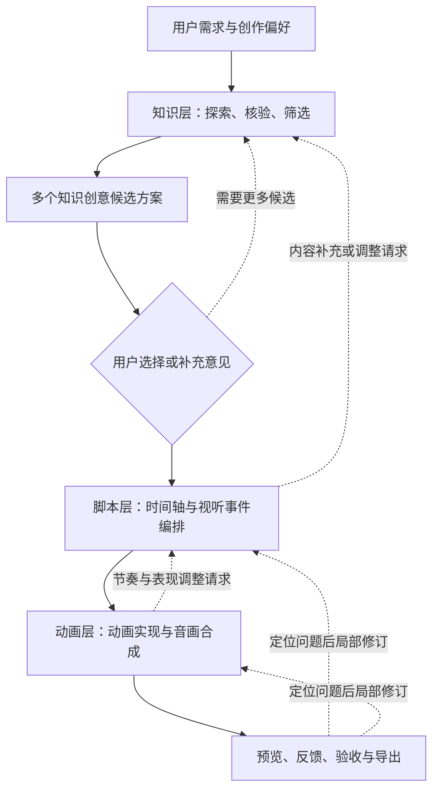

# 知识短视频生成系统：产品理念与工作流共识

> 文档定位：双人黑客松项目的产品设计共识，用于统一产品目标、用户体验、模块职责与交接方向。
>
> 当前阶段只确定**做什么、为什么这样设计、各阶段如何协作**。暂不规定具体模型、Agent 框架、动画技术栈、美术风格和详细数据格式。

## 一、产品定位与核心目标

### 1. 产品服务于谁

产品面向希望制作知识短视频的普通人。他们可能只对某个主题感兴趣，缺少专业知识，也没有脚本策划、动画、剪辑或配音经验。用户应当能够以自然语言说明想讲什么，并在系统推荐的基础上作出少量、容易理解的选择。

最终视频的观看者也通常缺少专业背景，可能是在浏览内容时偶然接触视频。因此，成片需要在 **60–90 秒**内吸引注意力、维持观看兴趣，并让观众记住至少一个有价值的知识或发现。视频不以完整教授一套知识体系为目标。

本产品与 PaperSkill 的定位不同：PaperSkill 适合按个人节奏逐步阅读、交互和反复理解；当前产物是**线性播放的视频**。创作者可以在制作工作台中交互、反馈和修订，但成片不要求观众点击、选择或操作，也不以交互网页为交付形式。

### 2. 产品成功的标准

产品需要同时实现以下目标：

- **观感与吸引力**：视频具有足够好的美观度、视听品质、节奏与创意，让观众有看下去的欲望；重要知识最好能形成具有记忆点的画面或瞬间。
- **有效的知识收获**：内容准确、主题明确，观众能理解核心发现或关键关系；允许为了短视频节奏降低知识覆盖面与推导深度。
- **低门槛创作**：系统主动研究、推荐、策划与制作，不要求用户懂知识审查、写分镜或处理技术细节。
- **低成本修改**：先提供低成本的中间成果供选择和反馈，尽量在局部修订后复用其他已完成的内容。

其中，**知识事实的准确性是底线；视觉观感、叙事吸引力和观看体验是主要优化方向**。知识讲得更多、更完整，不必然意味着视频更好。

### 3. 三条贯穿全流程的原则

1. **系统主动提出方案，用户保留选择权。** 用户可以从推荐选项中选择，也可以补充自己的想法；不把专业判断责任转移给用户。
2. **知识内容与视觉潜力共同影响选题。** 适合讲的知识还需考虑是否能转化成有趣、直观、可实现的视听表现。
3. **分层生产、双向反馈。** 各层独立完成本职工作，使用清晰的交接产物连接；允许下游提出修改请求，但不任意越权改写上游的核心事实和约束。

## 二、用户输入与交互理念

### 1. 输入设计原则

用户入口应该是**结构清晰、默认值充分、字段大多选填**的创作表单，而非要求用户写一段涵盖所有信息的复杂提示词。即使用户只填写主题，系统也应能够继续进行知识探索与推荐。

输入分为三类：

- **内容信息**：想讲什么、希望聚焦什么、哪些内容特别想包含或避免。
- **创作偏好**：希望视频给人什么感觉，以及偏好的审美方向。
- **输出约束**：少量确实会影响生产流程的设置，例如画面比例。

用户明确提供的信息应优先遵守；系统推断的默认值可以自动调整。创作偏好用于影响候选方向排序和各层创作决策，不应成为僵硬的内容模板。

### 2. 第一版建议提供的独立字段

| 字段 | 必填性 | 输入形式 | 作用与默认处理 |
|---|---|---|---|
| **知识主题** | 必填 | 单独的文本框 | 例如“概率论”“熵”“为什么会做梦”；是知识探索的起点。 |
| **具体知识方向** | 选填 | 单独的文本框 | 指定想解释的问题、现象或知识点；未指定时系统主动推荐切入方向。 |
| **创作方向** | 可选、推荐展示 | 预设选项 + 自定义 | 决定偏向创意冲击、机制演示、信息精讲还是故事悬念；未选择时由系统结合主题推荐。 |
| **自己的创意想法** | 选填 | 单独的文本框 | 用户可以描述希望出现的趣味设想、比喻、表达方式或特殊点子。 |
| **希望包含的内容** | 选填 | 单独的文本框 | 记录用户明确希望视频提到的知识、案例或结论。 |
| **不希望出现的内容** | 选填 | 单独的文本框 | 记录需要避开的内容、表达方式或主题范围。 |
| **知识深度** | 选填 | 简单选择 | 例如“轻松入门 / 适度解释 / 干货较多”；默认让普通观众容易理解。 |
| **画面审美偏好** | 选填 | 简短描述或后续预设 | 表达“希望长什么样”；与“怎么讲”的创作方向分离。当前不固定美术风格清单。 |
| **画面比例** | 选填 | 比例选项 | 例如 9:16、16:9、1:1；默认由产品设置决定。 |

**创作方向建议先包含四类可理解的预设：**

- **创意拉满**：大胆联想，强调惊喜、反差和视觉想象力。
- **直观演示**：优先展示对象、关系和状态变化，帮助观众看见原理。
- **干货精讲**：优先保留核心知识，节奏紧凑，减少不必要的铺垫。
- **故事悬念**：利用疑问、矛盾、案例和揭示过程维持兴趣。

这些是**创作倾向**，不是强制模板，也不是美术风格。例如“创意拉满”不意味着必须堆砌复杂画面，“干货精讲”也仍需精美设计。

### 3. 暂不作为入口重点的信息

- **目标受众、视频用途、精确时长和配音配置**：目前不要求用户专门填写。默认以普通观众、60–90 秒知识短视频为目标；后续如有实际需求，再增加高级配置。
- **素材与参考作品**：具有潜在价值，但参考图、参考视频或指定素材会牵涉风格迁移、素材使用、画面可控性与制作成本。第一版暂不将其列为主要输入，后续可以作为独立的可选功能研究。

上述“暂不作为重点”不代表永远不支持；只是避免初始流程复杂化。

### 4. 推荐式用户交互

默认交互模式为：**系统给出推荐选项 → 用户选择、补充或采用默认推荐 → 系统继续推进**。

具体体现为：

1. 用户提交主题及少量选填内容，开始探索。
2. 系统自主研究，形成若干可选的知识创意方向。
3. 系统用普通人能理解的语言解释每个方向的看点、预期观感与核心收获。
4. 用户可以选择一个方向、要求重新推荐、合并适当的想法，或填写自己的方案。
5. 进入脚本与动画阶段后，用户仍可以针对中间预览提出自然语言修改意见。

用户**不负责**核验知识事实、逐项审批知识单元或判断程序是否正确。用户主要参与主观选择、内容偏好与观看体验反馈。对没有额外想法的用户，应允许采用系统推荐并继续。

## 三、三层生产工作流

整体采用以下主流程：

这是**以单向生产为主、下游可以请求上游调整**的结构。反馈时按问题归属局部处理，避免每次从用户输入重新生成整个视频。

### 1. 知识层：发现值得制作的知识方向

知识层负责理解用户内容意图，开展必要的自主联想与联网研究，提取、核验和筛选知识，再形成**若干具有视频创作潜力的候选方向**。

知识层重点回答：

- 这个主题里有哪些准确、相关、有趣或反直觉的内容？
- 哪些知识适合在 60–90 秒内带来明确的认知收获？
- 哪些内容存在可具象化的对象、动态变化、关系、转折或视觉高潮？
- 哪些事实、假设和边界必须保留，才能避免误导？

知识层可以提供视觉表现的**机会与建议**，但不预先规定每秒的画面、台词、镜头或具体动画技术。

### 2. 脚本层：把选定方向编排成时间流程

这里的“脚本”主要指**视频在各时间段依次发生什么**，不是特指话剧或双人对话。

脚本层负责将创意方向与知识材料转化为具有明确先后顺序的制作计划，包括：每段讲什么、持续多久、需要呈现什么信息或变化、旁白与字幕的大致位置、音乐和节奏如何配合，以及各段如何衔接。

脚本层可根据时长、叙事连贯性、视觉高潮等因素，向知识层请求精简内容、补充案例或调整知识方向；原则上不自行创造未经核验的核心事实。

### 3. 动画层：完成具体视听作品

动画层负责把脚本中的场景与时间安排转化为可播放画面，并完成必要的声音、字幕、过渡与最终合成。当前设想倾向使用**可编程动画**（例如 JavaScript 脚本）提高可控性与局部修改能力，但此文档不绑定具体技术方案。

动画层可以根据真实制作效果向脚本层提出调整，例如延长某一视觉变化、替换难以呈现的表现方案、重新分配场景时间。需要更改核心知识时，由脚本层转交知识层处理。

## 四、知识层内部的设计方向

### 1. 从需求到候选方向

知识层内部采用以下逻辑链：

**需求规范化 → 主题探索与必要检索 → 知识提取与核验 → 视频适配筛选 → 多候选方案生成 → 用户选择 → 标准化交接。**

这里有两项重要考虑。

首先，**知识探索与创意发现相互影响**：研究时主动发现有趣现象、反直觉结果与适合视觉表达的机制；评价时也要考虑视觉设想是否符合真实知识，而不是等到动画层才寻找表达方式。

其次，**研究范围应与视频规模相匹配**：目标是找到足够支撑精彩短视频的材料，而非撰写覆盖所有子领域的长篇报告。事实核验不能因为希望节省成本而省略。

### 2. 知识筛选的评价依据

| 维度 | 需要判断的问题 |
|---|---|
| 准确性与证据 | 关键事实、数值与因果关系是否可靠？必要前提是否明确？ |
| 用户意图匹配 | 是否符合用户指定主题、知识重点及需要避开的范围？ |
| 吸引力 | 是否包含好奇点、认知反差、新鲜发现或自然的叙事机会？ |
| 可视化潜力 | 是否有具体对象、关系、动态过程、变化结果或具有冲击力的揭示？ |
| 简洁与可理解性 | 是否能在目标时长内让普通观众获得一个明确收获？ |
| 制作可行性 | 是否有机会以合理成本稳定实现足够好的视听效果？ |

准确性和明确的用户约束属于必要条件；其余维度用于比较可用候选。**美观潜力和观看吸引力应具有较高优先级**，但最终实现难度需要接受动画层的反馈。

### 3. 知识层交付多个候选，而非一份长报告

建议默认探索并形成 **2–3 个候选知识创意方案**（数量为初步建议，可按主题质量调整）。如果用户指定范围很窄，没有必要硬凑不同方向。

每个候选至少要让用户与脚本层清楚以下内容：

| 信息 | 含义 |
|---|---|
| 核心问题或主题切入点 | 视频打算围绕什么问题展开 |
| 吸引观众的看点 | 为什么这个方向值得观看 |
| 预期知识收获 | 看完后应该理解或记住什么 |
| 关键知识材料 | 支撑这个方向的事实、原理、案例和必要前提 |
| 叙事机会 | 适合制造哪些疑问、反差、揭示或认知变化 |
| 视觉表现机会 | 哪些对象、关系或变化适合视觉化呈现 |
| 边界与限制 | 哪些说法需要避免，哪些条件不能省略 |
| 来源与核验状态 | 关键事实依据及尚待确认的内容 |

知识层应区分**已验证的知识事实**与**创作性建议**，方便脚本层自由取舍而不误用事实。

### 4. 面向脚本层的交接边界

知识层可以在内部维护较完整的知识资料，但交接时应优先提供两类成果：

- **候选创意方案**：各方向的核心看点、知识收获、视觉机会与内容边界，支持选择和编排。
- **可引用的知识材料**：关键事实、解释、依赖、来源与核验状态，支持脚本层准确使用。

同时传递用户的**统一创作意图**，包括明确要求、可选偏好和输出约束，使脚本层无需重新解释原始输入。

不要求脚本层知道知识层用了几个 Agent、搜索了哪些页面、怎样评分；知识层也不要求知道脚本层的内部实现。需要补充材料时通过明确请求反馈，而不是彼此直接修改内部结果。

## 五、质量控制与双向修订

### 1. 把专业检查留在系统内部

- **知识层**核验关键事实、引用、必要前提和内容边界。
- **脚本层**检查叙事是否流畅、时间安排是否合理、信息是否过载、场景是否围绕核心看点推进。
- **动画层**检查画面与音频能否正确执行、呈现是否符合脚本、是否存在明显错位、遮挡或节奏问题。

对于观感、美观和叙事效果，自动评价只能辅助，用户的实际观看反馈仍然重要。不能把“自动通过检查”等同于“观众一定愿意看”。

### 2. 反馈按职责回传

| 反馈情形 | 主要处理层 |
|---|---|
| 需要新的知识角度、补充事实或纠正内容 | 知识层 |
| 知识太密、节奏拖沓、揭示顺序不理想 | 脚本层；必要时请求知识层调整 |
| 画面不够美观、动画不好理解、音乐配合不佳 | 动画层；必要时请求脚本层调整 |
| 用户修改知识目标或创作方向 | 从受影响的最早阶段重新规划 |

生产中允许回退，但应尽量保留未受影响的中间结果。正式的数据标识、版本与依赖追踪机制留到实现阶段设计。

### 3. 用户主要审阅“看得懂的中间结果”

核心人工决策节点建议控制在两个：

1. **知识创意方向选择**：从推荐候选中选择、补充想法，或接受默认推荐。
2. **视频预览与修订**：观看样片，描述“不够吸引人”“太拖沓”“这里想更震撼”等体验层面的意见，再由系统定位对应环节。

用户可以随时提供修改意见，但不必逐关确认内部研究报告、知识单元、技术方案与自动检查结果。

## 六、当前共识与暂未决定的事项

### 已形成的共识

- 最终交付物是**非交互式的知识短视频**；交互主要发生在创作工具中。
- 主要面向普通创作者和普通观看者，默认视频长度约 **60–90 秒**。
- 视频吸引力、美观、视觉创意和音画节奏非常重要；知识准确是底线，知识深度和覆盖面可以适当控制。
- 用户入口以**独立字段、默认值和选填项**构成；系统主动推荐，用户可以自由补充。
- 创作方向与画面审美分开；推荐创作方向可包含创意拉满、直观演示、干货精讲、故事悬念。
- 知识层需要自主探索、核验、筛选，并输出**若干具有视觉表现潜力的创意候选**。
- 三层主流程为**知识层 → 脚本层 → 动画层**；脚本主要组织时间线与视听事件，而非默认采用人物对话形式。
- 各层职责解耦，允许下游提出结构化反馈，支持局部修订。
- 用户不承担专业知识审核，主要参与创作方向选择与观看体验反馈。

### 暂不在本阶段锁定

- Agent 的数量、编排框架、模型供应商及搜索实现方式。
- 知识单元和候选方案的精确 JSON Schema、评分算法与接口协议。
- 具体美术风格、动画组件、转场规则和渲染方案。
- 参考素材与参考视频的上传、分析和复用机制。
- 配音、音乐、字幕和音画同步的具体技术实现。
- 各阶段自动审查的具体指标、阈值和重试次数。

这些问题将在总体产品理念确定后，按模块分别设计，不应反过来限制当前已经明确的用户体验和生产职责。
