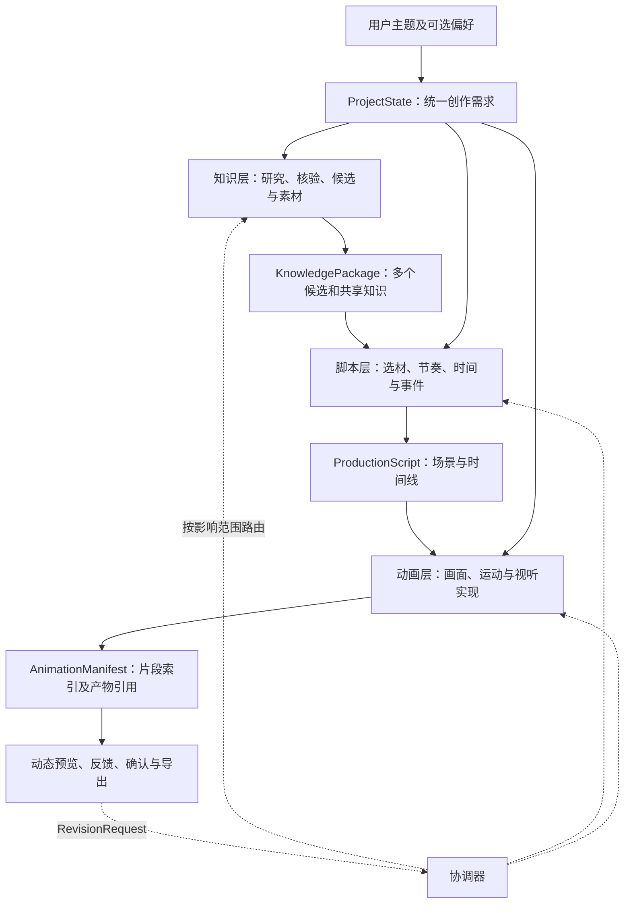

# knowledge-show 产品理念与工作流共识

> 记录已讨论确定的产品目标、创作输入、用户决策方式和三层生产原则，供知识、脚本与动画模块对齐。本文属于**产品设计共识**，不是已实现功能清单；准确字段请查仓库根目录 `contracts/schemas/`，跨层行为请查 `contracts/跨阶段接口契约与协作规范.md`。

## 一、产品定位

### 1. 创作者和观看者

产品主要服务希望制作知识短视频、但未必掌握知识细节和动画制作技能的普通用户。用户可能只提出一个宽泛的主题，对知识内容和视觉表达尚无明确判断。因此系统需要主动完成知识研究、内容取舍、脚本策划与动画制作，并提供可理解的推荐和直观的修改方式。

最终视频面向可能偶然刷到内容的普通观看者。典型长度约 **2 分 30 秒至 3 分钟**，目标是让人愿意看下去、感受到美观与有趣、记住一个准确且有价值的知识点。内容不追求系统地讲完一门课程，也不要求观众通过点击或操作才能理解。

### 2. 与 PaperSkill 的区别

PaperSkill 可以以渐进、细致、反复探索为目标；本项目输出的是**线性播放的视频**。教学深度可按观看时长取舍，观感、节奏、声音和惊喜感应有较高权重。

产品内部可以允许用户交互、选择和修订，但交付物本身是可播放、可导出的知识视频，而不是需要观众操作的交互式课程。

### 3. 成功标准

- **观看吸引力**：开头能引起兴趣，过程有持续的画面与声音变化，成片具有一定美感和记忆点。
- **知识价值**：关键事实准确、逻辑关系成立，观众能获得一个明确发现；允许省略复杂证明和拓展内容。
- **创作低门槛**：用户不承担专业事实审核、逐秒脚本设计或编程任务；系统主动提出方案。
- **可修订与成本控制**：在可以观看的中间成果上表达反馈，优先局部修改，尽量避免重复生成整条视频。

**知识准确性是底线，观看体验是主要优化方向。** 不能用夸张视觉掩盖错误事实，也不能为了知识全面牺牲必要的观看节奏。

## 二、用户创作需求

### 1. 使用独立字段而不是复杂提示词

用户可以只输入一个知识主题，系统应自动开始。其他信息分开提供，**默认选填**：

| 字段 | 用途 | 默认处理 |
| --- | --- | --- |
| 知识主题 | 想讲什么 | 唯一必填项 |
| 具体知识方向 | 想重点回答什么问题 | 未填写则由系统寻找合适切入点 |
| 创作模式 | 想怎样讲，期待怎样的观看体验 | 系统可自动推荐；支持预设和自定义 |
| 自己的创意想法 | 用户特定的构想或表达倾向 | 保留并传给后续阶段 |
| 希望包含的内容 | 用户明确希望出现的知识或案例 | 作为内容约束处理 |
| 不希望出现的内容 | 需要避开的主题、例子或表达 | 作为内容约束处理 |
| 知识深度 | 想讲得多浅、多深入 | 默认便于普通观众理解 |
| 美术风格偏好 | 视频希望呈现的画面审美 | 与创作模式分离；可使用默认值 |
| 画面比例 | 适配目标观看形式 | 采用产品默认值，允许调整 |

目标受众、用途、精确时长、配音、参考素材等暂不作为第一版主入口的核心要求。尤其参考素材和风格参考可能影响画面生成的可控性，待实现能力明确后再决定是否加入。

`ProjectState.brief.user_input` 保存用户实际输入；`brief.effective` 保存系统补全的生效配置。系统可补缺省项，不能静默覆盖用户明确要求。

### 2. 创作模式、美术风格和知识深度解耦

| 创作模式 | 内容选择重点 | 后续创作倾向 |
| --- | --- | --- |
| 创意优先 | 反直觉现象、有趣联系、想象空间 | 新颖结构和富表现力的视听画面 |
| 直观演示 | 明确对象、关系、机制和状态变化 | 让观众看到知识如何运行 |
| 干货精讲 | 核心原理、重要结论与必要解释 | 更紧凑的叙事及清楚的信息呈现 |
| 故事悬念 | 问题、认知冲突、发现与转折 | 由悬念、推进和揭示组织观看体验 |

模式是**选择偏好**，不是强制脚本模板。天马行空也需要可靠事实；干货精讲也应具有视觉品质。用户可以组合“创意优先 + 较深入知识 + 极简美术”等合理配置。

## 三、生产流程与职责

### 1. 知识层：发现可靠且适合制作的内容

知识层对主题进行分析、联想、必要的检索、结构化和事实核验，形成可供脚本层使用的知识池及若干方向。知识素材可以相对充分，包含核心、辅助与拓展事实，以及来源、解释和必要前提。

知识层还需考虑某个方向是否值得制作成短视频：内容是否有吸引力，是否适合 2 分 30 秒至 3 分钟，是否具备数量、关系、过程、状态差异等**可视化潜力**。但**只标注潜力与判断理由，不预设具体对象、镜头、视觉隐喻或动画示例**，避免下游机械继承例子而失去创作自由。

多个候选方向应有实质区别，不能只是换标题。范围已经非常精确时可减少候选，不为凑数量强行偏离需求。知识层保证素材可靠，但不替脚本层提前决定最终视频采用哪些可选知识。

### 2. 脚本层：把内容组织成时间流程

脚本指**视频从开始到结束，每段时间发生什么、先后顺序是什么**，不特指人物对话或话剧形式。脚本层在知识包和用户要求基础上选择方向与素材，组织叙事目的、场景、事件、字幕/旁白以及视听节奏，形成可供动画层直接使用的计划。

脚本层可以删除不适合时长的可选材料、调整知识先后顺序或重新组织内容；必须遵守可靠事实和真正的强约束。如内容不足或现有材料难以构成合理脚本，可请求知识层补充事实、案例或重新探索方向。

### 3. 动画层：将时间脚本转化为视听作品

动画层根据场景目标、时间事件、知识引用和用户审美偏好，自主完成视觉设计、运动效果与音画表现。当前方向偏向可编程动画，但不在产品理念中锁定框架。

动画层输出可播放成果及片段索引，支持局部修改和反馈定位。一个脚本场景可以对应多个连续动画片段。实现受阻时可以反馈脚本层调整时间或事件，但不得自行改变重要知识事实或用户明确的方向。

## 四、用户决策与反馈

### 1. 首次生成前的选择不强制

知识层可在内部形成多个候选并给出推荐，但**用户不必在第一轮制作前从中选择**。系统可以采用默认推荐直接生成首版，让用户基于真实画面评价效果。

用户若希望事先确认，也可以查看几个通俗易懂的候选卡，比较它们的核心看点和学习收获，选择其一或补充想法。提前选择能减少一部分方向性返工，但不能代替最终动画预览。

用户的推荐选项与自由表达互补：系统主动推荐，用户可以接受、调整、换方向或跳过。不得强制普通用户检查专业知识包。

### 2. 先预览实际动画，再确认导出

最终阶段应给用户真实可播放的动态预览，使其能够判断画面、节奏、讲解与声音；用户确认后再导出视频。预览和最终视频应尽量复用同一套动画实现，避免重新随机生成一份不一致的成片。

用户可以针对某段内容或时间范围提出自然语言反馈。系统根据实际对象引用和上下文区分：

- 知识方向、事实或案例需要调整 → 知识层；
- 叙事顺序、内容密度或时间安排需要调整 → 脚本层；
- 画面、运动、音效或具体表现需要调整 → 动画层。

不要求用户了解内部模块名称。无法直接归类时由协调器分析反馈，并按照受影响的最早层级局部修订。已有无关成果尽量复用，明确已确认产物和待验收的新版本。

## 五、协作、验收和成本原则

跨层只有**共享需求、标准交付和明确反馈**；不要求相互知晓内部 Agent 数量、模型推理过程或私有代码组织。

- 全局 `ProjectState` 统一保存用户要求、默认值、当前决策和产物版本。
- 知识层交付 `KnowledgePackage`；脚本层交付 `ProductionScript`；动画层交付 `AnimationManifest`；修改通过 `RevisionRequest` 定位与请求。
- JSON Schema 约束字段结构与基本引用；事实核验、讲解质量、动画播放、音画同步及观感应由相应阶段独立检查。
- 优先完成低成本方案探索和局部预览，必要时再投入复杂制作；预算、模型和渲染实现是后续内部设计问题。
- 已确认的用户约束和事实前提应在各层传递；创意建议不应成为不可改动的强制命令。

## 六、当前确定与仍待实现的内容

**已确认**：三层职责与双向反馈、独立的创作模式/美术风格/知识深度、独立选填输入、默认推荐可直接推进、用户可选提前确认、动态预览后反馈、可追踪的标准产物引用。

**尚未确定或尚未实现**：具体模型和 Agent 编排、知识检索与核验策略、脚本生成算法、JS 动画栈、配音/音乐方案、资源持久化方式、可用的服务端点、视频导出机制和实际交互界面细节。

本文件记录设计目标。当前代码与可运行状态以 `README.md`、`STATUS.md` 和真实测试为准；跨阶段字段不得以本文替代 `contracts/schemas/`。
